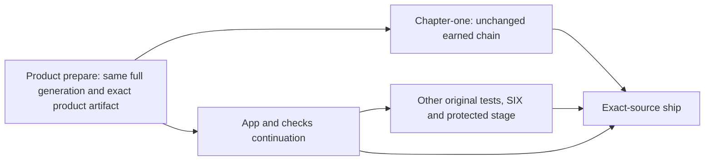

# CI-FIRST-PRINCIPLES: what GitHub Actions does per push, why it is slow, and what it should do

**State:** `open` 2026-10-29, ruled by Jake ~17:45 (G918–G923); revised ~18:45 to match: every test still runs on **Not part of SHARD-PLATFORM; lowest priority (G924): its rows come after FOUNDATIONS, frame-cost, the Pine / Nine QA rows and CX1–CX3.**
every push, in far less wall clock; pins are deleted outright; the tested build ships as soon as it is green; the
Simulator stays on GitHub Actions; the Node harness is the main integration test; test-quarantine goes. Rows CI1–CI14
are open. Where this text disagrees with G918–G923, the G-rows win.

Jake, 2026-10-29 ~16:50 Cancun: *"How many actions are there per commit on main? Are there 16 fanout actions and
another 8 fanout actions for like all kinds of really slow-ass tests? How fucking long do they take? … What's a really
good way of doing integration tests for the system? And what are we doing, and why is it so slow and shit?"* ~17:45
(G918): *"We need to run all the tests but faster and better."*

Measured with `gh` over 48 h, 2026-10-27 22:00 → 10-29 22:20 UTC (1,951 runs on `main`, 659 runs' jobs, all 264
failed jobs' logs). Per-file vitest times come from 4 of the 16 `behaviour` shard logs of run 40940376404.

## One screen

- **Today: 16 + 8 fan-out.** Each code push starts a 30-job `deploy` run (16 + 8 vitest shards and 6 build / types /
  docs jobs). On top come `storage`, `test-quarantine` and, when the run is green, `boot-smoke` (10 jobs, 7 on macOS).
  That is **4 runs and 43 jobs per push**, at 385 pushes a day.
- **Today's time:** push to CI answer **23 min** (p90 31), the boot smoke **+16**, and the release **rebuilds the game
  (+21)** on an hourly slot. Push to live is **1–3 h**.
- **Why slow:**
  1. **Vitest spends 80 % of its time not testing.** A 10-min shard reports "setup 49 %, import 32 %, tests 18 %".
     `test/setup.ts` installs the whole game (species, pickups read from `public/`, Nalati and Pine native blocks,
     loot, score) before **each** of 2,174 files.
  2. `gen` runs twice (in `generated-inputs` and `products`), and the 8 product shards start 2.5 min behind the 16.
  3. **60 % of finished runs are red, almost all on pin tests** broken by intended changes. Only 44 green SHAs in
     2 days could ship.
  4. Releases wait for the hour and then rebuild what CI built.
- **Target (G918–G920): every test, every push, ≤ 12 min to an answer; live ≤ 15 min after the push when green.**
  One prepare job builds once. Every test and browser leg runs in one parallel wave on that artifact. The run's last
  job deploys that same build.
- **Order:** delete tonight's Nalati pins and ship the tested build first (unsticks the deploy), then the speed work,
  then the harness.

---

## 1. What runs today (`.github/workflows/`)

| Workflow | Trigger | Jobs | Notes |
|---|---|---|---|
| `deploy` (push) | every code push (docs / progress / art / sources ignored) | 30: `generated-inputs`, `products`, `typecheck-lint`, `derived-docs`, `behaviour` ×16, `behaviour-products` ×8, `build-and-deploy`, `dispatch-boot-smoke` | One group: the running run finishes and only the newest pending one survives (G582) |
| `deploy` (release) | :17 hourly + dispatch | 1 | `newest-ci-green` pin, then **rebuilds**: native build 11.3 min + `vercel build` 7.5 min |
| `boot-smoke` | each green push run | 10: `build`, 7 `macos-15` legs (boot-public, -developer, -grid, hover-chromium, hover-webkit, explorer, phone-route), `verdict`, `release` | Reuses the push dist; phone-route is report-only and runs `brew install` every time |
| `test-quarantine` | after **every** deploy run, cancelled ones too | 2 | Report-only; 38 of 46 sampled jobs red |
| `storage` · `admin-deploy` · `site-deploy` · `ota-promote` | push · :47 · site/ · manual | 1–2 | Small |

`gpu-gate.yml` was deleted on 10-13 (819a36b8d4), but DEPLOY.md still says it runs nightly.

## 2. Numbers (48 h)

| Workflow | Runs / day | Outcome | Wall p50 / p90 | Runner-min / run | Runner-min / day |
|---|---|---|---|---|---|
| deploy push | 265 | 78 % cancelled before starting; of 116 finished, 44 green and 70 red | 25 / 36 | 215 | ≈ 12,400 |
| boot-smoke | 22 | 33 green, 11 red | 16 / 19 | 51 | ≈ 1,130 |
| test-quarantine | 277 | jobs mostly red | 1.5 / 5 | 1.7 | ≈ 470 |
| deploy release | 16 | 24 real deploys | 22 / 26 | 21 | ≈ 230 |

**Long poles:** `generated-inputs` 5.8 min, then each `behaviour` shard 8–10 min (p90 13). `products` 9.5 min (gen
2.4, shardfiles 4.1), then `behaviour-products` 3.7 (+2.5 queue). **Smoke legs:** explorer 7.6, boot-developer 4.5,
boot-public 4.3, grid 2.8, hover 1.7 min.

**Slowest test files (s, one run):** `sky-prepared-model-output` 60 · `sky-signal-quest-product` 50 · `heavy-lane` 32 ·
`scene-dressing-rows` 31 · `pine-return-binary` 29 · `template-generation` 27 · `return-projection-v2` 23 ·
`nine-map-cache` 22 · `nalati-decorative-scene` 22 · `taming-script-admission` 21 · `nalati-places-program` 21 ·
`isolated-shard-pine-output-values` 20 · seven `isolated-shard-*-values` / `nalati-*` files at 16–19.

**Reds (264 failed jobs):** `browser-escape` (10 SHAs over 17 h), `test/value` (8), `nine-source-output`,
`nine-owned-product`, `nalati-species-product-inputs`, `nalati-place-blob-program` (5 each), then ~50 files on 2–3
SHAs. Nearly all fail with "expected [new shape] to deeply equal [old pin]". Lanes landed 48 `fix(test)` and ~90
`test(...)` commits in the 2 days. Tonight's reds (21:24–22:02) are Nalati pins: `nalati-titan-binary`,
`nalati-headless-assembly`, `nalati-script-sections-source`, `nalati-species-product-inputs`,
`nalati-place-blob-program`. **Flaky:** the Simulator leg (25 timeouts: inspector, `xcrun`) and hover-webkit (3).

## 3. What CI caught and what it missed

**Caught (boot smoke):** Nine fatal at load (10-27 22:26), Pine specimen bytes missing (10-28 05:45), title GL error
1282 (10-27 23:46, 10-28 03:44), a blank Nalati boulder card (10-28 02:01). **Vitest:** almost all oracle drift.
**Missed:** all of QB1–QB21. A browser journey catches QB1, QB3, QB4, QB5, QB7, QB9, QB13, QB14 and QB21. The Node
harness catches QB11, QB17 and QB15's crank logic. The Simulator catches QB12. Looks, feel and design (QB2, QB6,
QB8, QB10, QB16, QB18–QB20) are not testable this way.

## 4. Target design (G918, G920)

**One run per push, three stages, every test, ≤ 12 min:**

| Stage | What | Wall today → target | How |
|---|---|---|---|
| Prepare (1 job) | `gen` once, shardfiles, vite build, `vercel build` → one artifact (dist + `.vercel/output` + products) | 5.8 + 9.5 (two jobs, gen twice) → **≤ 6** | Merge `generated-inputs` and `products`. Cache `node_modules`, `~/.cache/wildshard/{gen,generate,shardfiles,basis}` and Playwright by key. Build once; no other job rebuilds |
| Wave (parallel) | **All** vitest files (product and product-free together) · types + lint + docs · browser legs · Simulator leg | 10–13 (+3.7 behind) → **≤ 5** | Lazy setup (§5). Shards balanced by measured file time (the `DurationSequencer` fed with CI timings), no shard > 1.2× the mean. Product tests in the same wave. Browser legs on the prepare artifact |
| Ship (1 job) | `vercel deploy --prebuilt` of the prepare artifact, if every wave job is green and the SHA is newer than live | 1–3 h → **≤ 2** | No hourly slot, no second build (G920) |

**Push → answer ≤ 12 min** (6 + 5 + ~1 of job start). **Push → live ≤ 15 min** when green.
**CI9 delivery decision (sp-x2, G872):** scope G582 coalescing to the prepare job rather than the entire push:
finish the running prepare and retain its newest pending source while earlier running waves finish. Push workflow
keys are unique per run. Native phone admission has its own per-ref coalescing, still starts alongside prepare and
never cancels a running phone job. Manual release and production shipping remain serialized; exact-run artifacts,
all source gates/SIX and the live floor remain mandatory. This removes the whole-wave dependency, not the account's
runner queues. GitHub's [job concurrency semantics](https://docs.github.com/en/actions/how-tos/write-workflows/choose-when-workflows-run/control-workflow-concurrency)
permit this scope. Future containing runs must measure queue/throughput effects; no live-time gain is claimed.

**Job count:** stays within GitHub's concurrent-job cap so one run never queues behind itself: prepare 1, vitest ~12,
checks 1, browser legs 3–4, Simulator 1, ship 1 (≈ 20). macOS legs ≤ 5 (the cap on concurrent macOS jobs).

## 5. Making every test faster (G918) and deleting pins (G919)

- **Lazy setup.** `test/setup.ts` keeps only `localStorage`, `location` and strings (milliseconds). The world installs
  (species, pickups, native blocks, loot, score) move into fixtures that only the files needing them import. Expected:
  setup 49 % → < 10 %, so each shard is roughly −40 %.
- **Import cost (32 %).** Pure-unit files run with `isolate: false` in a threads pool, so modules load once per worker.
  Files that mutate globals stay isolated. Heavy fixtures are read once per worker from the prepare artifact.
- **Slowest files** (§2 list): each one ≤ 10 s by sharing its built product from prepare instead of rebuilding it in
  the test. A file that is a pin is deleted instead (G919).
- **Duplicate work:** gen runs once; `derived-docs` folds into the checks job; the native build runs only on native
  inputs (already); the release build goes.
- **Pins deleted outright (G919):** a test that pins exact bytes / hashes / shapes and only goes red on intended
  changes is deleted, in waves. Each commit lists the test and what it pinned. Real behaviour tests stay.

## 6. Integration tests without a browser: the Node game harness (G922)

**Already in Node today.** vitest runs in `environment: 'node'`, and Rapier runs in Node. `HeadlessSimulation`
(`src/sdk/headless.ts`) boots a **real built shard product** and steps it with commands
(`sim.step([{ source: 'player', commands: [{ kind: 'player', moveX, moveZ, yaw }] }])`). It returns a snapshot
(`decodeSimSnapshot`) and a `checkpoint`. `test/shard-headless.test.ts` already boots all 8 shards, walks 24 ticks and
completes every quest. Grid `SimHost` (docs/GRID-SIMULATION.md) steps regions with no renderer.

**What blocks the rest:** the verbs (crossbow `heldFirearm`, the hook, the crank, the HUD slots in
`src/engine/ui/hudSlots.ts`) live page-side, driven by DOM events and the render loop. Some modules touch DOM /
WebGL / Worker / `fetch` at import time, and timers decide things. three.js itself is fine in Node.

**Harness design:**
- **A journey is a command tape plus asserts on state.** Per shard:
  - enter;
  - walk 1,800 ticks on the physics route;
  - play each verb on the shard's verb list (MF15–MF18: hook lock → zip → land; crank ×3; crossbow aim / fire /
    reload / swap; each quest step);
  - exit and dispose.

  It asserts: no throw, nothing quarantined, no system switched off, the player grounded, verb state advanced (bolts
  30 → 29 → reload → 30), and resources released. It takes seconds and never retries.
- The physics walk (`physics-baseline.mjs --mode=walk`, in Chromium today) becomes a harness journey.
- **Server-ready** (the server itself is Jake's, G828): commands in and snapshots out, a fixed tick with no wall clock,
  seeded RNG, no renderer or DOM in sim state, many sims per process. **Each verb becomes a sim command** (MF14's
  "HUD from state").

## 7. The "heavy proofs", in plain words

| Proof | What it does | Where · time | Caught lately | Verdict |
|---|---|---|---|---|
| Boot smoke (`scripts/parity/boot-smoke.mjs`) | Real built game: every shard reaches page-ready; Explorer draws; HOVER mounts | CI, after green · 16 min | **4 real breaks** | **Keep; move into the push wave** as browser journeys (§8) |
| Phone route (Simulator) | Jake's cold route in the iOS Simulator | CI macOS · report-only | 25 timeouts | **Keep on GitHub (G921), made fast** (§8) |
| Vitest products cohort | Tests that read built products | CI · 3.7 min ×8 | Mostly drift | **Same wave; pins deleted** |
| Soak (`scripts/soak/`) | 30–60 min drive; leak census | local · ~1 h | Leaks | Milestone |
| Frame floor | fps and long frames per scenario | local · tens of min | Freezes | Milestone; "no frame > 100 ms" also in journeys |
| Physics walk | Fixed route per shard, 0 stuck | local · minutes | Stuck spots | **Node harness** |
| gpu-gate | Pixel parity | deleted 10-13 | — | Fix the DEPLOY.md text |
| Golden compare (144 cameras) | Stills vs the approved look | local · port approval | Looks | Looks only |
| Phone-loading, tile-plan reading | Load model; tile census | local | Estimates | Tools, not proofs |
| test-quarantine | Re-runs quarantined tests | CI · 2 jobs | Nothing | **Delete (G923)** |

## 8. Browser and Simulator legs, made fast (G920, G921)

**Journeys** (read through the game's own debug hooks, never pixels; on the prepare artifact):
- icon → title ≤ 0.5 s;
- each shard: enter → PLAY → walk 30 s → MAIN MENU;
- RELOAD;
- warm load: bar full ≤ 0.1 s;
- the bar never passes its total;
- no `/api/errors` report;
- no frame > 100 ms after 2 s;
- deploy skew;
- Explorer draws every catalogue.

**Browser legs:**
- No per-leg rebuild; one static server.
- One browser per leg, with a fresh context for cold runs and the same context for warm runs and RELOAD.
- 3 pages in parallel per leg, split by journey instead of a browser × shard matrix.
- WebKit as the iPhone 16 Pro; Chromium only where WebKit cannot run the check.
- Wait on conditions, never sleeps or 150 s timeouts. No retries.

**Simulator leg (GitHub macOS, G921):**
- Start the dedicated report-only phone job alongside Linux prepare. Boot and
  warm Safari in the foreground before dependency installation or artifact IO
  on its Mac. Keep the original 120 s Safari readiness and 20 min job bounds.
- Wait on only this run's successful prepare job before exact SHA/run archive
  intake; never wait on the aggregate containing the phone job. Failed native
  startup or producer refusal never causes a retry or silent WebKit fallback.
- Cache `ios-webkit-debug-proxy` instead of `brew install` every run.
- Use one pre-created device.
- Run a shorter route that waits on conditions.

**Expected wall clock:** the browser legs take ≤ 5 min in parallel, the Simulator ≤ 6, both inside the wave.

## Rows

Codex does the workflow engineering (non-visual). Ordered to unstick the deploy first.

| Row | What | Done when | Lane | Size |
|---|---|---|---|---|
| CI1 | Pin wave 1 (G919): delete tonight's red Nalati pins and the 2-day repeat offenders (§2); each commit lists the test and what it pinned | **done** (see lane) — Push CI green on main again | Codex sp-ci-deploy · done 143b3edd27, 5b54b7d044, ba70969be3 | S |
| CI2 | Ship the tested build (G920): push CI stages tested prebuilt output beside the wave; after all 37 green, ship promotes that exact protected deployment, with the original strict prebuilt fallback | Release ≤ 3 min; live `version.json` = the tested SHA | **in flight (2026-10-31, sp-x2 retained audit):** 26/32 complete ship jobs meet 180 s. All six misses are dominated by artifact download plus strict restore, **69.532–214.302 s**, with no historical network/decode split. CLI install, deployment and verifier are measured separately; two misses have 20 s verifier waits. `f15555814f` checkout and protected staging `1f56a01a53` are landed. First normal fast-path release `19c9b94da8` ships in **49 s**; select/promote cost **2.240 / 4.110 s**, with no ship artifact download/restore. This one after reading does not close the whole acceptance bar. [Each miss and limits](#ci2--ci3-miss-classification-and-current-acceptance). | M |
| CI3 | Deploy as soon as green (G920): drop the hourly slot; a green exact-SHA proof deploys at once if newer than live | Live = the newest green SHA within 5 min of its verdict | **done (2026-10-31, G872 ruling):** since `93bd4ce2ba` merged boot verdict and shipping, **21/21 automatic releases** in the retained cohort reach the matching live build within 300 s of the exact-SHA success status (107.685–196.017 s). All eight automatic misses predate that merge and are superseded; BA78 is a later manual recovery, not a 2,676 s runner-queue miss. Earlier required-job completion remains a separate CI9 clock. [Source-bound cohort and exclusions](#ci2--ci3-miss-classification-and-current-acceptance). | S |
| CI4 | Delete `test-quarantine.yml` (G923); fix DEPLOY.md's gpu-gate text | **done** (see lane) — Workflow gone; DEPLOY.md matches | Codex sp-ci-deploy · done 87baf789f5 | S |
| CI5 | Lazy `test/setup.ts`: world installs move to opt-in fixtures | **done, measured bar (G872):** setup < 10%; ordinary green containing run. Original shards −40% is not measurable; shard balance belongs to CI7. | **done (2026-10-31, sp-x9).** `72aad6c49d`: same local 12-file cohort 24.85 → 10.42 s (−58.1%), setup 52% → 1%; not a CI shard comparison. Retained Linux `60c0084758` / run `41154960690`: 24 timing artifacts, 2340 files exactly once, setup 46.613 / 7609.665 module-phase s = **0.61255%**. Ordinary containing green `6a84ecffe6` / run `41201418097` passes all 36 required jobs, native3 and SIX, verified live `6a84ecf-mvwe2b6c`; ancestry to `72aad` checked. No pre-`72aad` ordinary shard baseline is retained, and CI7 has since rebalanced allocation: the original −40% half is **not measurable**, not a claimed gain. CI7 owns that axis (60c0 max 199 s / mean 167.667 s = 1.186879x). G872 closes CI5 on the measured setup/ordinary-run bar. | M |
| CI6 | One prepare job: merge `generated-inputs` + `products` + vite / vercel build; gen once; every job reads one artifact | Prepare ≤ 6 min; no job rebuilds | **done (2026-10-30, sp-x1 + sp-x2 + sp-x9)**: ordinary run **41123682086**, source `5f41cc9623`, prepare job `124296598406` succeeds in **349 s**, with **24 distinct products reused / 0 rebuilt** through the unchanged source/content and admission guards. Gen 68 s, parallel checks/app 76 s (app 67.80), exact web/release packaging 44.813 s (boot encoder 22.613), uploads 54 s, cache post 11 s. This is the first retained applicable warm reading under 360 s; prior f7 / 41118506049 was 444 s with all 24 rebuilt. The qualifying source contains independent packaging overlap `f8db260657`, but predates streamed prebuilt tar `430cb9f706` and verified phone/world archive sharing `32b0aa1ab9`; no isolated causal saving or whole-CI/deploy success is inferred. Those later cuts retain every archive/source/run/hash/extent/transport guard and the separate phone artifact when shard sets differ. Full product generation or proof of identical inputs remains mandatory (G918). Local parity and phase evidence for the earlier product/app/cache cuts stays in their defining commits (`65609ab320`, `589b702280`, `c93a7ac9b1`, `eb312d69da`, `ba60585eb3`, `b39b50ed63`); neutral verify-in-place and compiler-URI prototypes were withdrawn. | M |
| CI7 | One test wave: every Vitest file once across a duration-sharded matrix and blocking native Escape runner; `isolate: false` for pure files | Vitest wave ≤ 5 min, no shard > 1.2× the mean | **done** (2026-10-30, sp-x6 + sp-x8; audit of run 41154960690 on `60c0084758`): max shard 199 s / mean 167.67 s = 1.187x, under both bars (300 s, 1.2x); 2340 parallel files exactly once, native 6 disjoint and exhaustive, 11 / 11 fixture writers pass. Levers: plan order kept heavy-first (Vitest sorted by file size), Basis tool shared from prepare (`aa63eaf885`), byte-backed snapshots, scoped module loans, the physics split (`7a3acdc6ac`). Earlier status: **done (2026-10-30, sp-x6):** first accepted containing source `60c0084758` / run `41154960690` meets both measured bars: max **199 s** (B10), mean **167.667 s**, ratio **1.186879×**. All **2340 parallel files** match the source/run plan exactly once; **6 native files** are disjoint and make the exhaustive union. Both blocking native jobs and **11/11 fixture writers** pass at that source. Later `34220aeca1` moves the intact Pine-door case to the existing native stories job (7 native files); its containing qualification is separate. This is **not a green source/release wave**: `frame-floor-draw-budget.test.ts` and `pine-door-continuation.test.ts` fail; retain that result and omit only those two module observations from the **2338 successful complete-module weights**. Model max 139.975 s is separate from the actual 199 s. Main cuts include `31a0ab90cf`, `f6b0901616`, `b609e7179b`, `2157a536fe`, verified Basis reuse `aa63eaf885` and King setup `e5709ddef4`; the awareness capture is in `60c0084758`. Later local Node-world, Kokpar, Kit-body and physics-split readings are not inferred as remote gains. No cases, deadlines, source guards or native allocation were removed. Historical failed balance: `ab792` / `41149186669` was 270/172 = 1.569767×; `5f41` / `41123682086` was 367/203.333 = 1.804918×. CI9 now owns the remaining release/queue acceptance. | M |
| CI8 | Slowest files ≤ 10 s each (§2 list), or deleted if they are pins | **done** (see lane) — None over 10 s | Codex sp-x9 · done 82814dfd66 + c2b1f2acd9 (all 47 slow files ≤ 8.9 s) | M |
| CI9 | Browser journeys (§8) in the push wave on the prepare artifact; the ship job deploys after them; the boot-smoke dispatch chain goes | Push → live ≤ 15 min; the 4 real breaks replayed red | **Open (2026-10-31, sp-x8):** latest measured staged release `6294193` / run `41247565372` reaches first matching live in **2565.814 s /42m 45.814s**, **1665.814 s over 900 s**. Largest segment: **1600 s required wave**, ending on chapter-one (**574 s admission +68 s setup +953 s earned step +5 s tail**, all13 tests pass). Stage **126 s** is fully overlapped; final ship-to-live **27.814 s**. Prepare rebuilds24 products; 82b9 reused24, so this is no isolated cut regression. [Four-release additive table, stage overlap and exact bindings](#ci9-staged-release-end-to-end--6294193). **Growth/admission follow-up:** four added King cases account for **149.046 s of the +324 s** tape growth; **174.954 s** remains in the original nine-case prefix/harness. Retained occupancy starts with **0 same-run /18 other-run jobs**, later becomes mixed; chapter-first creation ordering cannot guarantee runner priority or remove its queue. [Exact case table, missing 60e per-case limit and occupancy census](#chapter-growth-four-added-cases-explain-149-s-not-all-324-s). **Nearest-case/design follow-up:** 4b2 original9 **393.070 s** versus629 **800.958 s**, same tick/command/part counts; an unchanged-native-code control retains all9 handoff hashes while varying **381.536 to749.596 s**, so no stable175 s code regression is established. Chapter consumes Nalati plus shared native/source inputs, **no app dist**. **Evaluated, not taken (G872):** early chapter artifact/prepare split adds a 38th required job to the contended pool for at best 194 s of observed readiness headroom and no guaranteed admission saving. No workflow change. [Chapter-only paid-runner brief](#chapter-only-paid-runner-brief-analysis-only). **Replay boundary cut (sp-x8):** strict native byte decode/private final decode; one plains pair **33.286 → 32.181 s**, all **15,819,695 stored handoff bytes identical**, independent ticks/assertions/caps unchanged. [Measured accounting](#trusted-replay-representation-only-boundary-cut). [Case comparison and unlanded design](#nearest-per-case-comparison-no-stable-175-s-code-regression-established). **Earlier native4 reading (sp-x6):** native4 ordinary release `60e20e1e73` / [41207842709](https://github.com/Raynos/project-wildshard-singleplayer/actions/runs/41207842709), all **37 required jobs + SIX**, reaches production `60e20e1-mvwh9sri` in **1882.675 s / 31m 22.675s** from run creation (the retained push-clock proxy): **982.675 s over 900 s; CI9 stays open**. Additive segments: prepare admission **384 s**, prepare execution **679 s**, required wave **694 s**, ship creation **0 s**, ship admission **2 s**, ship start→first production MATCH **123.675 s**. The largest individual segment is the **694 s wave**, ending on **chapter-one: 3 s queue +691 s job**, with **629 s** in its earned-tape step. Preparation including admission totals **1063 s**. These exact 60e clocks replace the earlier cdb 427/449/389 s native hints; 60e tape steps are Titan **256 s**, stories **430 s**, chapter **629 s**, independent routes **128 s**. This run is **35.848 s slower than 3422** and **235.959 s slower than 6a84**, despite the wave finishing **71 /66 s sooner** respectively; this is not isolated source-gain/regression evidence. The source audit finds nine earned stages with checked predecessor handoffs; fresh-worker replay already overlaps capture. No measured independent work or safe source cut is established from the retained job clocks. Keep every route, assertion and cap. The newly landed cache-save cut `0eafc1d8b7` is later than 60e and has no after-reading here. [UTC timeline, three-run table and source assessment](#ci9-native4-end-to-end--60e20e1). Evidence: `tmp/sp-x6-ci9-60e-end-to-end/audit.json`; root retained 60e roster, boundary, deploy log line **512**, full proof. No API read, dispatch or hardware proof. **60e prepare accounting:** **679 s =160 restore +161 save +84 generation +89 checks/app +3 install +182 other**, including every measured step and 4 s boundary gaps. All **24 products reused (cache), zero cold authors**; their printed validation/reuse walls are not author CPU. Main archive **6,576,926,772 B restored →6,577,274,485 B saved** (+347,713 B, not identity proof), **321 s transport**. App command is **80 s rounded /79.12 s heavy-lane**, including the nested **18.55 s Vite**; do not add these to the 89 s checks/app container. [Full step and product table](#ci9-60e-prepare-accounting-and-receipt-key-limit). Tree-key invalidation is confirmed; whole receipt-set/five-root identity is not printed by the old log. **Post-generation save-key cut (local controls; ordinary skip pending):** restore all five roots once, then derive the save identity from every current admitted product receipt/index plus the complete verified compiler/generator source-input and lockfile hashes. A lookup-only exact-key check never replaces admitted output bytes; its ordinary exact-hit post-action skips save. Missing/crossed/incomplete identity or an unavailable identity process retains the legacy tree-key save. Keep strict generation/admission, Basis key, all paths and protected coalescing. **86 controls**, root/scripts types, typed lint and Actionlint pass. No 161 s actual saving is inferred; the **second ordinary containing run** must show the skip. [Protocol and qualification limits](#ci9-admitted-input-cache-save-key). **Prepare-admission cause (retained 6a84 vs 3422):** the same `deploy-prepare-push-refs/heads/main` group with `cancel-in-progress: false` protects one running prepare. `9fbdb9de3a` prepare `124534760981` runs **12:23:45–12:34:43 UTC**; 6a84 arrives **12:30:35** and starts **12:34:44**: **248 s overlapping its predecessor + 1 s handoff = 249 s**. The predecessor spends **145 s** saving its cache (**12:32:14–12:34:39**), plus **103 s** other overlapping prepare work/cleanup. For 3422, `0975e63169` prepare `124406561924` ends **02:00:48** after its **40 s** cache save (**02:00:04–02:00:44**); **60 s overlap + 2 s handoff = 62 s**. The **187 s growth = +105 s predecessor cache save +83 s other predecessor tail −1 s handoff**. These are remaining-tail intervals at arrival, not an isolated cache or source-regression benchmark. This is configured prepare serialization with one-second observed handoff on 6a84; no additional runner-quota cause is evidenced. Prepare has **no upstream `needs`**. 6a84 itself is not cancelled; the intermediate pending `c792` run is separately cancelled while 9fb remains running. Its own **107 s cache restore (12:35:17–12:37:04)** occurs after admission, so it cannot cause this pre-start interval. No measured safe source cut is established from these retained clocks: cache-save compression/upload/service costs are not separated. Keep the protected prepare/coalescing policy; do not regain admission time by cancelling or discarding the release run. The **145 s predecessor cache-save tail** is the remaining lever, not a demonstrated gain. Evidence: retained `fixed-receipt-9fbd-final.json`, `next-0975-final.json`, both source job rosters and immutable workflow headers; checked breakdown `tmp/sp-x6-ci9-prepare-admission/audit.json`. No remote read, dispatch or hardware proof. **Cache-save cut (local component, ordinary after-run pending):** only the preparation cache action sets `ZSTD_CLEVEL=1`; all five paths, keys, fallback restores and protected prepare/coalescing stay. Retained 9fb prepare `124534760981` restores **5,724,768,478 B** from a fallback key and saves **5,725,192,011 B** under its new tree key: **144.465 s**, including **116.429 s** from tar start to first upload report. The 423,533 B compressed-size difference does not prove equal content. Exact-key hits already skip saves. Six alternating local legs over **726 actual files / 112,039,041 payload B**, covering all five families, decode the identical **113,346,560 B tar** including names/modes. Level 3 → 1 medians: **36.795 → 19.908 ms wall**, **259.937 → 195.476 ms CPU**, **23,169,528 → 26,077,508 B compressed** (**+12.55% transport bytes**); no whole-archive or CI saving is inferred. A two-second metadata observer reports each unsplit family's bytes and sorted file-list/size SHA, with incomplete rows explicitly unqualified. The local real-cache scan took **1.776 s**, completing shardfiles at **5,360,211,449 B / 21,473 files**; generate, gen and compiler-code/1 remained incomplete. This fingerprint can remain equal after same-size content changes: use it only to rule out or nominate a family; any real split key must hash its generating inputs. Five newest completed prepare raws retained locally (2197/9fb/68d/57b/ccc) show the same Basis recipe key, already separately cached at about **5.02 MB**. They contain no individual size/hash census for the four unsplit families, so no new stable-family key is justified from those logs. Keep every restore path; await ordinary reports. Evidence: `tmp/sp-x6-ci9-cache-save/{baseline-audit,component,five-retained-family-audit}.json`. **CI-only generation-history prune (cloud reading pending):** complete current24-product receipts mark198 G keys. A read-only local project-root census retains798,627,139 B and identifies214,643,244,926 B of recognized history, above the entire1,596,248,781 B author-bundle directory. No local deletion. Isolated CI may prune only unreferenced project-step entries; unknown/refused/timed-out evidence keeps all generation history and the legacy save. Global memos and author bundles stay. The15 s scan budget, strict admission, all5paths and protected group remain. [Restore split, ordinary clevel1 after-reading and prune authority](#ci9-project-generation-history-before-cache-save). **Ship-path cut (ordinary after-reading pending):** retained 60e ship-start to first MATCH is **123.6750776 s**, versus **138.7158110 s** on 6a84. Both match the first verifier request: **zero retry sleeps**. 60e spends **34.288 s** on artifact download/strict restore, **12.581 s** on CLI installation, **24.906 s** on checkout; Vercel materializes prebuilt outputs, with only **0.039 s /516.2 KB** incremental upload progress. The push-only checkout now retains all root configuration plus the pin/four controllers: **34 vs13,961 tracked files** on measured HEAD. Manual/recovery checkout and all source/run/archive/map/floor/live checks stay. **69 controls**, typed lint and Actionlint pass; file counts are not a measured after-time. [Additive two-run ship split and exact checkout cut](#ci9-ship-start-to-first-production-match). **Nine author audit measured close (G872):** `10809d569d` lends detached admitted cast slots; six fresh-process legs preserve all 94 files /40,005,113 B and save 840.658 ms (51.45%) at the cast-cache miss. The retained [top-five baseline](#ci9-nine-author-audit--retained-top-five) is recorded without inventing a current HEAD whole-author time. Further Nine experiments stop; CI10 constructor route evidence takes priority. **Artifact transport experiment closed as measured (G872):** ship already downloads only vercel-prebuilt; all categories have deployment/admission/private-map readers. A current-size representative a6 static/map plus retained function-fixture pair preserves all **10,901 members /2,307,668,139 B**. Duplicate-body tar reduces compressed bytes **1,537,114,796 ->1,395,289,224**, but local restore **4.898069 ->4.611016 s**, only **0.287053 s**, below the **5 s** bar. GitHub download saving is unmeasured; **no new protocol or verification change ships**. [Consumer inventory and exact rejected component](#ci9-ship-artifact-consumer-audit-and-rejected-dedup). **Historical evidence:** Codex sp-x2 · **QA f7ee6c3c17 / [41118506049](https://github.com/Raynos/project-wildshard-singleplayer/actions/runs/41118506049), measured 2026-10-30 (sp-x6): still open.** UTC push-run created **19:50:25** → prepare **19:52:47–20:00:11** → last non-verdict required job green **20:19:18** → **all 36 required jobs green / ship queued 20:22:38** (boot status success 20:22:36) → ship starts **20:31:29**, done **20:33:39** → full live HTML/SW/core verification **20:35:10**. The ship log already records production `f7ee6c3-mvve9g0q` MATCH at **20:33:36.190939**, before job end: push → first verified live **43m 11.191s / 2,591.191s**, failing the 900s target; later full proof is **44m 45s**. Critical-path queues: prepare **2m 22s**, Developer smoke **11m 31s** (+7m 35s execution), boot verdict **3m 13s**, ship **8m 51s**. Prepare execution is 7m 24s. Behaviour (10) also queues 10m 39s (concurrent, not additive); native Escape/Titan has the longest required-job execution, 9m 24s, but finishes off the critical path. The later full proof is not propagation latency; no account-quota or app-cause inference, workflow edit, retry or cap change. Earlier evidence: wired fa13b9fce6; sealed baseline fe0ca110e6 / 41035012795: created 09:39:23Z, verified live fe0ca11-mvuso9aw at 10:15:29.802Z, 2,166.802 s (36 m 06.802 s) vs 900 s. Critical path: workflow coalescing 482 s, prepare runner allocation 3 s, prepare 533 s, Explorer runner queue 337 s, Explorer job 600 s (actual catalogue guard 515 s), verdict/shipping queue 9 s, shipping to verified live 202.802 s (exact prebuilt restore 122 s). Observed peak 15 Ubuntu plus five macOS jobs does not establish the account quota. Remaining: workflow/concurrency policy sp-x2; CI6 prepare sp-x1 with app/build-script work sp-x9 and workflow sp-x2; prebuilt restore/shipping sp-ci-deploy; Explorer rendering stays Opus; the harness reuse cut is sp-x9 7cc041b4cd. One immutable 0b72 local Metal comparison retains all 24 dynamic catalogues and identical 338 card identities, 106.776 -> 83.011 s (-22.3%), with first-canvas sums 69.183 -> 54.819 s. One context/page retains native caches across fresh requested-world documents; URL, probe slug, changed time origin and final current card membership refuse stale catalogues. Original pixels/fatal/HTTP/navigation/no-progress checks remain. The existing harness identity suppresses telemetry without request interception or mocked assets. Completed resource-timing transfers 731.655 -> 331.534 MB, JavaScript 120.825 -> 11.956 MB and Wasm 52.164 -> 4.016 MB are observations, not a full wire census or isolated shader gain. All 15 behavior controls, root/test types, typed lint and the 7,659-file ratchet pass; ordinary remote acceptance remains open. Containing eb5 CI exposed a boot QuotaExceededError after 13 cases; storage isolation ca5ca51129 clears persistent origin stores only after leaving the old document, retaining HTTP/shader caches and every original guard. A local immutable 0b72 Metal run at an explicit 128 MiB quota passes all 24 catalogues / 338 cards in 84.741 s, with all 24 preboot storage usage readings zero. The CI quota and failing write were not recorded; a two-world old-harness local control did not reproduce the fatal. Seventeen behavior controls, root/test types and typed lint pass; containing remote repair qualification remains open. Sealed a149ffbbd9 / 41042142412 was created 10:37:49Z: prepare 749 s, Explorer runner queue 374 s then job 717 s, and boot-verdict queued a further 638 s before its 3 s verdict. Ship was skipped, so no same-carrier push-to-live acceptance exists. Runner/admission policy remains sp-x2, prepare generation sp-x1, and restore/shipping sp-ci-deploy. Keep 24x2 after the measured queue review; no speculative per-run cap is adopted. Forward policy: coalesce pending prepares and phone admissions separately, let running waves finish, keep manual/production serialization. Create macOS journey entries in measured LPT order Explorer/public/developer/WebKit/Chromium/grid; all SIX, Metal runners and caps stay. Fixed-duration replay models 656 s versus actual 937 s postprepare Explorer finish, but creation order is only a scheduling hint, not runner priority. Workflow-key, native admission, exact-once SIX and promotion controls pass; same-carrier push-to-live acceptance remains open. **Current prepare work:** sp-x9; [2026-10-31 measurements](#ci9-prepare-measurements). [Nalati profile and exact cuts](#ci9-nalati-uncached-author-2026-10-31-sp-x8-hourly-batch) (sp-x8). **Prepare cache observation:** `2197` / `41203409896` builds 4 products and reuses 20; 83/129 cache hits reuse 80,797,412 payload B, 46 misses compute/store 327,856,619 B. Pine has no author timing on this reused-product run; [complete comparison against 68d](#ci9-prepare-cache-observation--2197). No isolated cut gain. **Pine author pass closed as measured (G872):** [top five, exact cuts and neutral follow-ups](#ci9-pine-author-pass--measured-close). Author cuts apply to changed shards; ordinary 60e reused all 24 products. | M  App publication and the measured remaining phase bill: [current breakdown](#ci9-app-publication-and-phase-bill--2026-10-31).  Grid pass: [measured close at the 2 s bar](#ci9-certified-grid-bake--measured-close-at-the-2-s-bar). |
| CI10 | Simulator leg fast on GitHub macOS (G921): early boot, cached proxy, condition waits, shorter route | ≤ 6 min, 0 timeouts for a day | **open** · Codex sp-x2. Latest retained ff31 / 41083974455 phone 124160135910 contains 7c: imports 54.455 s finish while bootstatus continues to 249.792 s, confirming overlap delivery rather than a cold-time gain. The launch stage is 103.356 s and includes a synchronous process-observation command that alone takes 72.352 s despite its nominal 250 ms timeout; one check returns no process rows. Owned document arrives at 117.727 s, no two-frame callback by 120 s; prep fails 124 / 415.591 s, before app work. Forward cut removes process enumeration from readiness and samples only the exact UDID-bound launch command's local output (≤4096 B per sample). A complete Safari PID receipt permits requesting the probe before RPC exit; only the existing owned two-frame callback grants a lease. Truncated/foreign/nonpositive receipts and PID-only/no-frame cases refuse. All 35 startup cases remain (30 ASTs unchanged; process-specific cases retargeted to owned receipt guards), original startup/preparation controls pass 13.8 s under unchanged 20/25 s wrapper; 120/10 s native limits, 14 GB Intel profile, cleanup and producer authority unchanged. No native visit or new retry; containing readiness and overall acceptance remain unqualified. The first page remains 197 B with zero external URLs. Earlier f0b8 / 41057053237 entry misses at 60.396 s: modules 30.023 s / assembly 9.597 s / Home 18.734 s ongoing, Product data wait 0.0 s, faults[], hero 1237 ms/FCP 1036, no gameplay/FPS. Last completed binary read 57 ms does not identify the pending wait; failure snapshots now include live wait resources/ages. This differs from 93e4/8b02 shader-link waits. Prior fe0 completed route/wall but hero 1706 ms and completed draws 19.45/28.79/21.29 fps miss; native correctness, hero/FPS and total-time bars remain open First screenshot-source 0cc4 run 41205051566 / phone 124548323615 is prep124: launch 78.933s, all five HTTP counts 0, no owned frames. Artifact 13044148937 contains five files and ZERO PNG/capture JSON. Parent diagnostic dispatch requested 82.564s -> forked 87.836s stalled 5.272s; fork/setpgid/descheduling are not separable from these stamps. G872 forward change pre-creates both diagnostic groups/exec workers inside the SAME 300s admission, then sends each phase once through owned nonblocking pipes. No diagnostic process creation while the 120s Safari proof is active; original 10s URL bound, independent 1s capture watchdog and BOTH proofs remain. Local 61-case wrapper PASS 19.53s under original 20/25; screenshot0 is not a lease/frame/UI proof. First active containing source 50b / run 41210974840 / phone 124565690794 delivers both pre-created workers during admission (2.916–9.319s, ready2/errors[]), then equal request/dispatch stamps at109.504/120.160s and exec requests109.515/120.164s. Both native screenshot commands fail to complete before the independent1s watchdog (expired/timeout, native resultNULL). Artifact13046417780 SHA2561435f76cdd774a13cda6889d8dff8bfdf93b9b31ea334c5ab4ef668e347345bb contains7files, ZEROimages/captureJSON and two empty native.err files. Dispatch delivery is qualified; UI/foreground and readiness are not. G872 stops screenshot diagnostics here. Separately60e actual cold/warm owned-frame proofs pass before the Driftwood grid-entry deadline; the behaviour-exact forward lever is a stable code/Wasm-first partition of the SAME complete spawn list, retaining hashes, admission, full barrier and60s. | M |
| CI11 | Node harness v1 (G922): every shard enters, walks 1,800 ticks, quests, disposes | **done** (see lane) — All shards < 60 s in the wave | Codex sp-x1 · done e04252c31e (18 cases / 8 shards in 18.2 s) | M |
| CI12 | Verbs as sim commands + tapes (MF15–MF18 verb lists) | Hook, crank, crossbow and quest steps pass; QB11 / QB17 replayed red | Codex · Pine + Nine verbs done (sp-x9 51280a4d5a, c2fb86a782); Pine 55ff9bdd62 passed Linux a037 / 41019098886 after the 5792 status-1 refusal (exit cause unconfirmed); child diagnostics 220a1a7e28 + live observation cut cbd2cb8fe1: matched 10.753 -> 10.240 s, same 29312 ticks / 29418 commands / 65 observations / final resident save; original 30/35 test 11.15 s; Linux 5c3 preallocation still timed out at 30.162 s; current dd2cc42999 + 1b619096db ordinary Linux 4a41 / 41027244389 original Pine case PASS 26.314 s, with every tick, command, observation and original cap retained (no isolated cache gain claim); Pine margin remains open after later Linux 3c5 passed at 29.435 s. Opus pure-return memo c510d3e794 retains guest fuel, owner validation and full 64 KiB rewinds on misses (project CPU 444–504 -> 73–119 ms, same complete Pine outcomes). Pure controller extraction d91517c445 removes a second eager witness product load: local matched child 9.263 -> 9.006 s, controller setup 111.09 -> 28.44 ms, all 29,312 ticks / 29,418 commands / 65 complete observations / final save identical. Reverse pair refused before ticks on changed product inputs; no reverse or controlled two-core claim. Source-current original 30/35 wrapper passes 7.73 s; root test types, expanded lint and 7,657-file ratchet pass. Ordinary containing Linux >= 3 s steady Pine margin still needs qualification; Driftwood full quest ec64ddf75e + Nalati (sp-x6); Signal full quest + storm retry done (sp-x1, 14,180 ticks); Sky (sp-x8); Driftwood margin source 420440d2e9 (Opus), proof sp-x1: two cold child pairs 8.625 -> 7.222 s / 8.601 -> 7.282 s (-16.3% / -15.3%), all 17,238 input ticks, five full native checkpoints and 37 replay observations exact. Each independent recorder/worker matches 165,456 pose calls, 3,183,154 bone outputs and 29,144,754 raw Float64 values including signed zero. Original 30 s child / 35 s test and terminal stream guards stay; third post-c510 pair 10.912 -> 10.448 s (-4.3%) on an explicitly shared loaded host, with the same inputs/full checkpoints/reports; final source-current original test passes 7.726 s after normal generation and independent strict reads (c510 + 8408127). All original guards remain; coherent Linux c1f3530761 / 41038657010 original DW case passes 19.393 s, retaining 10.607 s headroom under the 30 s child cap (no isolated CSE causal claim). Qara cdc3367ecc retains the actual f0b8 Linux 175 s timeout at captain tick 34,899. Capture/replay already overlapped; correction 723109b3b8 splits at earned night and real bow exhaustion, carrying the full continuation, motion memory and one combined 128-part / 60k tick and command / 8 MB ledger. Original 30 s requests and 175/180 s child/case guards stay. Final three child walls 7.874 / 50.044 / 9.005 s; all nine native, handoff and pipeline controls pass. Read-only unsplit comparison matches every command value including signed zero, all 10,684 combat ticks, original full observation intervals and ordered effects, and final canonical save. The extra checked boundary makes 22 parts instead of 21 without resetting the allowance; root types, expanded fixture lint and 7,683-file ratchet pass. Linux 8b02 passed, then d55c timed out; the scheduling follow-up below retains both receipts; Nalati finding (2026-10-30, sp-x6): `passChain` has no live UI reader, so the verb list's `2 HIT` chip is absent. Numeric two-hit inputs, fresh-worker replay and earned one-hit restoration pass (19.5 s): two natural body contacts, not two enemy hits. Adding that HUD element requires Jake's pick and E332 coordination; none is built tonight Qara scheduling correction 37bbf02909: newest applicable marker carrier ff31 / 41083974455 passes all three cases, patrol child 157.852 s. All 21 replay requests progress in 2.853–7.840 s; after quiver completion at 145.247 s, final replay finishes at 153.342 s, canonical check at 154.609 s and handoff write at 156.748 s. This pass shows sustained compute, not a stuck final request; the earlier d55c 175 s refusal remains separate. Qara was omitted from the reviewed two-core serial-native policy. It now runs whole, without sibling Vitest files, in one of two blocking serial groups: Escape + Titan, and Pine + Driftwood + discovery + Qara. The actual ff31 native job was 460 s (332 s stories + 16 s Escape); adding Qara’s 212.143 s ordinary module to one job models about 672 s, versus the slowest behaviour job’s 552 s. The two groups contain measured test work of 272.143 / 286.091 s; adding the observed roughly 112 s setup models 384 / 398 s whole jobs, not a measured remote gain. Every current test file is discovered exactly once, whole earned-checkpoint files stay together, each group has one Vitest worker and both are required by deployment/recovery. All 24 focused discovery/recovery controls, types, typed lint and Actionlint pass; independent group/CLI correspondence and unchanged Qara source hashes pass. All native commands, observations, final saves and 30/175/180 s plus combined 128-part/60k/8 MB guards remain unchanged. Ordinary containing Linux variance and CI7/CI9 acceptance remain pending. **Driftwood buy tape implemented; Linux repair pending (2026-10-31, sp-x8 + sp-x2):** `3d2b6d8de6` follows the mechanical native RNG/save/state ports with a maintained real BUY tape. Real kills earn nine coins, the admitted cape spends eight, and one remains; empty/repeat BUY and the BUY-omission counterfactual refuse grants/spending. Every native observation/effect and the fresh purchased-save 120-tick suffix match, with 48 byte-identical physics comparisons. One case passes in 14.798 s under unchanged 30/35 s limits, in the existing exactly-once one-worker escape-titan group. No purse grant or game-rule change; ordinary containing Linux qualification remains separate. Required old-source `68d1d64e4d` / `41193483738` and `84d8d920a2` / `41195106851` hit the original 30 s child cap; their last marker is capture-ready, so later phases are unproven. Exact decoder `2c6fe25db9` matches 360,991 predecessor outcomes and retains canonical padding, framing, checksum and basis refusal. On normally refreshed current products, the ORIGINAL whole case passes locally in **13.331258 s**, including fresh suffix and disposal, under unchanged 30/35 s limits and every old assertion. Bounded completed-part/disposal markers now identify a future timeout phase. Neither old red contains the decoder; containing ordinary Linux qualification remains open, with no remote cure or isolated speedup claim. | L |
| CI13 | Physics walk moves into the harness; the Chromium walk retires | **done** (see lane) — 0 stuck in Node | Codex sp-x1 + sp-x6 · done: Node fixed 75 / 75, 0 snags, 42.4 s (a4b85eadc5, 7858ced937, b8905d9134) | M |
| CI14 | Pin waves 2+ (G919): rank files by reds-on-intended-change over 14 days; delete from the top | No file red twice in a week for a drift-only change | **Pine / Nalati / Driftwood wave done (2026-10-30, sp-x8)**: `6e00681285` removes Pine emitted-Wasm length/hash pins while retaining current native descriptor/content-address and corruption authorities; `17ede1f3dc` deletes the pure Nalati desktop-grass output pin, retaining ownership/detachment/refusal behavior. No forced Driftwood deletion: audited top families assert actual native/admission/lattice behavior. The retained detailed-red dataset is an Oct 27–29 lower bound, not exhaustive 14-day case coverage; six Pine timeout SHAs are not pin-drift closure evidence. Far Reach / Sunscar / Nine earlier waves remain done. Every remaining test still runs (G918). | M |

### CI9 prepare measurements

2026-10-31, sp-x9 hourly batch. CI9 remains open at 900 s push-to-live;
these local components do not establish an isolated CI gain.

- `c6981f400e`: thirty real model textures retain every KTX2 byte in 210
  comparisons. Uncached median **11,418.526 ms**, fresh-process disk-hit
  median **46.399 ms**, first population **10,954.009 ms**. Early functional
  test overlap remains shared-host evidence. Raster/KTX2 checks still run;
  missing or damaged optional storage invokes the original encoder.
- `858d238bd8`: raw AssemblyScript memo. Full Titan/pasture metadata,
  selected modules and legacy witnesses retain all five SHA256 identities
  and byte counts across five fresh processes. Uncached **9,121.020 /
  9,261.620 ms**, first population **9,222.361 ms**, disk hits **853.769 /
  1,257.000 ms**, each making six memo requests and zero raw compiles.
  Source/import budgets, memory-base checks, finite/fuel passes, executable
  admission and witnesses remain fresh; pure compilers gain no filesystem
  imports. Twelve controls, types, lint and the 7,878-file ratchet pass.
- First completed encoder-containing prepare: `cccdad8431`, run
  `41187460898`, job `124497179520`, **SUCCESS**, **24 built / zero reused**;
  fallback cache restore **4,546,356,572 bytes**. Nalati project-read is
  **260.517 s**, versus **297.543 s** on `6bb8169a20`; Nine **191.182 s**
  versus **192.593 s**. No per-encoder hit/population counter exists, so the
  observed reduction is not assigned to the memo. This is prepare-only
  evidence, not whole-wave acceptance. Earlier direct `c698` prepare was
  cancelled. Root retains the ordinary containing watch; no new dispatch
  or watcher was added.

- `9e0d28410a`: Pine's admitted-blob merge uses native full-byte comparison
  only for ordinary fixed byte views, retaining the original scalar path
  for proxies, accessors, custom methods and shared storage. Six alternating
  fresh-process legs preserve all 980 output assets / 153,544,204 bytes and
  complete shard/cost/name JSON; medians **1,100.548 -> 502.638 ms**.
- `b7510b639f`: direct float-storage scans in phone geometry retain all
  390 complete comparisons over 65 actual Pine GLBs and kept-input identity.
  Each leg emits **3,681,340 identical bytes**; six fresh-process batch
  medians **239.783 -> 222.965 ms**. Normalized channels keep the original
  accessor decoder; grid math and every output/admission choice stay intact.
  These are shared-host component measurements, with no author/CI claim.
- First completed raw-AS-containing prepare: `57b183d277`, run
  `41189102073`, job `124501997415`, **SUCCESS**, **24 built / zero reused**.
  Pine/Nalati/Nine project-read is **118.836 / 257.733 / 171.789 s**;
  fallback cache restore **4,979,888,476 bytes**. This source predates the
  per-content report counters, so none of these wall times establishes a
  raw-AS or encoder hit rate or isolated gain. CI9 remains open at 900 s.

### CI9 cache-use attribution (2026-10-31, sp-x8 hourly batch)

Provider hooks `0a8d870ffb` and prepare CLI `e2089b5c409d` are on origin.
One bounded `wildshard cache counters:` batch labels validated disk and
in-process hits, misses, successful populations and payload bytes for Pine
maps, Nine casts/maps, raw AssemblyScript, Zstd and other generation steps.
Whole-product reuse is separate. Zero lookups means not invoked; failed
products or missing, duplicate or invalid child reports remain incomplete.
All cache keys, admission and optional-storage fallback behavior remain.
Three focused suites, root/scripts types and typed lint pass. A necessary
normal intake emitted a complete report. Containing prepare `21976c1907`
now prints aggregate cache counts; per-product elapsed attribution remains
unproved. Payload reuse is not elapsed-time savings, so none
of the earlier prepare reductions is assigned to these memos.

### CI9 full-reuse validation (2026-10-31, sp-x8)

The retained `60e` prepare already runs independent strict validators in
**six processes**; its 14.8 / 12.3 / 12.2 s Nalati / Nine / Pine walls are
not cold author costs. Every product still re-admits current bytes,
schemas, budgets and actual script execution; saved build evidence is no
substitute. The compiler is rechecked in every child.

A phase-owned stable CLI import URL was tested to share Node code parsing
without sharing module state or bypassing any validator. Independent
normal populations preceded each fresh strict prepare; both timed legs
reused **24/24 products**, authored none, validated all 24 and emitted the
same **25** compiler-use marks with `local-prepare:1`.

| Fresh full prepare | Baseline | Counterfactual |
| --- | ---: | ---: |
| Wall seconds | 18.112545 | 18.153146 |
| CLI import median seconds | 0.561 | 0.526 |
| Compiler preparation seconds | 0.205 | 0.466 |

**Neutral (+0.22% wall), rejected.** The small child import improvement
did not reduce the whole prepare wall. All **6,570 payload files /
919,593,028 bytes** compare directly against pinned ordinary cache
entries. All 24 validation receipts agree apart from their expected
control-source `buildKey`; no other byte or admission check is omitted.
Eighteen lifecycle, identity, source-inspection, corruption and refusal
controls, root/scripts types and typed lint pass. No runtime/tool cut was
committed. One necessary normal HEAD restoration passes in 18.40 s;
independent strict admission confirms all 24 physical output folders are
current. Evidence: `tmp/sp-x8-ci9-reuse-validation/prepare-pair.json`.

The remaining phone-wire report reads and validates products serially;
bounded independent reads are the next source-only candidate. CI9 and
whole-prepare timing remain open; this trial grants no Linux/CI gain.

### CI9 reuse validation: measured stop (2026-10-31, sp-x8)

The original strict validators already run in a bounded pool of six.
The later phone-wire report is serial. A private bounded-six report
counterfactual preserves all descriptor reads, admission, hashes,
selection, Brotli policy and ceilings. Its real format-2 controls pass
sorted duplicates, zero/exact/missing ceilings, corrupt sections, the
first sorted refusal and drained recovery. Two initial
fixture declarations correctly refused before timing; neither changed
production policy.

Across all 24 existing products, the complete reports are identical:
**990.622 ms serial → 966.186 ms bounded (-2.47%, only 24.435 ms)**.
**Rejected; never activated.** No additional whole-prepare A/B is warranted
for this neutral component. The earlier 18.112545 → 18.153146 s full
prepare comparison remains rejected too. Evidence:
`tmp/sp-x8-ci9-wire-parallel/result.json`.

One original HEAD prepare with parent/validator V8 sampling first
populates the current source frontier: 18 built, six reused, 21.494 s.
That is not an all-reuse reading. The following fresh process passes
**24 reused / zero built / zero nested author-cache lookups**, all 24
original validation messages, in **16.330 s with diagnostic overhead**.
This is a profile, not a before/after gain. Top five sampled self items:

| Item | Prepare parent ms | 24 validator processes, pooled ms |
| --- | ---: | ---: |
| `realpath` | 1,862.904 | 2,094.474 |
| synchronous subprocess wait (`spawnSync`) | 1,296.834 | — |
| `lstat` | 870.544 | 1,018.142 |
| hash `update` | 754.594 | — |
| file `open` | 735.419 | 1,511.545 |
| module compilation (`compileSourceTextModule`) | — | 1,306.748 |
| Binaryen `Ar` | — | 1,182.541 |

The two columns each show their own top five; native calls include I/O
and samples are not isolated CPU resource time. Validators overlap, so
pooled milliseconds cannot be added to the prepare wall. Idle, program
and GC samples are excluded from this table. In the repeated-asset audit,
`inspectBlob` totals 1,935.122 inclusive sampled ms across all validators
(maximum one product 644.169 ms); `validateShardfileAssets` totals
2,943.745 ms (maximum 574.663 ms). These nested, overlapping checks are
not independent wall-time savings. Byte/kind inspection and reconstructed
source admission both remain intact.

**Reuse validation is spread thin; this audit is stopped under G872's
at-least-two-seconds wall-saving bar.** No exact cut meeting that bar was
qualified; no source optimization, skipped check, cache change or cap
change ships from either rejected trial. Current evidence:
`tmp/sp-x8-ci9-reuse-profile/reuse/{reading,ranked}.json`.

### CI10 warm Home / Road regression (2026-10-31, sp-x8)

**Home and Road bars met by published forward fixes.**
The original phone preset is Chromium iPhone 16 Pro, 10x page CPU,
10 Mbps down /2 Mbps up, 100 ms latency, grid entry, 3 s title dwell and
4 s post-control dwell. Each revision owns one normal immutable preview,
stopped after its cold/warm pair. No telemetry fixture or timing change.

| Revision | Cold total (ms) | Warm total (ms) | Warm Home (ms) | Warm Road (ms) |
|---|---:|---:|---:|---:|
| `afe90e0` | — | 26,638.9 | 13,654.2 | 15.9 |
| `61f0961dc4` | — | 33,772.9 | 18,922.0 | 17.6 |
| `153a2cf63f` | — | 39,666.1 | 21,006.4 | 4,485.5 |
| Home parent `e2dfc879b5` | 74,876.9 | 26,669.6 | 13,842.8 | 17.1 |
| Home first bad `039d78823e` | 51,650.9 | 35,032.6 | 19,617.1 | 21.7 |
| Forward fix `4ef7467733` | 52,536.0 | 27,561.3 | 9,168.7 | 6,418.5 |
| Road window `9cca053447` | 51,444.7 | 26,326.7 | 14,510.4 | 18.1 |

The 48-commit Home search is closed by the adjacent `039d78823e` pair.
MF21 delayed first registration until control: at the bad cold visit's
end there was no active worker and installation was still pending. The
warm document began uncontrolled, with 697 network /1 service-worker
response rows. Parent warm began controlled and used 35 network /667
service-worker rows. The bad change saved 23.226 s cold but cost 8.363 s
warm. A separate user-directed short Node ledger probe overlapped that
bad run; its retained clock bounds are not an isolated hardware result.
The source/control boundary is explicit, and no repeat or error filtering
was used to erase that overlap.

Jake approved an early, nonblocking first registration, retaining both
approximately 52 s cold and 27 s warm, with a worker-served warm document.
`4ef7467733` starts the existing registration helper immediately and
returns ready without waiting for registration, installation or activation.
X9 released only `boot()`; PR2/PR3 discovery, existing-registration watch,
newest-worker choice and explicit adoption remain byte-identical to
`35ee78401a`. There is no claim, activation wait or old blocking-ready path.
Nine boot/update suites pass, with root types and typed lint clean.

The single matched candidate pair measures **52.536 s cold /27.561 s
warm**. Cold-end registration is active; warm document-start controller
is activated, and its actual document response is service-worker sourced.
Warm again has 35 network /667 service-worker rows. Both original native
unpaused-control witnesses qualify. Cold request accounting is complete;
warm retains one navigated-away telemetry-body accounting refusal, plus
the original static-preview HTTP405 errors. CLI exit1 remains, so these
are native timings and control evidence, not a blanket benchmark PASS or
physical-phone claim. The unchanged post-control dwell was not extended.

Road's separate first bad remains `153a2cf63f`, the selected-road-tiles
default. Keep that default (G674). Capture serially awaits durable archives.
`d3538ff0c6` still freshly encodes/hashes each tile, reusing a body only
when its entire hash matches; missing, corrupt and failed reads keep the
original write/refusal. The warm diagnostic records **1,956 verified
road hits /zero puts**, so rewriting is no longer the cause. Native cache
query cuts `5eefd16398` /`20bce27290` preserve exact namespace, length,
bounded body and caller hash checks, with the original open/match fallback.
Those cuts alone did not cure Road: their 6.419 s result missed the bar.
The archive-window row below closes it at 18.1 ms without changing the
default or skipping validation. Road overlaps Home, so row redistribution
is not an isolated gain.

Evidence: `tmp/sp-x8-warm-regression/*-local-summary.json` and original
JSON paths; candidate folder
`tmp/phone-loading/2026-10-31T19-50-58-716Z-4ef7467-mvwtaylf/` includes
read-only document-start/end-registration sidecars. Queries occur after
the original measured visit and neither register nor wait for a worker.
The separate diagnostic CPU source maps were unavailable; no mapped
hotspot attribution is invented from that profile.

### CI10 warm Road archive wait (2026-10-31, sp-x8)

**Done: the original-preset warm Road bar is met on published
`9cca053447` /`b5abba2c6d`.** The selected-tiles default stays enabled
(G674). The final uninstrumented matched pair is 51.4447 s cold /26.3267 s
warm, with native Road 15.1 ms /18.1 ms. The warm document is actually
service-worker served (status 200, transfer 0, decoded 200,997 bytes).
Both native unpaused-control witnesses qualify. Warm request accounting
is complete; cold retains two navigated-away accounting refusals for
the startup JS body and telemetry. Static telemetry405 remains in both
legs and the original CLI exit1 is retained. This is a native protocol
bar verdict, not a blanket command PASS or physical-phone claim.

| Uninstrumented revision | Cold total (ms) | Warm total (ms) | Warm Home (ms) | Warm Road (ms) |
|---|---:|---:|---:|---:|
| Accepted Home fix `4ef7467733` | 52536.0 | 27561.3 | 9168.7 | 6418.5 |
| Batches of six + FIFO `5596fde41e` | 52860.7 | 27190.2 | 12502.3 | 2584.7 |
| Rolling oldest `f832e02799` | 54256.1 | 28279.3 | 12818.5 | 2468.2 |
| Any completion `19c9b94da8` | 54874.0 | 29698.8 | 13165.8 | 3074.5 |
| Loading byte window `9cca053447` | **51444.7** | **26326.7** | **14510.4** | **18.1** |

The `19c9` pair overlaps an already-started peer preview builder; its raw
reading is retained without an isolated regression claim. Earlier small
differences are not overall gains. Road already starts beside Home: its
row is the remaining join, not all archive CPU time. The final window
lets the same checks complete during Home; no progress clock, readiness
barrier, dwell, preset, residency limit or selected-tile default moves.

The serial pole was `Backing.write -> sliced.flush -> persist`: each
fresh SHA, named-cache lookup, bounded full-body read and stored SHA
preceded the next archive. The first mapped diagnostic has 6,851 ms Road,
1,725 intersecting native hits/zero writes and 3,270.5 ms clipped union of
Road promises. A second six-job diagnostic still has 2,769.2 ms Road,
1,153 hits/zero writes and 2,452.8 ms union. Promise spans include callback
CPU and cannot be added to CPU samples. Both diagnostics contain the
same complete set of 1,956 content keys; no digest or byte change earns the
result. Main/runtime maps remain absent, explicitly, from both profiles.

`4b2e47dc51` bounds independent operations; `eaa05d10bc` serializes equal
keys per store so the second cold duplicate reads after the first write.
The equal-key control fails before that fix and passes after: clean
duplicates write once, poison repairs and repair quota refusal refuses.
`19c9b94da8` refills any completed slot but commits only the ready authored
prefix. Completed out-of-order entries keep their full scratch charge.
`b5abba2c6d` fills up to 32 loading jobs under the unchanged 25 MB batching
threshold; medium/large/unknown estimates still drain earlier or use the
original single-operation fallback. `9cca053447` keeps six beside live
draws. Every fresh/stored/restored SHA, miss, corruption and quota check,
owner fence, final publication barrier and full failure/cancellation
drain remains. Geometry, material, layout and physics arithmetic do not
change. Async encoded writers do not retain disposed scratch geometry.

All 48 focused cases/eight suites, root types and typed lint pass. The
controls compare every serial fine/coarse archive byte; hold 32 small
reads; refill after the last slot completes while 31 earlier reads stay
held; keep references authored; prove six medium jobs hit the unchanged
byte threshold; keep unknown/large and live-draw serial/six-job policies;
and retain reverse refusal, poison/quota, retirement and pin controls.
Source commits are verified on origin with normal gates green. The
final pair follows explicit whole producer/strict/test closures. Its
browser closed and normal 4400 borrow released immediately; X6 retained
the shared exact preview for its following independent Pine cohort.

Final original pair:
`tmp/phone-loading/2026-10-31T22-29-08-575Z-9cca053-mvwypfyc/`.
Diagnostic profiles/cache promises and mapped ranks:
`tmp/phone-loading/2026-10-31T20-41-25-844Z-6324eee-mvwv7aw5/` and
`tmp/phone-loading/2026-10-31T21-44-26-484Z-5596fde-mvwxi2cc/`.
Intermediate original pairs and refusal labels are retained in
`tmp/sp-x8-road-serial/uninstrumented-comparison.json`; no unchanged
uninstrumented timing retry, telemetry substitution or accounting filter is used.

### CI10 local loading CLI acceptance (2026-10-31, sp-x8)

**Done locally:** original phone/grid/Chromium preset exits **0** on
committed HEAD snapshot `1aeb76658b` / `1aeb766-mvx1c5vm`. No timeout,
dwell, CPU/network preset, native control or error filter changed. Cold
is **50.9833 s**, warm **26.6213 s**; both native qualifications and the
original four-second post-control windows pass, with `errors: []`.
Warm document is SW-served, HTTP200, zero transferred bytes. Road remains
15.2 ms cold / 12.9 ms warm. These are local protocol readings, not phone
or CI performance credit.

`ad2fc61765` replaces the preview's blanket telemetry POST405 with an
actual local sink. It shares production's unchanged validator, records
the original bytes plus cleaned record outside served files, then sends
204. Invalid/oversized payloads and write failures still return 400/413/500;
other POST routes still refuse. Five actual run records (1,288 raw bytes)
match their recorded payloads byte-for-byte. No browser HTTP fixture or
production API submission is used.

The two earlier cold body refusals are classified: the startup prefetch
was cancelled by document navigation, and the exit POST reached a static
server that rejected it. The real observer bug was a false native-record
miss when independent CDP starts differed by more than 1 ms, followed by
a read of a retired response body. `578c36fb03` retains observed partial
bytes via a unique overlapping completed lifetime and exact response
validators/status/representation headers; ambiguous, foreign and unknown
records still refuse. Queued passive completion events get one event
turn, within the unchanged five-second deadline and late-result seal.
The POST's navigation abort remains visible; HTTP204 proves its empty
response without reading a retired body. Earlier raw refusals remain.

All finished request accounting is complete: zero incomplete rows and
zero accounting timeouts in both legs. Two still-in-flight title/font
requests per capture remain explicitly pending/unknown under the existing
protocol; no zero-byte body was invented. Ten sink/API controls plus 34
accounting/loading controls, root/API/caller types and typed lint pass.
X9's independent static-header P0 `1aeb76658b` is included; no SW behavior
change is attributed to this task. Normal shared HEAD preview borrow was
released immediately after the one CLI pair; all own browsers closed.

Official JSONs:
`tmp/phone-loading/2026-10-31T23-35-59-662Z-1aeb766-mvx1c5vm/`.
Command/exit/normal release: `tmp/sp-x8-phone-clean/official*`.
Exact local records: `tmp/preview-telemetry/12399-1793489499669/`.

### CI10 current-HEAD Home proxy (2026-10-31, sp-x8)

The stale `47392c5322` capture is before-only and is not an after
comparison. The fresh pair uses **one exact `4490a4e-mvwu7cqr` preview**,
Chromium iPhone 16 Pro 402x681 /screen402x874 /DPR3, 6x page CPU, the
maintained phone bootstrap and the original 60 s Home-ready bound.
Two fresh contexts run serially with identical build and provider hashes.
The before port performs the old `open(ws-assets-v1) -> match` operation
only for `assetCache.ts`'s exact named-cache query. After uses the landed
native query (`20bce27290`); every other lookup is passed through.
Body/status/length/hash checks, ownership and Home barriers remain.

| Native phase | Original lookup port (ms) | Native query (ms) |
|---|---:|---:|
| Home | 7,435.1 | 7,289.0 |
| Scenes library intake | 873.5 | 838.4 |
| product.read | 726.3 | 731.5 |

Both original Home-ready witnesses pass with 1,038 colliders /zero forest
records and no captured page faults. The API ports report 412 /414
lookups at Home completion and zero refusals: asynchronous Road progress
differs, not the admitted Home. All 249 other resource URL/decoded-byte
observations match; the remaining request is the ordinary `version.json`
timestamp nonce, with the same 62-byte response and identical build data.
The 146.1 ms Home difference is **one small, order-confounded local pair**,
not an isolated gain, physical-phone result or CI timeout cure.
product.read is neutral; the library difference is only 35.1 ms.

Mapped sampled self costs in the current after profile:

| Phase | Item | Self ms |
|---|---|---:|
| product.read | Native/program frame | 326.4 |
| product.read | Cache.put /fetch | 45.3 /40.3 |
| product.read | Bounded body reader | 25.0 |
| product.read | Tier string traversal | 20.6 |
| Library | Native/program frame | 200.8 |
| Library | Cache.put | 70.1 |
| Library | Position dequantization | 41.5 |
| Library | Wasm decoder | 22.9 |
| Library | Home snapshot write | 15.0 |

These native/program samples do not isolate an internal browser cost.
Nested preparation envelopes overlap and cannot be summed. Retained
private maps now join the exact served build: 42 of 44 requested maps
are retained. The main and bundler-runtime map files are missing and
remain unmapped; no other map is substituted. No remaining sampled JavaScript item explains the CI
19.1 s Home envelope by itself. Simulator loading acceptance stays open.
The exact cache-query cut is delivered, but this pair does not justify
a broader cache, lifetime or admission change.

After both timing records and profiles were written, an optional
read-only Road-body extraction failed to settle. Its private caller
bounded the Road-ready wait but omitted a bound on the subsequent
evaluation; the existing four-minute browser lease expired (exit143).
Raw refusal is retained; **no archive input fixture or whole-command
PASS is claimed**, and neither timed leg was repeated. Any future
capture must bound that evaluation and record its stage first. The
unmeasured full-byte comparison draft remains unshipped. All browsers
closed and the sole preview was normally stopped.

The Road audit separately found a concrete admission gap:
`b5bace4479` verifies the full restored reference hash before decoding,
so a valid same-length scalar mutation refuses. All 14 archive/tile/
coarse controls, root types and typed lint pass. This is a correctness
fix with no Road timing claim; the tens-of-ms Road target remains open.

Evidence: `tmp/sp-x8-ci10-home-head/{before,after}.json`, their CPU
profiles and mapped `*-ranked.json`, the exact private maps, closure log
and `road-archives-refusal.json`. X2 has the code SHA and retained paths.

### CI9 Nalati uncached author (2026-10-31, sp-x8 hourly batch)

`c7922b4c42` indexes the original grass-coverage neighbourhood without
changing its arithmetic: six real input legs retain all ten files /
469,027 bytes, **244.624 -> 196.154 ms** median component time.
`f88fb89ede` buckets geometry weld candidates, then compares every original
attribute word before sharing a vertex. Six fresh legs over **446 real
geometries / 4,777,893 corners** retain every layout, block boundary and
**77,454,352 bytes**: **2179.964 -> 569.924 ms** median writer time. All
nine geometry/dressing cases, root types and typed lint pass. These are
component gains; neither is a measured whole-author or Linux prepare gain.

The profile after grass/weld, before channel copying (`37040678af`),
passes normal author validation in **22.912 s instrumented**. The fresh
profile after `e92ee03200` and MapRaster `cdb524d86d` (`60e20e1e73`) passes
in **22.844 s instrumented**, with zero negative clock deltas and matching
profile-window/delta totals. These are independent diagnostic profiles,
not a paired whole-author gain. Both use an empty private generation
cache, the ordinary prepare texture/AS/Zstd memos and the normal sealed
input receipt. Captured source files are written after profiling stops;
shared generated/export/type-only ordering is retained rather than
restored. The latest top five sampled self costs, before tuple lookup:

| Item | Sampled self ms |
| --- | ---: |
| Native lattice vertex deduplication | 645.921 |
| SDK noise sampling | 567.413 |
| Voxel ambient occlusion | 526.587 |
| Nalati geometry writer | 487.664 |
| Smooth-geometry position merging | 422.494 |

The top item exceeds Jake's **300 ms** sweep threshold; this is not a
spread-thin closure. A string-append counterfactual retains every byte
but regresses slicing **959.274 -> 1066.078 ms (+11.13%)**, so it is
rejected without a production hunk. `50b426db88` instead hashes owned
vertex tuples and compares their complete values, preserving signed
zero/NaN identity and the first occurrence. Unsupported tuples or long
collision chains return to the complete original string map; every
entry remains, and no input cap, cache policy or clipping math changes.
Six fresh alternating actual Nalati L0/L1 legs retain all **80 tiles /
560 buffers / 25,212,288 bytes**, signed-zero-aware bounds and metadata:
**912.652 -> 460.149 ms (-49.58%)** median slicing. All **4,061** private
lookup/storage decisions and five Float32/64, refusal, signed-zero,
collision/fallback and JavaScript-coercion cases pass, with root types
and typed lint. This is a component gain; whole-author/Linux impact
remains unmeasured.
The tuple-bucket A/B is already the `add()` cut in `50b426db88`, not
the earlier channel-copy cut. It pays only when a changed product invokes
its author: the ordinary `60e` prepare reuses all **24 products** and
authors none cold. Its **14.8 s Nalati / 12.3 s Nine / 12.2 s Pine** reuse
validation walls are not author CPU. That run invokes none of the nested
AS/Zstd/generation caches, so no reused-prepare gain is assigned to these
author cuts. Retained evidence: `tmp/sp-x6-ci9-60e-end-to-end/`.
The complete local counter report records **30 AS disk hits / 650,174
payload bytes**, **30 Zstd disk hits / 29,876,317 bytes**, and **32 generation
misses/populations / 96,647,273 bytes computed**, plus **15 memory hits /
31,920,951 bytes reused**. Other cache families have zero lookups (not
invoked). No product was published by the no-output author validation;
payload reuse is not elapsed-time savings. Whole-prepare timing and the
CI9 push-to-live bar remain separate and open.

The next sampled vertex-copy item is now cut by `e92ee03200`: ordered
channel iteration avoids spread argument lists while preserving the
original position copy, every subarray read and yielded value. Six fresh
actual Nalati-ground L0/L1 legs retain all **80 tiles / 560 buffers /
25,212,288 bytes**, signed-zero-aware bounds and complete metadata.
Median slicing is **1269.514 -> 992.985 ms (-21.78%)**. Both Float32 and
Float64 iterator/admission controls, root types and typed lint pass.
No whole-author or Linux gain is inferred from this component.

Separate read-only Linux evidence (`21976c1907`, sp-x6) records Nalati
project-read **119.059 s**, against `68d1d64e4d` **69.668 s**. Nested bundles
fall **10.803 -> 9.147 s**; post-bundle author residual grows **51.047 s**.
All 15 output metrics are identical, so this is not observed output-scale
growth. Cache counters are a four-product aggregate, not Nalati-only.
The old source lacks self-CPU and cache counters; neither a specific
regression nor a cold-cache delta is proved. This is retained separately
from the exact local components and current-source CPU profile.

### CI9 app-stage measurements (2026-10-31, sp-x6 hourly batch)

The retained 3422 / 396e / 57b checks groups took **94 / 87 / 94 s**:
strict prepared unpack **6 / 6 / 10 s**, then app **88 / 81 / 84 s** in
parallel with source-graph checks **5 / 4 / 4 s**. The app, rather than
that graph check, is the critical member. Current local app profiling
was **32.381 s**, including **14.250 s** seam bake, **4.415 s** across
two generators and **3.158 s** bundle process. These are distinct scopes.

- `2df201a704`: private four-scalar seam-certification scratch replaces
  per-sample allocations. Matched full component **13.759033 ->
  12.206427 s**; all **39 artifacts / 183,461,866 B** and complete plans
  are byte-identical. Original/current comparisons cover **69,632**
  Object.is-exact error pairs and **128** identical refusals; all 31
  existing cases remain. No arithmetic, geometry, cap or guard changed.
- `d630550e2f`: invocation-local syntax and resolution reuse preserves
  all **26 closures / 784 paths** in six alternating legs. Component
  medians **367.691333 -> 75.753083 ms**; all nine original cases plus
  shared-cycle/product/alias-refresh coverage pass. This is not a
  measured reduction of the entire 4.415 s generator bill.
- `fe54bfb2a2`: omit console-only web gzip reporting; mandatory chunk
  gzip measurements and title/session refusals still run. Twenty existing
  cases pass; native config and raw-size warnings stay. Private reporter
  asset/CSS-plus-one-entry replay: **13.719417 -> 12.081458 ms**, all
  **206** output files exact. It does not measure full app-chunk gzip cost.

Negative prefix-hash, metadata-walk and shared-membership prototypes
were removed. The membership normal-publisher pair passed both original
source fences with one intended input difference and **7,007** unchanged
other inputs, but bundle **1.21 -> 1.23 s** / app **26 -> 26 s** showed
no gain. X1 functional overlap stays shared-host evidence. Two hidden
asset maps had internal Rolldown URL-token changes; dynamic build-identity
files differed as expected. Raw comparison refusal remains; no tolerance
or all-file-exact claim was added. All local numbers remain separate from
ordinary containing CI acceptance; **CI9 stays open at 900 s push-to-live**.

### CI2 / CI3 retained-release acceptance (2026-10-31)

This is an offline census of all **32 fully verified release receipts** retained
by sp-ci-deploy, from 2026-10-30 20:33 UTC through 2026-10-31 12:15 UTC.
No workflow, browser, deploy or remote read was started for this measurement.
The 1977 release is excluded: its actual deployment succeeded, but 5590
superseded it before an independent fresh-live proof was made.

**CI2 stays open.** Every retained receipt binds the tested full SHA/run and
prebuilt artifact to the matching live build, with independent version, SW
and private-map verification. The release uses `vercel deploy --prebuilt`;
this measures the complete ship job, including artifact intake and cleanup,
not just the deployment command. **26/32 are within 180 s.** The six misses
are f958 **188 s**, 9bfd **190 s**, ab79 **183 s**, 9164 **194 s**, 2da7
**203 s**, and BA78 manual recovery **348 s**. Even excluding recovery,
**26/31** pass. CI2 needs a release path that meets 180 s consistently;
the worst ordinary observed job is **23 s over**, and recovery is **168 s
over**. BA78 spends **228 s** restoring the exact artifact; its native and
Vercel rebuild steps are skipped. These observations do not establish why
that artifact transfer was slow.

**Original mixed-cohort CI3 reading (superseded for acceptance by the G872 ruling below).** The published exact-SHA `boot-smoke` success timestamp
is the recorded verdict; the endpoint is the first deploy-log read saying
`Production <build>; target <SHA>; match true`. The later agent receipt,
optional phone/draw results and aggregate workflow completion are not the
clock. **23/32 meet 300 s** from that status to live. BA78's source run
41181584310 publishes success at **08:14:38 UTC**; recovery controller run
41186784311 first verifies the same tested source live at **09:04:58.439**:
**3020.439 s**, or **2720.439 s over**. This is a measured recovery gap,
not proof that the source controller shipped it within five minutes.

Merged publishing happens inside the ship job, so its status can hide queue
time. The last column also reports the last successful required-source job
(including all SIX, and the verdict job where that older topology has one)
to first matching live version. Only **12/32** meet 300 s on that earlier
clock. For 5590, required jobs finish **12:09:07**, the publisher posts at
**12:13:13**, and live matches at **12:15:39.641**: **246 s before the
status**, then **146.641 s after**, **392.641 s total**. Neither clock is
silently substituted for the other. A complete simultaneous inventory of
all other green main candidates at each verdict is also absent, so this
release census alone cannot prove the global **newest**-green condition.
This was the unresolved evidence at `557d180b03`; G872 now accepts the current merged automatic cohort below. The earlier clock remains recorded for CI9 rather than silently replacing the CI3 status clock.

All seconds below come from retained completed job metadata and actual
production-match log lines. The run link identifies the release controller;
BA78 uses source run 41181584310, controller 41186784311. Other rows use
the same source and controller run. Full tested SHA/build bindings remain
in the retained complete proofs; the short SHA here is a table label.

| Tested SHA | Release run | Ship job (s) | Green status → live (s) | Last required job → live (s) |
|---|---|---:|---:|---:|
| `f7ee6c3c17` | [41118506049](https://github.com/Raynos/project-wildshard-singleplayer/actions/runs/41118506049) | 130 | 660.191 | 658.191 |
| `4b49fb00fd` | [41127873671](https://github.com/Raynos/project-wildshard-singleplayer/actions/runs/41127873671) | 166 | 720.103 | 718.103 |
| `4fe6619330` | [41138893609](https://github.com/Raynos/project-wildshard-singleplayer/actions/runs/41138893609) | 134 | 752.505 | 750.505 |
| `cc9336974a` | [41141400538](https://github.com/Raynos/project-wildshard-singleplayer/actions/runs/41141400538) | 134 | 787.337 | 785.337 |
| `f95804ace2` | [41142749386](https://github.com/Raynos/project-wildshard-singleplayer/actions/runs/41142749386) | 188 | 887.524 | 885.524 |
| `9bfd8ce0aa` | [41143731699](https://github.com/Raynos/project-wildshard-singleplayer/actions/runs/41143731699) | 190 | 844.930 | 843.930 |
| `ab792cd85f` | [41149186669](https://github.com/Raynos/project-wildshard-singleplayer/actions/runs/41149186669) | 183 | 194.189 | 192.189 |
| `9164439da4` | [41150077471](https://github.com/Raynos/project-wildshard-singleplayer/actions/runs/41150077471) | 194 | 310.390 | 308.390 |
| `307686a2e4` | [41152220514](https://github.com/Raynos/project-wildshard-singleplayer/actions/runs/41152220514) | 145 | 633.082 | 630.082 |
| `55eaf50cb4` | [41152839062](https://github.com/Raynos/project-wildshard-singleplayer/actions/runs/41152839062) | 110 | 171.327 | 169.327 |
| `34220aeca1` | [41157920287](https://github.com/Raynos/project-wildshard-singleplayer/actions/runs/41157920287) | 173 | 166.827 | 400.827 |
| `eb94988ca4` | [41160176917](https://github.com/Raynos/project-wildshard-singleplayer/actions/runs/41160176917) | 161 | 154.417 | 568.417 |
| `2da77f5cb9` | [41166045016](https://github.com/Raynos/project-wildshard-singleplayer/actions/runs/41166045016) | 203 | 196.017 | 422.017 |
| `fd1d0af320` | [41172338698](https://github.com/Raynos/project-wildshard-singleplayer/actions/runs/41172338698) | 134 | 128.434 | 256.434 |
| `ef7e5eaf78` | [41173366345](https://github.com/Raynos/project-wildshard-singleplayer/actions/runs/41173366345) | 119 | 113.266 | 214.266 |
| `e88dda7f5c` | [41173740678](https://github.com/Raynos/project-wildshard-singleplayer/actions/runs/41173740678) | 137 | 130.934 | 135.934 |
| `396e6f9294` | [41174317244](https://github.com/Raynos/project-wildshard-singleplayer/actions/runs/41174317244) | 115 | 109.591 | 114.591 |
| `a7cced9287` | [41176819074](https://github.com/Raynos/project-wildshard-singleplayer/actions/runs/41176819074) | 119 | 115.115 | 388.115 |
| `4ecb6b961e` | [41177266985](https://github.com/Raynos/project-wildshard-singleplayer/actions/runs/41177266985) | 169 | 162.226 | 462.226 |
| `bbc01a75b5` | [41177911840](https://github.com/Raynos/project-wildshard-singleplayer/actions/runs/41177911840) | 133 | 128.141 | 275.141 |
| `4d230be328` | [41178053403](https://github.com/Raynos/project-wildshard-singleplayer/actions/runs/41178053403) | 175 | 169.119 | 174.119 |
| `edde3f265f` | [41179475862](https://github.com/Raynos/project-wildshard-singleplayer/actions/runs/41179475862) | 126 | 122.526 | 126.526 |
| `d7d4dae8f8` | [41180817087](https://github.com/Raynos/project-wildshard-singleplayer/actions/runs/41180817087) | 120 | 116.127 | 278.127 |
| `0fefa8bf2d` | [41180852379](https://github.com/Raynos/project-wildshard-singleplayer/actions/runs/41180852379) | 112 | 107.685 | 444.685 |
| `ba78100f9a` | [41186784311](https://github.com/Raynos/project-wildshard-singleplayer/actions/runs/41186784311) | 348 | 3020.439 | 3238.439 |
| `b21f4b3ccb` | [41185180660](https://github.com/Raynos/project-wildshard-singleplayer/actions/runs/41185180660) | 115 | 109.043 | 396.043 |
| `a8cd4879b3` | [41186070669](https://github.com/Raynos/project-wildshard-singleplayer/actions/runs/41186070669) | 123 | 119.193 | 429.193 |
| `8791037fe7` | [41186205550](https://github.com/Raynos/project-wildshard-singleplayer/actions/runs/41186205550) | 132 | 126.551 | 259.551 |
| `cccdad8431` | [41187460898](https://github.com/Raynos/project-wildshard-singleplayer/actions/runs/41187460898) | 130 | 125.499 | 130.499 |
| `72dc76ac7d` | [41187700947](https://github.com/Raynos/project-wildshard-singleplayer/actions/runs/41187700947) | 172 | 165.908 | 335.908 |
| `b237d2e5e0` | [41190593031](https://github.com/Raynos/project-wildshard-singleplayer/actions/runs/41190593031) | 143 | 138.027 | 313.027 |
| `5590ee087a` | [41197892764](https://github.com/Raynos/project-wildshard-singleplayer/actions/runs/41197892764) | 153 | 146.641 | 392.641 |

## CI9 author components — 2026-10-31, sp-x9

`2fe208728a` lends the already admitted Driftwood fixed bank to the map
miss. Six fresh-process actual map legs preserve every input/receipt
refusal and compare all 304 bank payloads (60,398,831 B per leg) plus the
complete 4 MB map RGBA. Median **8638.605 → 7102.578 ms (−17.78%)**;
1824 full payload comparisons are exact. Map hits add no fixed-bank read.
`9fbdb9de3a` repairs the existing selection fixture by invoking the actual
cache producer with its declared raw inputs; all 90-selection/no-owner
assertions and production guards remain. Both are contained in the
fully green ordinary `6a84` release above; no isolated CI gain is claimed.

`d03cc439fa` memoizes Pine's original ordered cabin packing batch under
its native generation context, exact names and raw-byte hashes. Seven
fresh-process legs cover 158 shapes / 34,408,608 raw B: direct median
**611.993 ms**, first fill **682.464 ms**, persistent-hit median
**94.207 ms**. All 1106 packed payload comparisons and complete named
metadata are exact (13,287,512 B per leg). Normal author validation
passes in 15.029 s and records actual miss/population events. Its raw
input key differs from the frozen component key; a full-byte audit of
all 158 actual production packed outputs still matches the reference.
The raw banks are not claimed equal. Ten focused cases, root types,
typed lint and the 7905-file ratchet pass. First-fill overhead is retained;
whole-author/CI gain awaits a containing run and actual cache counters.

## CI9 prepare cache observation — 2197

Completed prepare `124543581836`, source `21976c1907`,
[run 41203409896](https://github.com/Raynos/project-wildshard-singleplayer/actions/runs/41203409896),
contains the `e2089b5c40` cache reporter and the preceding author cuts.
One exclusive completed log read supplies this table. Baseline `68d1d64e4d`
/ run `41193483738` rebuilt all 24 author products and has **no cache
counter report**, so baseline hits/misses/bytes are unavailable, not zero.

`2197` builds four products and reuses 20 complete products. The latter
validate/reuse their existing products without invoking their author, so
**their author time is unmeasured**, not zero. Their cache-validation wall
is shown separately and is not compared as author CPU. All 24 identities
are accounted for. Author `project-read` seconds are:

| Shard | 68d author (s) | 2197 author (s) | 2197 product reuse/validation wall (s) |
|---|---:|---:|---:|
| `pine-hollow` | 97.953 | not invoked | 14.7 |
| `nalati-grasslands` | 69.668 | 119.059 | — |
| `driftwood-isle` | 69.377 | not invoked | 15.2 |
| `nine-dragon-stack` | 39.475 | 108.659 | — |
| `open-plot-night-market` | 38.995 | not invoked | 28.5 |
| `far-reach` | 28.774 | not invoked | 27.0 |
| `sunscar-dunes` | 16.596 | not invoked | 20.9 |
| `blender-template` | 13.796 | not invoked | 12.8 |
| `open-plot-sky-harbor` | 10.241 | not invoked | 10.2 |
| `open-plot-sky-race` | 10.181 | not invoked | 10.3 |
| `_template` | 10.018 | 8.134 | — |
| `open-plot-mosslight-ruins` | 9.866 | not invoked | 11.3 |
| `open-plot-ember-forge` | 9.318 | not invoked | 10.2 |
| `open-plot-clockwork-canyon` | 9.282 | not invoked | 9.3 |
| `open-plot-frostline-peaks` | 8.826 | not invoked | 9.7 |
| `open-plot-lantern-bayou` | 8.794 | not invoked | 9.9 |
| `open-plot-coral-drift` | 7.707 | not invoked | 7.9 |
| `open-plot-thin-ice` | 7.351 | not invoked | 10.0 |
| `open-plot-showcase-template` | 7.238 | not invoked | 10.4 |
| `open-plot-desert-ruin` | 7.185 | not invoked | 11.0 |
| `ink-cel-valley` | 7.103 | not invoked | 15.4 |
| `open-plot-alien-plain` | 6.999 | not invoked | 10.0 |
| `pastel-plain` | 6.288 | 4.586 | — |
| `open-plot-starfall-observatory` | 3.038 | not invoked | 7.8 |

The bounded batch cache report is `complete: true`, `invalidReports: 0`,
`products: {built: 4, reused: 20, failed: 0}`. Counts and **payload bytes**
below are aggregated across the generation batch; the reporter does not
provide a per-shard partition for AS, Zstd or `other-generation`. No
per-shard attribution is inferred from log ordering.

| Cache | Lookups | Hits (disk / memory) | Misses | Reused B | Computed B | Stored B |
|---|---:|---:|---:|---:|---:|---:|
| `pine-map` | 0 | 0 (0 / 0) | 0 | 0 | 0 | 0 |
| `nine-casts` | 1 | 0 (0 / 0) | 1 | 0 | 40,005,113 | 40,005,113 |
| `nine-map` | 1 | 0 (0 / 0) | 1 | 0 | 4,000,000 | 4,000,000 |
| `assemblyscript-raw` | 33 | 33 (33 / 0) | 0 | 666,190 | 0 | 0 |
| `zstd-bytes` | 30 | 30 (30 / 0) | 0 | 29,876,317 | 0 | 0 |
| `other-generation` | 64 | 20 (5 / 15) | 44 | 50,254,905 | 283,851,506 | 283,851,506 |

Zero Pine-map lookups mean **not invoked** because the whole Pine product
was reused; they are not cache hits. Nine's casts and map each miss and
populate. AS and Zstd have actual disk/memory reuse as reported above.
All populations complete, with zero bypasses, write failures or races.

The interval from the generation command's start to the following source-
table check is **217.564 → 155.864 s (−61.700 s)**. This is an observed
cross-run interval with different product-cache work, source and concurrent
load, not an isolated speedup. Nalati's invoked author is **69.668 →
119.059 s** and Nine's **39.475 → 108.659 s**; neither establishes an
author gain. Pine/DW author cuts remain unmeasured in this run. Prepare
success alone is not whole-CI, release or the 15-minute CI9 bar.

Parsed provenance/table/counters: `tmp/sp-x9-ci9-prepare/2197-prepare-author-cache.json`.
No extra CI dispatch, artifact download or native visit was used.

## CI9 native4 end-to-end — 60e20e1

Retained-only reading, 2026-10-31 (sp-x6). Source
`60e20e1e733b52cbd25691769831f30202e6c94b`, ordinary run
[41207842709](https://github.com/Raynos/project-wildshard-singleplayer/actions/runs/41207842709),
passes all **37 source-required jobs**, all four native groups and exact SIX.
Its merged source step publishes the boot status successfully. The aggregate
run conclusion is cancelled because the report-only phone job is cancelled;
the draw-budget diagnostic also fails. Neither is counted as a required green.
The retained exact-source release proof verifies build `60e20e1-mvwh9sri`.

UTC: run created **13:56:49** → prepare **14:03:13–14:14:32** → last required
job finishes **14:26:06** (chapter-one) → ship created **14:26:06**, starts
**14:26:08** → exact-SHA boot status **14:26:17** → first production MATCH
**14:28:11.6750776** → ship completes **14:28:14**. The later fresh full
HTML/SW/core check at **14:31:21** and proof finalization at **14:33:26.524431**
are separate from the first live match. Run creation remains the push-clock
proxy; the table does not invent a separate push timestamp.

| Additive segment (s) | 3422 (native2) | 6a84 (native3) | 60e (native4) |
|---|---:|---:|---:|
| Run creation → prepare start | 62 | 249 | 384 |
| Prepare execution | 619 | 497 | 679 |
| Prepare end → all required green | 765 | 760 | 694 |
| Required green → ship created | 1 | 0 | 0 |
| Ship created → start | 230 | 2 | 2 |
| Ship start → first live MATCH | 169.827 | 138.716 | 123.675 |
| **Total** | **1846.827** | **1646.716** | **1882.675** |
| **Above 900 s bar** | **946.827** | **746.716** | **982.675** |

60e is **35.848 s slower than 3422** and **235.959 s slower than 6a84**.
Its wave is 71 /66 s shorter respectively, but prepare admission grows
322 /135 s and prepare execution grows 60 /182 s. The combined preparation
phase, including admission, is **1063 s**; the **694 s required wave** is the
largest individual additive segment, 15 s longer than prepare execution.
Even removing both observed admission intervals leaves **1496.675 s**
(24m 56.675s). CI9's 15-minute bar remains open.

| Exact 60e native group | Admission (s) | Whole job (s) | Main tape step (s) | Finished UTC |
|---|---:|---:|---:|---|
| Escape/Titan | 103 | 326 | Titan 256; Escape 16 | 14:21:41 |
| Stories/Qara | 3 | 487 | 430 | 14:22:42 |
| Chapter-one | 3 | 691 | 629 | 14:26:06 |
| Independent routes | 12 | 181 | 128 | 14:17:45 |

The earlier **427 /449 /389 s** native step readings belong to source cdb,
not this 60e release. On 60e, chapter's **629 s tape +62 s other execution
+3 s admission** defines the full 694 s wave. The last SIX job finishes
**14:25:10** and the last behaviour shard **14:25:06**; these overlap the
chapter job, so their waits cannot be added to its critical path.

Source assessment: the source-bound `nalati-chapter-one.test.ts` has nine
ordered, earned stages. Each consumes the preceding stage's checked file
and hash; `nalati-chapter-one-run.ts` restores the earned continuation into
both the real recorder and a fresh replay worker, then checks every new
part and the cumulative ledger/digest. The single-flight replay pipeline
already overlaps capture. There is no independent route left in this
chapter file to move into the fourth group. Job metadata does not separate
cold import, product admission, physics/digest reconstruction and recording
versus replay CPU; no chapter per-case/phase raw is retained in this packet.
No safe source cut with measured benefit is established from those clocks.
A per-boundary full physics-state digest reconstruction is a future profiling
lead only; retain canonical physics, original fresh-worker checks, all nine
cases and every original deadline. The current King extension is later work
and is not credited as measured by 60e.

Prepare's retained steps include **160 s restore +161 s post-save**, **84 s
generation** and **89 s checks/app**. The protected admission/coalescing
policy stays. The later `0eafc1d8b7` compression/census packet has no containing
after-result in this reading. Ship start→MATCH is **123.675 s**, not the old
6a84 138.716 s: the exact-source prebuilt restore takes **47 s**, deployment
**37 s**, checkout **25 s**, with the remaining job setup/publication overhead.
No source, cache-policy, cap or coverage change is justified by these
cross-run wall times alone.

Evidence: `tmp/sp-ci-deploy-qa-refresh/qa-60e2-{attempt-jobs,source-proof,complete-proof}.json`,
`main-60e-prepare-complete-boundary.json`, and `qa-60e2-deploy.log` line 512.
All SHA/run bindings, the exact 37-job roster, native topology, additive
arithmetic and comparisons are checked in
`tmp/sp-x6-ci9-60e-end-to-end/audit.json`; prior baselines remain in
`tmp/sp-x6-ci9-end-to-end/audit.json`. No new API/log fetch, CI dispatch,
app build, browser or native visit was used. This is ordinary delivery
qualification and a cross-run observation, not an isolated speedup claim.

## CI9 60e prepare accounting and receipt-key limit

The one authorized exact read of prepare `124556481471`, source
`60e20e1e733b52cbd25691769831f30202e6c94b` / run `41207842709`,
is retained at `tmp/sp-x6-ci9-60e-end-to-end/prepare-124556481471.log`.
No second read, CI dispatch, build or hardware proof was used. Job metadata
is second-resolution; the complete partition below sums to **679 s**.

| Prepare interval | Seconds |
|---|---:|
| Main preparation cache restore | 160 |
| Main preparation cache post-save | 161 |
| Dedicated Basis restore +save | 3 |
| Dependency install | 3 |
| Generation and all product admission | 84 |
| Checks +app build container | 89 |
| Boot/Vercel packaging, overlapping consumers | 40 |
| Exact-run products packaging | 9 |
| Artifact uploads | 59 |
| Checkout | 28 |
| Other named setup/source checks/planning/cleanup | 39 |
| Job-boundary/inter-step gaps | 4 |
| **Total** | **679** |

The top individual step is **161 s saving the main cache**; restore is
**160 s**, so transport totals **321 s**. The restored compressed archive
is **6,576,926,772 B** under fallback
`preparation-v3-Linux-X64-node24-2908500de5b62a61e84245b32713ee493282f3a1`.
The new primary is
`preparation-v3-Linux-X64-node24-fd2a68d3d4a6014fb333ce54721385dc38e25722`,
whose suffix is the checkout's Git tree. The save is **6,577,274,485 B**:
**+347,713 B does not prove equal payloads**. The earlier local 5.36 GB
shardfiles census is not a per-family measurement of this cloud archive.

**Zero cold shard authors:** all 24 products print `reused (cache)` and
the complete cache report confirms `built: 0, reused: 24, failed: 0`.
Every nested author cache has zero lookups: not invoked, not a hit.
`ci-product-cache` checks 24 current products and removes zero historical
entries. Printed per-product walls include lookup/copy/strict admission;
they overlap within the 84 s generation step and are **not author times**.

| Reused product | Printed reuse/validation wall (s) |
|---|---:|
| `nine-dragon-stack` | 12.3 |
| `pine-hollow` | 12.2 |
| `driftwood-isle` | 13.2 |
| `nalati-grasslands` | 14.8 |
| `far-reach` | 23.5 |
| `open-plot-night-market` | 24.3 |
| `open-plot-ember-forge` | 7.2 |
| `blender-template` | 8.2 |
| `pastel-plain` | 19.4 |
| `sunscar-dunes` | 21.8 |
| `_template` | 21.5 |
| `ink-cel-valley` | 21.2 |
| `open-plot-sky-harbor` | 5.7 |
| `open-plot-mosslight-ruins` | 7.6 |
| `open-plot-showcase-template` | 8.7 |
| `open-plot-thin-ice` | 9.6 |
| `open-plot-clockwork-canyon` | 9.6 |
| `open-plot-frostline-peaks` | 9.2 |
| `open-plot-sky-race` | 9.6 |
| `open-plot-alien-plain` | 9.0 |
| `open-plot-desert-ruin` | 7.7 |
| `open-plot-lantern-bayou` | 7.8 |
| `open-plot-coral-drift` | 7.9 |
| `open-plot-starfall-observatory` | 7.9 |

There is no cold-author cost to hand to the Nalati, Pine or Nine profiling
lanes on this run. The combined checks/app step is **89 s**, with **9 s
rounded** same-run preparation verification before its two parallel
commands. The app command reports **80 s rounded**, its heavy-lane body
**79.12 s**, and Vite's nested bundle **18.55 s** (including 14.5 s in
`vite:prepare-out-dir`). The graph check reports 4 s in parallel. These
nested numbers must not be added to the 89 s container. Boot pack reports
21.894 s while Vercel setup/pack reports 40.262 s; their overlapping
release-packaging wall is 40.265 s, rounded to 40 s in job metadata.

**Receipt-key assessment:** prepare needs every current product's complete
bytes to publish the application and all test artifacts. On this run all
24 came from the restored shardfile cache. Restoring only products that
regenerate would withhold the unchanged outputs needed for those hits.
Whole historical product generations are unnecessary; the existing trim
only removes them after an admitted complete current product is present,
and removes none here.

The local cache already selects each product using a sealed read receipt,
current input hashes, toolchain/recipe and strict validation. Each 60e hit
therefore had a matching restored receipt. On that path the builder does
not publish a new product receipt; publication is inside the cold-build
callback. That is stronger than a metadata fingerprint, but the log does
not print the complete pre/post receipt set or its digest, and the five
transport roots also contain compiler/generator/Basis entries beyond
products. **An identical complete receipt-set or five-root payload is not
proved by this log.** Restored receipts themselves are inside the archive,
so a literal pre-restore receipt-derived primary also needs bootstrapping.

Approved next implementation: keep the initial restore, compute a canonical
admitted product-receipt identity after generation plus compiler/generator
source and lockfile input hashes, then use that as the save key. An existing
exact key skips the save; an incomplete or unknown identity falls back to
today's save. Basis retains its own key. Strict current admission and all
five restore paths remain. This accounting changes no workflow or cache
policy; the implementation and its negative controls are a separate packet.
The second ordinary containing run owns the actual save-skip reading.

Parsed steps, all 24 exact-once product statuses, cache counters, archive
keys/bytes and the raw SHA are checked in
`tmp/sp-x6-ci9-60e-end-to-end/prepare-audit.json`. Source assessment:
`scripts/build-shardfiles.mjs`, `shardfile-inputs.mjs`, `built-product.mjs`,
`shardfile-cache.mjs`, `ci-product-cache.mjs` and the source-bound workflow.

## CI9 admitted-input cache save key

The 60e accounting above identifies **321 s cache transport**, including
**161 s post-save** after all 24 products were reused. Its old key moves
with the whole Git tree. The old log has no complete before/after receipt
set digest, so it cannot establish that the entire archive was identical.
This packet changes the future save identity; it does not invent that proof.

The initial `actions/cache/restore@v4` restores the same five paths once,
with receipt-key and legacy-tree prefixes for transition. Normal `gen.mjs
--reuse` still builds or strictly validates every product. After generation
and the existing trim, `preparation-cache-key.mjs` verifies the complete
sealed source phase against the current committed inventory, source bytes,
generated outputs, node/platform/architecture and all declared products.
Its compiler/generator input set is the source phase's `src`, `scripts`,
`lint`, `vite`, `budgets` and package/workspace/lockfile inputs, with the
same registered-generated-output exclusions. It is not a Git-tree, mtime,
file-size, directory-list or payload fingerprint.

Each product must be present in `out/<slug>` and match the current sealed
read receipt, recipe/toolchain, build key and index hash. CI's same-run
reader bypass is deliberately not used for this key. Canonical ordered
product identities plus the verified generating-input hashes form the
`preparation-v4` save identity. Docs/workflow-only tree changes do not change
that identity; changed source, lockfile, product inputs or indexes do.
There is no per-shard transport split, no dropped root and no new shard API.
The dedicated Basis recipe remains untouched.

A second **lookup-only** cache action checks the derived exact key without
restoring or overwriting this run's admitted bytes. Its normal post action
skips an existing exact key; on a miss it saves all five roots with the
already landed `ZSTD_CLEVEL=1`. The action's
[lookup implementation](https://github.com/actions/cache/blob/v4/src/restoreImpl.ts)
retains the matched key, and its
[post-save implementation](https://github.com/actions/cache/blob/v4/src/saveImpl.ts)
skips exact primary matches before archiving. No restore-prefix match can
qualify this second check. Unknown/incomplete/crossed proof, missing output,
stale product receipt or an identity-process startup failure uses the
legacy tree key and its existing save behavior instead. No strict admission,
required gate, deadline, worker count or protected prepare group changes.

**Local qualification:** 86 direct controls across six suites pass. Real
sealed product/phase fixtures cover equal identities on separate runner
roots, different commit-tree fallbacks with unchanged products, all output
bytes unchanged, compiler/generator changes, same-size edits with restored
mtime, lock changes, new sources, stale/forged receipts, missing output or
generated bytes, crossed inventories and invalid fallback keys. A real Bash
fixture proves identity-process refusal preserves the legacy save. Existing
native archive roundtrips, source/current-product refusals, native4/SIX
admission controls remain. Root and scripts types, explicitly checked new
script source, typed lint and workflow-owner Actionlint pass.

The first ordinary containing run may need to populate the new key; the
**second ordinary containing run** owns the actual exact-hit/save-skip
qualification. A key hit does not claim the full **161 s** saved from 60e:
archive size, service speed, source and pool overlap can differ. No CI
workflow was dispatched, cache was deleted or remote content republished
by a local proof. Evidence: `tmp/sp-x6-ci9-cache-key/final-tests.json` and
the checked HEAD-only packet. CI9 remains open above the 15-minute bar.

## CI9 Pine author pass — measured close

**Stop this author pass (G872, 2026-10-31, sp-x9).** Retained 60e
prepare accounting observes all 24 products reused, with zero cold author
invocations and zero nested-cache lookups. Pine's 12.2 s there is reuse
validation wall, **not author CPU**. These author cuts pay on changed shards;
none is presented as a measured ordinary-prepare or CI9 15-minute gain.

The last uncached profile runs the unchanged original Pine generator with
an empty private generation root and normal host codec/texture memos.
Normal admission/capture passes in 10.469 s; original generation is
10.592 s, with zero negative clock samples. Source-frame self times below
aggregate repeated call paths. **This profile includes `cdb524d86d` and
`e92ee03200`, and precedes `d7bdf500d1`; these are not post-owner-cut
measurements.**

| Source frame | Sampled self (ms) | Result |
|---|---:|---|
| `assetOwner.ownAssetBytes` | 641.253 | Addressed by `d7bdf500d1`; no post-cut self-time claim |
| `MapRaster.geometry` | 464.575 | Scoped Vector3 reuse is exact but neutral; withdrawn |
| `MapRaster.projectedTriangle` | 458.173 | Retains the coverage/depth/colour law; invariant-only trial was neutral |
| `nativeLattice.add` | 277.879 | Below 300 ms in this Pine profile; no new Pine cut |
| `staticGlb` | 216.837 | Below 300 ms; earlier exact writer cuts retained |

Accepted cuts remain in source. `cdb524d86d` bounds internal integer pixel
candidates while keeping the original public/wide fallback: six fresh
actual-map legs **2142.529 → 1800.583 ms (−15.96%)**, all full 4 MB RGBA,
4 MB depth and 3 MB colour buffers exact, 5,594,134 triangles per leg.
`d7bdf500d1` compares ordinary aligned fixed/unshared byte views by words,
with every other scalar fallback and all copy/hash/port guards retained.
Six fresh original-generator cold legs are **9439.563 → 8835.354 ms
(−6.40%)**; all 935 payloads / 153,226,871 B per leg, complete
1,847,206 B metadata and map RGBA match. 22,413 equality/refusal controls,
37 focused cases, final nine owner cases, root/SDK/test types and typed
lint pass. Local/shared-host results only.

The one final map-geometry A/B reuses a private Vector3 only within each
geometry call. All six full raster/RGBA buffers match, but median wall is
**1814.127 → 1799.836 ms (−0.79%)** and total CPU
**1.979623 → 1.979014 s (−0.03%)**: neutral, so the prototype is deleted
and production geometry is unchanged. (User CPU alone improves 0.15%;
it is not substituted for total CPU.) The earlier invariant-only raster
trial **2148.631 → 2137.736 ms (−0.51%)** was also withdrawn. No further
map/source change or hardware run is queued from this pass.

Evidence remains in `tmp/sp-x9-ci9-prepare/pine-cold-after-bounds/`,
`pine-asset-equal/reading.json`, `pine-map-edges/bounded-reading.json` and
`pine-map-vector/reading.json`. Duplicate benchmark modules, private
generation caches, reference payload copies and the unlanded vector
producer are removed; compact results and the 27 MB map bank remain.

## CI9 project generation history before cache save

**Approved CI-only project-step prune; ordinary cloud saving pending.**
60e's retained restore downloads **6,576,926,772 B** in **51.103397 s**
from hit to the final download report, then spends **107.739525 s** in
`tar -xf ... --use-compress-program unzstd` through restore success.
The log has no CPU/syscall/disk counters to separate zstd, tar and disk
cost. No extraction-bottleneck or faster-flag claim is made.

The first completed clevel1 producer is `0eafc1d8b7`, run `41211103967`,
prepare `124566096550`. Its first raw read correctly refused while the
whole run was active. One cause-directed read after the sealed handoff
succeeds: restore **6,778,483,415 B /125 s**, save **7,635,960,760 B** in
**92.367884 s** from tar start to saved (93 s job metadata). The source,
content and bytes differ from the earlier runs, so this is not an isolated
clevel saving. The observer costs **0.552 s**: cloud `gen` is an incomplete
lower bound **14,581,461,355 B /47,122 files**, while shardfiles completes
at **2,797,813,814 B /8,313 files**. An incomplete family is not zero.

The current normal HEAD restoration strictly admits all 24 products.
Their sealed read receipts retain **198 G keys** even on whole-product
reuse: these are the reachability authority, rather than this run's cache
misses or zero nested author counters. A complete **read-only local** scan
of declared project-step directories at `f5c78e86e3` finds:

| Local project generation population | Entries | Files | Bytes |
| --- | ---: | ---: | ---: |
| Referenced by current admitted products | 198 | 2,516 | 798,627,139 |
| Recognized unreferenced history | 33,458 | 642,852 | 214,643,244,926 |
| Total declared project roots | 33,656 | 645,368 | 215,441,872,065 |

The entire local author-bundle directory is only **1,596,248,781 B /576
files**, an upper bound on its removable history, so project generations
rank first. These shared-Mac bytes are not cloud archive savings. The
15 s local scan refused twice with zero deletion; a bounded 60 s census
completed in **26.049 s**. Production retains the **15 s scan budget** and
falls back without pruning if it cannot finish. **No local cache bytes
were removed**: other revisions still need their warm entries.

Only the isolated hosted Linux prepare may apply the prune. Before any
deletion, require complete current source/output/receipt admission and
collect all current G references. Preserve every referenced entry. An
unreferenced project-step entry is eligible only with the recognized
keyed manifest, exact flat inventory and matching file lengths. Any
unknown, partial, linked, invalid or timed-out inventory refuses the entire
generation sweep. The post-save identity then uses the legacy tree key.
Global codec/wire memos, input receipts and author bundles remain untouched;
there is no complete global-key read log authorizing their eviction.

Retention/refusal controls cover marked entries on all-reuse runs, actual
fixture deletion of only history, unchanged referenced bytes, globals,
unknown/partial/corrupt entries, stale/missing/forged admission, links,
expired budgets, local CLI refusal and save-key fallback. All five cache
paths, strict product validation, required jobs, caps and protected prepare
coalescing stay. Root/scripts types, typed lint and Actionlint qualify the
packet. The **second ordinary containing run** owns the cloud restore/save
reading; no workflow dispatch or local heavy regeneration was used.
Evidence: `tmp/sp-x6-ci9-author-bundle-prune/project-complete-census.json`,
`author-bundle-upper-bound.json`, focused test results and
`tmp/sp-x6-ci9-cache-save/after-audit.json`.

## CI9 ship start to first production MATCH

Retained logs only; no API read, dispatch, deploy or hardware proof.
`60e20e1e73` / run `41207842709` / ship `124563126617` starts
**14:26:08 UTC**, first MATCH **14:28:11.6750776**: **123.6750776 s**.
`6a84ecffe6` / run `41201418097` / ship `124543116978` starts
**12:55:43 UTC**, first MATCH **12:58:01.7158110**: **138.7158110 s**.
The following additive log boundaries include command/action handoffs;
they are observed wall intervals, not process CPU attribution.

| Ship phase | 60e seconds | 6a84 seconds |
| --- | ---: | ---: |
| Runner startup and exact-SHA boot publisher through checkout start | 10.475 | 3.780 |
| Checkout action through controller start | 24.906 | 26.650 |
| Controller, live precheck and Node setup | 1.036 | 1.274 |
| Exact artifact download + strict decode, checksum and restore | 34.288 | 53.812 |
| Vercel CLI install and step handoff | 12.581 | 11.951 |
| Private source-map upload | 2.727 | 2.767 |
| Forward-only floor and public map removal | 1.001 | 1.372 |
| Vercel CLI/project/hash preparation through upload start | 6.129 | 5.327 |
| Incremental upload progress | 0.039 | 1.617 |
| Deployment creation through first Building log | 1.957 | 1.887 |
| Remote build admission/list retrieval | 3.252 | 3.198 |
| Remote materialization of 10,515 deployment files | 16.539 | 17.559 |
| Prebuilt output publication through production alias | 7.763 | 6.719 |
| Alias through first production MATCH | 0.981 | 0.803 |
| **Total, from unrounded boundaries** | **123.675** | **138.716** |

The Vercel upload deltas are only **516.2 KB** and **20.6 MB** as printed
by the CLI, not total deployment payload sizes. Both remote builders say
**Using prebuilt build artifacts**: this is file materialization and
publication, not recompiling the game. Both source artifacts restore
**10,905 inventory members**. The artifact step has no internal download,
decode, hash or extraction clocks, so its **34.288 /53.812 s** remains a
combined interval; no narrower bottleneck is invented.

Both production verifiers match on their **first request**. Their configured
18 attempts /10 s retry delay contributes **zero sleeps** here. Alias-to-
MATCH **0.981 /0.803 s** includes CLI return, process startup and HTTP work;
it is only an upper bound on unseen propagation. Reducing polling cannot
recover the observed two-minute segment. Keep its verification unchanged.

**Exact source cut:** automatic pushes restore their same-source/run,
checksum-bound tested output. They do not rebuild `src`, `public` or `api`.
The controller reads the pin physically, while source/roster/ancestry checks
use Git objects and exact run evidence. The four copied release controllers
are self-contained. The push-only checkout therefore retains **every root
file**, including `.vercelignore`, `vercel.json`, package and any future CLI
configuration, plus the pin and those four controllers. On current committed
HEAD, this selects **34 tracked files instead of 13,961**, excluding **7,620
runtime source/asset files** from checkout. These are file counts, not an
estimated after-time. The observed **24.906 /26.650 s checkout** is the cut's
input evidence; its actual after-seconds require an ordinary containing run.

Manual dispatch and explicit recovery retain the original full checkout
and original exclusions. All shipped static/function bytes and private maps
still come from the exact admitted artifact. Artifact/member/source/run
checks, source37/SIX proof, pin selection, forward-only floor, public-map
removal, first live MATCH and private API verification remain unchanged.
No upload file, required test, worker, cap or concurrency group is removed.

Real tiny Git fixtures qualify the actual sparse rules, preserve controller
and root-config bytes, exercise the real reader's exact-wave success and
red/foreign/publisher refusals, and retain full manual/recovery build inputs.
All **69 controls across six suites** pass, including original archive,
source-map and release-selection refusals. The original SIX publisher shell
fixture now extracts the actual first step's indented run body, preserving
all 16 success/error combinations across named checkout steps. Types, typed
lint and owner Actionlint are checked with the atomic packet. Evidence:
`tmp/sp-x6-ci9-ship-live/{audit,checkout-inventory,final-tests}.json` and both
root-retained `qa-{60e2,6a84}-deploy.log` files. CI9 remains open; no measured
cloud speedup is inferred from file counts.

### CI9 app publication and phase bill — 2026-10-31

The retained `60e20e1e73` prepare (run `41207842709`, job
`124556481471`) spends about **89 s** on verified preparation and the
parallel app/checks block: roughly 9 s verified unpack, then the 80 s app
chain alongside a 4 s source-graph check. Typecheck and lint are separate
jobs, not phases hidden in these 89 s. Heavy-lane records app **79.12 s**,
zero queue; Vite reports **18.55 s**, including **14.5 s** preparing the
output directory. The remaining **60.57 s** is outside that reported Vite
window; config/process startup was not timed separately. Buffered child
stdout timestamps cannot supply individual stage durations.

An ordinary local app profile over independently accepted current products
for all 24 shards (`77ac17bbf5`) attributes its **27.883 s** as follows:

| Stage | Local wall time |
| --- | ---: |
| Certified grid-seam bake | 12.220 s |
| Pre-bundle subprocesses | 5.752 s |
| Vite subprocess, including public copy | 2.502 s |
| Chunk report and boot-bank publication | 2.715 s |
| Final product copy | 1.480 s |
| Emitted-JS top-level-await check | 1.227 s |
| Version/index/manifest publication | 0.795 s |
| Rig and service-worker publication | 0.424 s |

The two shard-discovery children cost 1.782/1.791 s; boot tables 1.314 s,
sky bake 0.760 s. The grid CPU profile has no negative clock deltas:
`encodeGridStripPage` self 1.314 s, JSON 0.698 s, `plainFacts` 0.913 s
across two call paths, crypto updates about 1.53 s, inflate 0.673 s and
GC 0.657 s. This identifies the remaining grid pole, not a CI gain or a
reason to drop certification.

The app now omits the obsolete **1,139 files / 29,651,814 bytes** under
`public/shardfiles` from its public copy. Final `outputProducts` already
removes and replaces that entire tree. Intervening publication reads
`out/`, `public/assets`, named emitted files or `writtenBundle`, which
explicitly excludes `shardfiles/`. Standard managed fresh outputs copy
public files after bundling, preserving emitted-file precedence; custom
config/root/retained-output CLI cases keep the original Vite copy path.
There is no Vite plugin, removed final file or skipped validation.

The full app A/B directly compares **9,681 files / 2,374,382,195 bytes**:
**9,679 files are byte-exact**. Only two hidden `asset-urls` source maps
vary in opaque `ROLLDOWN_FILE_URL` labels in `sourcesContent`; their other
fields are exact. Two unchanged ORIGINAL app builds (`82b90bae05`, same
absolute output path, SHA and explicit document clock) reproduce exactly
those same two map-only differences, with the other 9,679 files exact.
This meets the coordinator's matching A/A rule; raw maps are retained,
never normalized or omitted. Four focused controls, strict helper/root
types and named typed lint pass. The earlier incomplete run stopped at
an owned clock-fixture syntax error after Vite; its refusal is retained.
These are local work-elimination/output proofs, **not a measured CI
improvement**. CI9's 15-minute bar remains open.

## CI9 Nine author audit — retained top five

**Measured close (2026-10-31, sp-x2; G872):** the next exact cut landed
as `10809d569d`. Record the retained ranking and stop further Nine author
experiments for now. CI9's whole push-to-live target remains open. An
ordinary unchanged run can reuse all 24 products, so author components
are conditional work, not an automatic per-push saving.

The last retained uncached full-author profile completed in **16.650 s**
with no failures or negative clock deltas. These are its five largest
**producer wall intervals**, all from that single frozen baseline:

| Rank | Producer | Producer wall | Whole cached-step wall |
|---|---|---:|---:|
| 1 | World geometry | 7,514.498 ms | 7,635.766 ms |
| 2 | World map | 2,382.100 ms | 2,387.839 ms |
| 3 | Slabs | 1,884.545 ms | 1,906.046 ms |
| 4 | Casts | 1,555.562 ms | 1,588.884 ms |
| 5 | Practice | 244.086 ms | 244.745 ms |

This is a **retained pre-cut ranking**, not a new HEAD profile or a sum
of today's independently measured after-times. Its source program SHA256
is `e9c08892cf46b808a17d91c87293a78d8d9f3a381dffede33cd03d314b9b4b50`;
compiler SHA256 is
`71a21e7f3b6b11e32b89d60bf2e4b1a587d575260231f2dabf51d758a291d297`.
Raw reading and mapped sampling are retained under
`tmp/sp-x2-nine-author/head-cold-profile/`. Sampling includes nested
stacks and GC; do not add inclusive samples to the stage wall bill.

Independent exact cuts now include GLB/world copying, scene copying, map and
cast input loans and spill traversal; independent component medians are
not a newly observed whole-author result. The final cast-slot loan uses
six **fresh Node processes** in PCCPPC order with private fresh caches:
**1,633.784 -> 793.126 ms**, saving **840.658 ms (51.45%)**. All **94 files /
40,005,113 bytes**, including raw/packed GLBs and publication metadata,
match on every leg; **470 literal buffer comparisons /200,025,565 bytes**
also match. Mutating the caller after admission cannot change generation;
the original world layout stays unchanged. All full-program and five
native-input identities, cache-hit admission and standalone paths remain.
Twelve focused controls, root/scripts types and full typed lint pass.
No cloud or full-prepare speedup is inferred. Evidence:
`tmp/sp-x2-nine-author/cast-slot-loan/{fresh-reading,binary-comparison,summary}.json`.

**CI10 takes priority over another author experiment:** `fb3ae019a4`
adds report-only constructor subphases after local Chromium measured
12 ms against the retained Simulator's 6.409 s. Its first containing
phone job `124594198012` failed before app entry (HTTP zero / native
readiness 124), so it gives no constructor attribution. The next ordinary
route artifact that reaches the app and contains the marks must name
that wait before further Nine work. Artifact/query ownership remains
with sp-ci-deploy; no Simulator visit, screenshot work, retry or new
native offer is added.

## CI9 ship artifact consumer audit and rejected dedup

**Closed as measured (G872), below the required 5 s benefit; no new tar
protocol ships.** Normal shipping already downloads only the named
`vercel-prebuilt` artifact: `proof.json` plus `prebuilt.tar.zst`, bound to
the selected source SHA/run. It does not download test-products, generation
caches, boot-dist packs or Vitest results. The tar contains Vercel config,
all static output and standalone API functions with their captured runtime
dependency closure. Its `dist` subset is only version, chunk metadata and
private maps; it is not a second complete app. Every category has a reader:
Vercel deployment, strict source/member admission, or the existing 30-day
private diagnostic artifact. No unique payload was proved dispensable.

60e's retained log restores 10,905 members in a combined **34.288 s**
download/decode/check/extract interval. It uploads **196 private diagnostic
files /10,731,458 compressed bytes**, then removes **194 public map files /
43,455,609 bytes** before Vercel upload. Public/private map copies and
repeated API dependencies motivate a transport-only duplicate-body trial;
they do not authorize dropping an output or a verification input.

One local current-size A/B uses the normally borrowed immutable **a6e6105c8d**
preview (`a6e6105-mvwmw65c`), including **194 current maps /43,528,779 B**
and its full **2,257,496,672 B static output**, plus the retained historical
`cb9dd9d0c` standalone-function fixture. This is an explicitly representative
corpus, not the 60e CI artifact or proof of current API-source identity.
Both legs have identical **10,901 logical members /2,307,668,139 B**.

| Local component | Legacy tar | Shared-body prototype |
| --- | ---: | ---: |
| Compressed transport bytes | 1,537,114,796 | 1,395,289,224 |
| Uncompressed tar bytes | 2,327,377,920 | 2,115,850,240 |
| Pack wall seconds | 5.400 | 4.497 |
| Restore wall seconds | 4.898069 | 4.611016 |
| Restore CPU seconds | 5.439346 | 5.214368 |

There are **210,576,359 duplicate logical body bytes**. The prototype saves
**141,825,572 compressed bytes** but only **0.287053 s** of measured local
restore, below the **5 s** bar. This single A-then-B pair does not measure
GitHub download speed or establish an isolated cloud saving. Every restored
byte, symbolic link and mode matches; restored duplicates are independent
files. The off-tree prototype also passes all 18 legacy controls plus three
new roundtrip/refusal controls. None of that licenses a new protocol for a
fraction of a second. Keep production's original artifact, tar, private-map
ownership and all source/run/hash/handler/link validation unchanged.

The whole bounded lease closes in **23.20 s**; large scratch is removed,
the normal preview borrower is released, and there is no product writer,
dispatch or manual deployment. Preserve the actual **34–54 s** combined
cloud interval without inventing its download/extraction split. Evidence:
`tmp/sp-x6-ci9-ship-artifact/{readers,comparison}.json`. This experiment is
closed; CI9's overall 15-minute bar remains open.

### CI9 certified grid bake — measured close at the 2 s bar

The captured current-app grid child takes **12.220 s wall**; its CPU
profile accounts for **12.157 s**, with **zero negative clock deltas**.
Its enclosing `bake-grid-seams` body accounts for 9.873 s of samples.
The main inclusive blocks are:

| Block | Sampled time | Meaning |
| --- | ---: | --- |
| `encodeGridStripPage` | 7.469 s | Packing **and** certification; not a removable encoding-only block |
| `generatePlatform` | 1.809 s | Original native lattice/geometry generation |
| `writeGridStripPages` | 0.431 s | Deduplication, wire selection and publication |
| `phoneWireReport` | 0.359 s | Current product/wire checks |

These are inclusive times, not additive independent savings. In
particular, page encoding includes **1.503 s** decoding the emitted page
and **0.878 s** generating the native look channels to certify against.
Both sets of checks remain. Self costs across the profile include
**1.314 s** in the encoder, **0.963 s** checking plain metadata,
**0.698 s** JSON encoding and **0.657 s** GC. SHA updates total
**1.650 s**, spread across native shape prefixes (0.512), artifact hashes
(0.483), current wire-size keys (0.492) and portable-codec keys (0.158),
with a small remainder. No individual safe deletion identified here
reaches the requested **2 s local** threshold.

The prior exact prefix-hash trial was **13.53 → 13.84 s** (negative),
and joint metadata/fact comparison **13.53 → 13.53 s** (neutral). Both
retained the same 39 artifacts / 183,461,866 bytes and plans; these older
controls are not new HEAD gains. The separate seam-error allocation cut
`2df201a704` already landed and is not credited again. Accessor, `toJSON`,
cycle/canonical fallbacks and every native-word/hash refusal stay intact.

**Measured close under the requested threshold:** no fresh safe cut
establishing at least 2 s was found in this read-first pass, so no new
prototype, full app rebuild or production/cache change was made. This
does not claim that grid baking is free or that future structural cuts
are impossible. The current costs remain in CI9's bill; the overall
15-minute push-to-live row stays open.

## CI2 / CI3 miss classification and current acceptance

**G872 ruling (2026-10-31): CI3 is done; CI2 remains open.** This is an
offline classification of the same **32** fully verified releases used
by `557d180b03`, not an expanded acceptance sample or a new run. No API,
artifact download, browser, Simulator visit or dispatch was performed.
All numbers bind the retained full source SHA/run, actual ship job and
first matching production version; optional phone failures are separate.

### CI3: current merged automatic pipeline meets the bar

Ancestry of the defining `93bd4ce2ba` merge separates the original sample:

| Source/controller cohort | Releases | Status → matching live ≤300 s |
|---|---:|---:|
| Pre-merge automatic | 10 | 2 |
| Merged automatic | 21 | **21** |
| BA78 manual recovery | 1 | 0; excluded from current automatic acceptance |

The **21/21 merged automatic** releases take **107.685–196.017 s** from
exact-SHA success status to the first matching live version. G872 accepts
CI3 on that current pipeline. The mixed **23/32** statistic is retained
as history, with all eight automatic misses explicitly superseded below.

| Superseded automatic miss | Status → ship start (s) | Ship start → matching live (s) | Status → live (s) | Classification |
|---|---:|---:|---:|---|
| `f7ee6c3c17` | 533.000 | 127.191 | 660.191 | GitHub pre-ship admission |
| `4b49fb00fd` | 557.000 | 163.103 | 720.103 | GitHub pre-ship admission |
| `4fe6619330` | 622.000 | 130.505 | 752.505 | GitHub pre-ship admission |
| `cc9336974a` | 655.000 | 132.337 | 787.337 | GitHub pre-ship admission |
| `f95804ace2` | 702.000 | 185.524 | 887.524 | GitHub pre-ship admission |
| `9bfd8ce0aa` | 658.000 | 186.930 | 844.930 | GitHub pre-ship admission |
| `9164439da4` | 119.000 | 191.390 | 310.390 | GitHub pre-ship admission |
| `307686a2e4` | 492.000 | 141.082 | 633.082 | GitHub pre-ship admission |

These eight spend **4,338.000 /5,596.062 s (77.5%)** before ship execution,
not downloading artifacts or running Vercel/verifier code. Retained queued
job snapshots for 4b49, 4fe6, cc93, f958 and 9bfd have **runner_id 0** and
no executing steps. They do not prove an account quota or separate runner
scarcity from the protected `production-release` concurrency group.
Overlapping prior ships cover only part of some waits (for example 134 s
of f958 and 146 s of 9bfd); do not assign the full delay to a prior ship.
No cancellation, priority assumption or concurrency relaxation follows.

BA78 is a distinct **manual recovery**, not a 2,676 s GitHub queue:
its source publishes green at **08:14:38Z**; the original ship job
`124485704925` fails at the production-floor comparison with HTTP404.
The later recovery request is **08:59:09.805728Z**, run creation
**08:59:11Z**, ship start **08:59:14Z** and first match
**09:04:58.4386667Z**. Thus **2,671.806 s precedes dispatch**, while
dispatch → ship start is only **4.194 s** (created → start **3 s**).
The recovered source/controller binds `41181584310` / `41186784311`.
Commit-typed floor resolution `b21f4b3ccb` and paginated-reader correction
`a8cd4879b3` are already landed; no new recovery controller is dispatched.

The original **last required job → live** result remains **12/32** within
300 s. Publishing the verdict inside shipping is not evidence that the
preceding admission wait disappeared; that earlier clock belongs in CI9.
The historical absence of a simultaneous global newest-green inventory
is also retained, rather than fabricating one. Neither is a reopened CI3
gate after Jake’s explicit current-pipeline acceptance ruling.

### CI2: all six misses are dominated by artifact intake

CI2 measures the **complete ship job**, not just `vercel deploy` or the
first match. Its 180 s bar stays open at **26/32**. Raw log boundaries
separate artifact intake from the pinned CLI installation that happens
after restore, avoiding the misleading combined workflow-step duration.

| Miss | Full job / over180 (s) | Download + strict restore (s) | CLI install/setup (s) | Vercel deploy path (s) | Verifier → match (s) |
|---|---:|---:|---:|---:|---:|
| `f95804ace2` | 188 / +8 | 97.128 | 13.856 | 37.822 | 0.353 |
| `9bfd8ce0aa` | 190 / +10 | 100.557 | 14.046 | 38.180 | 0.443 |
| `ab792cd85f` | 183 / +3 | 69.532 | 15.508 | 39.040 | 20.562 |
| `9164439da4` | 194 / +14 | 104.156 | 11.878 | 45.194 | 0.343 |
| `2da77f5cb9` | 203 / +23 | 83.786 | 15.128 | 40.587 | 20.864 |
| `ba78100f9a` | 348 / +168 | 214.302 | 13.392 | 40.597 | 0.287 |

Artifact download plus strict restore is the largest block in **every**
miss: **669.461 /1,306.000 s (51.3%)** across all six jobs. The current
roughly **1.54 GB** prebuilt payload explains the transport scale, not a
per-historical-row byte count. Those logs do **not** expose separate
network, ZIP extraction, zstd decode, hash or filesystem clocks. Vercel
deployment includes remote prebuilt file materialization, not another
game build. It cannot be relabeled as local CLI CPU.

Only ab79 and 2da7 have **two stale-version reads and 20 s of verifier
sleeps** before the third read matches; the other four match on their
first read. The exact visibility time between reads is unknown. Polling
faster has no demonstrated saving here; retain the exact-match barrier.

The old checkouts cost **24–30 s** (plus the manual pin checkout for
BA78). The existing `f15555814f` push-only sparse checkout already targets
materialization without weakening manual/recovery or source/artifact
proof. None of these historical misses contains that cut, so no actual
after-seconds or new CI2 acceptance is claimed. The representative
byte-preserving artifact-dedup experiment saved only **0.287053 s** of
local restore against a **5 s** bar; it was rejected and is not revived.
CLI installation is **11.878–15.508 s** and is not the dominant class.

**Decision:** keep CI2 open and record the dominant artifact-intake class
and its unresolved network/decode split. Retained data supplies no
evidence-supported additional local cut beyond the already-landed
checkout. Do not invent transfer parallelism, drop bytes, change limits,
waive validation or add retries. Normal containing releases own the
next f155 measurement; no new watch or dispatch is created.

Checks: the original 32/26/23 totals reproduce; all 11 distinct miss
releases bind their actual successful ship job and full SHA/run; restored
archive inventories and first-match targets agree; source ancestry
reconciles 10 +21 +1; exact raw boundaries produce every table cell.
The original raw line references and classifications are in
`tmp/sp-x2-ci23-misses/audit.json`. The first ordinary app-reaching
phone artifact containing `fb3ae019a4` remains higher priority than more
CI2/CI3 investigation; sp-ci-deploy retains sole artifact/query ownership.

## CI9 staged-release end-to-end — 6294193

**2026-10-31, sp-x8. CI9 remains open:** exact source
`62941932c97bd2fbfc6da57e050df2454636649c` /
[run 41247565372](https://github.com/Raynos/project-wildshard-singleplayer/actions/runs/41247565372)
reaches the first matching production version in **2565.813738 s /
42m 45.814s**, **1665.814 s above the 900 s bar**. Root's retained proof
binds all **37 required jobs + SIX**, native4, protected stage and the
same final BUILD `6294193-mvwz750r`. Optional phone/draw failures are
separate. Run creation is the available push-clock proxy, not a measured
Git upload timestamp. No dispatch or hardware proof accompanies this read.

| Additive segment (s) | 6a84 | 60e | 82b9 | 6294 staged |
|---|---:|---:|---:|---:|
| Run creation to prepare start | 249 | 384 | 394 | **454** |
| Prepare execution | 497 | 679 | 323 | **481** |
| Prepare end to last required job | 760 | 694 | 807 | **1600** |
| Last required to ship start, including creation/admission | 2 | 2 | 339 | **3** |
| Ship start to first live MATCH | 138.716 | 123.675 | 116.902 | **27.814** |
| **Total** | **1646.716** | **1882.675** | **1979.902** | **2565.814** |

UTC: created **22:18:12**; prepare **22:25:46–22:33:47**; last required
**23:00:27**; ship created **23:00:28**, starts **23:00:30**; first exact
production match **23:00:57.8137380**. The later full-proof check at
**23:06:07** is not propagation latency. The six exact additive intervals
(separating ship creation 1 s and admission 2 s) sum to the total.

### New largest segment: required wave, ending on chapter-one

The **1600 s / 26m 40s wave** is largest. Its pole is chapter-one job
`124677574840`, with this exact additive breakdown:

| Chapter pole after prepare (s) | Time |
|---|---:|
| Job admission, 22:33:47–22:43:21 | **574** |
| Setup and exact-input restore, to 22:44:29 | **68** |
| Complete earned-tape step, to 23:00:22 | **953** |
| Publication/cleanup to job completion | **5** |
| **Total** | **1600** |

All **13 chapter tests pass**; Vitest itself reports **951.19 s**, nested
inside the 953 s workflow step. Those clocks must not be added. The
stories rebalance `7d3009d715` is contained: its story step is **324 s**,
the independent-route step **229 s**, and both finish before the pole.
Fixtures producer `124674068536` is also green: **455 s execution**,
finished **22:32:32**, **75 s before prepare completes**. There is no
additional post-prepare fixture dependency gap in this sample.

### Stage is overlapped; promotion tail is short

| Protected stage job 124677574790 | Seconds |
|---|---:|
| Created after prepare, waiting until 22:42:54 | **547** |
| Actual job, 22:42:54–22:45:00 | **126** |
| Finished before last required green | **927** |
| Extra additive critical-path time | **0** |

The stage strictly restores the same archive and overlaps the pinned CLI
install: the original report shows **65 s download/ZIP materialization +
12.144 s strict restore**, with the combined restore/install controller
at **77.958 s**. The protected stage controller takes **35.925 s**. These
are nested stage measurements, not extra push-path segments. The final
ship selects that exact deployment and promotes it; controller promotion
is **4.314 s**, the original first verifier request matches the exact
staged BUILD. No ship-side artifact restore runs. Do not add the stage's
126 s to the 1600 s wave.

### Prepare/cut attribution limits

The v4 fixture-prefix fix `e9c199a929`, stories rebalance and staged
promotion `1f56a01a53` are source-contained. The main restore is
**1,086,434,340 B /18 s**, post-save **1,092,478,823 B /12 s**. Qualified
pruning retains the current **198 keys /798,627,121 B**, removes only
**20 history entries /27,165,392 B**, and reports **10.613 s** inside its
12 s workflow step. The admitted save identity still **misses** and
actually saves; this run does not qualify an exact-hit save skip.

Unlike 82b9's **24 reused products**, this prepare reports **24 built,
zero reused**, with a **168 s generation step**. Nested memo hits remain
reported; product rebuilds are not interchangeable with reuse validation.
The net path is **585.912 s longer than 82b9**: wave **+793**, prepare
**+158**, prepare admission **+60**, ship admission **−336**, and ship to
live **−89.088**. These differing sources, work and cloud admissions do
not isolate a regression or saving from any one cut. The measured next
pole is the chapter wave/admission, not ship promotion; no checks, caps,
fixture requirements or tape assertions are removed by this measurement.

### Chapter growth: four added cases explain 149 s, not all 324 s

**2026-10-31, sp-x8, retained-only follow-up.** The exact source test file
has **9 cases on 60e** and **13 on 629**; the original nine case names and
their runner calls remain. The added cases and actual 629 Vitest times are:

| Added required King case | Seconds |
|---|---:|
| Portal/intro entry (`46c0c16282`) | **46.635** |
| First health checkpoint (`2e47c0c71a`) | **31.364** |
| Shield adds / second health checkpoint (`291e56c5d0`) | **37.031** |
| Victory (`0f1906ec37`) | **34.016** |
| **Four added cases** | **149.046** |

The later neutral settle `42ba5cab6e` is **inside victory**, not a fifth
case or separately timed stage. Its cost is already in 34.016 s; do not
add it again. The unused elder/home trial does not add a required case.

The workflow tape step grows **629 to 953 s: +324 s**. New King cases
account for **149.046 s /46.0%** of that increase. The old nine cases
alone now total **800.958 s**; all thirteen total **950.004 s**, inside
Vitest's 951.19 s and the 953 s workflow step. Therefore **174.954 s** of
the increase is in the original prefix and harness, not added King case
time. Even the current nine case times exceed the *entire* old step by
**171.958 s**, so added coverage cannot explain all the growth.

Root and X6 confirm that the exact **60e per-case raw log is not retained**;
only its 629 s step metadata is available. The original prefix's aggregate
execution is slower, but these records cannot identify which old stage
grew or separate CPU/encoding/source/work/cloud effects. Do not substitute
local Mac stage clocks for missing Linux case times or claim an isolated
per-stage regression. X6 owns the transient-snapshot level-1 deflate
candidate; this audit adds no encoding prototype or benchmark.

### Chapter admission: overlap first, then mixed contention

The completed retained job intervals show both **other-run occupancy**
and **same-run fanout** during **22:33:47–22:43:21**. At prepare completion,
629 has **zero executing post-prepare jobs** while **18 jobs from other
runs** are active: 17 from older `b5a7` run `41246697308` and one phone
job from newer `50ea` run `41248576102`. The latter's prepare/fixtures
later occupy two Ubuntu runners through chapter admission.

| Actual UTC sample | 629 active jobs | Other-run active jobs | Retained total |
|---|---:|---:|---:|
| 22:33:47, prepare ends | **0** | **18** | **18** |
| 22:35:08, first own Ubuntu job | **1** | **19** | **20** |
| 22:38:19 | **14** | **6** | **20** |
| 22:43:18, just before chapter starts | **17** | **2** | **19** |

The 574 s window contains **473 s with 20 retained jobs active**, 82 s
with 19, 18 s with 18 and 1 s with 17. Integrated occupancy is **6600
same-run job-seconds /4759 other-run job-seconds**; those are occupancy
observations, **not causal shares of the 574 s delay**. Zero-runner and
zero-step cancellations are excluded. The census is a lower bound from
this repository's retained completed jobs; it neither inventories all
account activity nor establishes a quota or GitHub scheduling cause.

There is **no hidden fixture dependency on chapter-one**: the exact
native job needs only prepare; fixtures already finished 75 s earlier.
The 36 post-prepare required jobs plus optional stage are created at the
same **22:33:47**. Many 629 jobs then obtain runners before chapter.
Thus the delay cannot be attributed only to its own 37-job fanout, nor
only to overlapping runs: other runs occupy the opening window, and
its own fanout occupies much of the later window alongside them.

### Would chapter-first ordering remove the queue?

**Not established, and not guaranteed.** The native job is already
declared before `behaviour` in 629's workflow. Its matrix lists
`escape-titan, stories-qara, chapter-one, native-routes`; making chapter
first would change a creation-order hint without changing any cap,
dependency, worker, case or assertion. GitHub documents matrix order as
[job creation order, with parallel execution depending on runner availability](https://docs.github.com/en/actions/reference/workflows-and-actions/workflow-syntax#jobsjob_idstrategymatrix),
not a priority reservation across all jobs and runs. Actual native-routes,
listed after chapter, starts three seconds before it in this run.

The first observed same-run Ubuntu admission is derived-docs at
**22:35:08**, **81 s** after prepare and **493 s before chapter**. The
first native admission is Escape/Titan at **22:36:53**, **388 s before
chapter**. Those are possible ordering opportunities, **not measured or
feasible end-to-end savings**: an earlier long chapter occupies capacity
used by other work, which must then be rescheduled. Neither the retained
intervals nor YAML ordering prove that chapter would start immediately
or that the 574 s wait disappears. An ordering-only change remains an
unqualified scheduling hint; this audit makes no workflow/cap change.

Reproducible growth/source comparison and completed-interval census:
`tmp/sp-x8-ci9-629/{growth,admission}.json` and their asserting scripts.
No additional Actions API read, dispatch, hardware proof or native rerun
was made for this follow-up; the only external read is official scheduler
documentation. The missing 60e per-stage evidence stays explicitly missing.

### Nearest per-case comparison: no stable 175 s code regression established

**2026-10-31, sp-x8.** The requested completed logs are retained by Actions
but had no local raw copies. This follow-up reads each exact named job
once: 82b9 `124601957785`, 1dae `124612597270`, and nearest 4b2
`124661077968`. No run, artifact or benchmark is dispatched. All three
chapter jobs pass all thirteen cases; 4b2's overall wave fails elsewhere,
so its chapter timing is not a release qualification.

| Original case (seconds) | 82b9 | 1dae | Nearest 4b2 | 629 | 629 minus 4b2 |
|---|---:|---:|---:|---:|---:|
| Plains arrival | 81.418 | 107.805 | 54.885 | 109.979 | **55.094** |
| Stallion approach | 81.899 | 111.512 | 58.053 | 115.737 | **57.684** |
| Bond / five rounds | 30.345 | 41.036 | 22.121 | 42.047 | **19.926** |
| Kokpar | 62.325 | 82.239 | 43.010 | 86.033 | **43.023** |
| Return road | 66.071 | 82.172 | 43.751 | 85.368 | **41.617** |
| Home / elder | 70.391 | 81.381 | 43.573 | 82.555 | **38.982** |
| Carving road | 89.196 | 110.573 | 57.147 | 119.028 | **61.881** |
| Carving arrival | 58.536 | 67.998 | 35.236 | 81.845 | **46.609** |
| Three carvings | 54.655 | 71.163 | 35.294 | 78.366 | **43.072** |
| **Original nine total** | **594.836** | **755.879** | **393.070** | **800.958** | **407.888** |

Every original case runs longer on 629, not one newly expanded stage.
All nine keep the same cumulative tick/command/part counts across these
four runs. First-nine handoff hashes are also identical between 82b9
and 1dae. Their times rise 161.043 s despite identical earned outputs;
the later 4b2 sample then falls far below both before 629 rises again.
Regions are westus3 /eastus2 /centralus /westus respectively; region
does not identify a CPU model or prove a geographic cause.

The strongest existing runner-variance control is **0191 vs 0e754**:
the entire source diff is only `scripts/sim-safari-ready.py` and
`scripts/test_sim_lane.py`; the native runtime, fixtures and all nine
full handoff hashes are identical. Yet the prefix takes **381.536 vs
749.596 s (1.965x)**. Their later chapter failure does not invalidate
the nine individually passing, hash-identical prefix cases.

**Verdict:** large environment/run variance is demonstrated; the 175 s
residual is not a stable measured code regression. Against closer 1dae,
the nine-case increase is only **45.079 s**, led by arrival **13.847**,
carving road **8.455**, and carvings **7.203**. A source audit finds no
change in the simulation/snapshot core or the original nine input
controllers between 4b2 and 629. There is a real fixture/admission delta:
Nalati now parses the named meadow field after return-script admission,
plus the added wire-length diagnostic. It is not separately timed, so
do not assert that *every* latest extra second is runner noise. With no
60e per-case raw, no defensible attribution of its 174.954 s residual to
individual code paths exists. X6's encoding candidate stays independent.

### Trusted replay: representation-only boundary cut

**The sampled 25% is independent simulation, not duplicate encoding.**
Fixture source `60bc75106c`; no engine/SDK encoding change.
Recounting both resident-step call sites in X6's retained local plains
worker profile gives **8.124 of 8.136 sampled replay seconds** in actual
native ticks. The separate commit/encoding path is X6's work. Replay may
not borrow recorder decisions, snapshots, hashes or validation outcomes;
the earned chain and every command/observation/effect/assertion stay.

The agreed X1/X6 prototype targets the replay boundary: the existing
strict `decodeSimSnapshotBytes` avoids boxing native bytes into a number
array before `physicsState` copies them back. It still performs framing,
metadata/schema, checksum and basis admission. `physicsState` retains its
owned copy, real Rapier restore and complete ordered numeric enumeration.
The final independently decoded replay result remains private, bound to
the exact immutable wire; the final full-state comparison reuses that
decode instead of decoding that same wire again. No global memo, recorder
loan, skipped tick, allowance reset or encoder/default-level change.

One current ordinary-product plains before/after pair, after X1's Ground2
normal publisher, strict admission and original tests, and X9's actual
Simulator closure:

| Measure | Before | After |
| --- | ---: | ---: |
| Complete stage wall | 33.286 s | 32.181 s |
| Process-wide user + system CPU | 43.926 s | 42.975 s |
| Peak process RSS | 2,267,936 KiB | 1,988,992 KiB |

Wall **-3.32%**, process CPU
**-2.17%**. Both earn **6,609
ticks / 7,845 commands / 13 parts** under the
original 150 s child and 30 s replay-request caps. Complete stored handoff
**15,819,695 B is byte-identical**, SHA256
`41efc3e2c9d4d6b5152e637c88b2f49239956200c25d5cb2ac4a30296ed08b3b`: every input including signed zero,
observation, ordered effect, native digest and final continuation stays.
The normal stored encoder is untouched. No inherited checkpoint is used
to create this first-stage proof. No extra product writer or full tape
run was added.

The first private driver refused in 0.43 s before workers/ticks because
its borrowed all-product/app generation-phase fence was stale on
`lint/base64-debt.json` and `out/.app/titleCatalogue.generated.ts`.
Ordinary current Nalati admission passed. The corrected driver keeps
that admission in both native owners and freezes actual working-tree
source bytes, committed/negative inventories, all 40 generated outputs,
and every prototype helper across both legs. It does not treat an
unrelated stale full-prepare phase as chapter authority or publish a new
generation receipt. The failure log is retained; it is not a stage run.

Focused captured-wire controls also retain exact signed-zero/one-ULP
distinction and original JSON/checksum/unknown-field refusal messages.
The captured physics body is 22,120,988 B. This is one order-confounded
local matched pair, not a CI speedup, full-chain gain or core-scaling
estimate; process resource reports already include both owners and are
not summed across worker reports. The cut is limited to representation and duplicate private decoding.
All **13** focused guard controls, root types and named typed lint pass.

Evidence: `tmp/sp-x8-ci9-replay/{profile-audit.json,controls.json,
matched/comparison.json,summary.json}` and their asserting callers/source
hashes; `tmp/sp-x1-cs2-ground-audit/strict.json`. X6's encoding candidate
remains separate, and all thirteen chapter cases retain their original
earned order and caps.

### Chapter-only paid-runner brief: analysis only

**Recommendation: keep the current free runner on this evidence.** This
repository is public; the current `ubuntu-latest` standard Linux x64
offering already has **4 vCPU / 16 GB** and is free for public repositories.
A paid four-core runner adds no cores. An eight-core runner cannot be
credited with halving a single-flight earned chain. [GitHub runner
specifications](https://docs.github.com/en/actions/reference/runners/github-hosted-runners).

Prices read **2026-10-31 Panama / 2026-11-01 UTC**. Chapter-one alone,
Linux x64; list compute cost before eligible credits, tax or plan cost:

| Runner | USD/min | USD per chapter at 9–18 billed min | USD/day at the retained cadence | Supported tape speed forecast |
| --- | ---: | ---: | ---: | --- |
| Current public standard 4-core | 0 | 0 | 0 | Existing measured baseline |
| Paid 4-core | 0.012 | 0.108–0.216 | 18.48–36.96 | No extra cores; speed change unmeasured |
| Paid 8-core | 0.022 | 0.198–0.396 | 33.88–67.75 | No justified 2x; budget unchanged tape time |

[GitHub prices and billing rules](https://docs.github.com/en/billing/reference/actions-runner-pricing):
each job rounds up to a whole minute; larger runners charge even for
public repositories. Queue time is not execution time. The 9–18 minute
budget range uses observed complete chapter jobs (4b2 528 s; 629 1,026 s),
including setup/tail, not just the 479–953 s tape steps. It is an empirical
budget scenario, not a prediction of paid-runner speed or a billing cap.
At the latest 629 duration alone, use the upper daily figures.

**Cadence limitation:** the newest retained timestamped inventory has
four `deploy.yml` / `main` / `event=push` workflow arrivals at 23:05:09,
23:12:13, 23:22:10 and 23:30:24 UTC on October 31. Three intervals over
1,515 s imply **171.09 workflow arrivals/day if sustained**. These are
not all Git push transactions, a measured 24-hour total, or 171 executed
chapter jobs: filters/coalescing/cancellations can prevent chapter starts.
The table assumes one paid chapter per arrival; actual daily compute is
`executed billed chapter minutes × price`, with retries charged separately.
No new run-list/API read was made for this extrapolation.

**CPU evidence does not support a core-scaling estimate.** No retained
CI CPU-utilization report was found in the chapter logs. X6's instrumented
local original plains leg reports process-wide user **41.651931 CPU-s**
plus system **1.218357 CPU-s** over **31.995379 wall-s**: **1.340 cores on
average**. This is Darwin/shared-host, not Linux CI utilization. The main
and replay-worker profiles are not additive machine-wide utilization;
the resource report is already process-wide. The chain remains sequential
across cases, with recorder/replay overlap and one in-flight check. Its
observed local average fits within four cores; peaks and paid per-core
speed are unknown. Do not derive an Amdahl fraction or a 4-to-8 scaling
curve from that average. For planning, keep **953 s** tape time on either
paid size until measured otherwise. The demonstrated hash-identical
381.536/749.596 s prefix variance already occurs on ordinary runners;
neither recovery to the faster sample nor shorter admission is a paid
runner guarantee.

**Eligibility:** the current repository owner is a personal `User`,
whereas hosted larger runners require an organization/enterprise on
Team or Enterprise Cloud. This is therefore a conditional compute quote,
not an available personal-account switch or a subscription quote.
[GitHub eligibility](https://docs.github.com/en/actions/how-tos/manage-runners/larger-runners/manage-larger-runners).
No purchase, migration, workflow edit or paid trial is authorized or made.

Evidence: `tmp/sp-x8-ci9-runner-cost/arithmetic.json` and its asserting
script; `tmp/sp-ci-deploy-qa-refresh/main-ec5e-origin-boundary.json`;
`tmp/sp-x6-ci9-transient/matched/original/{reading.json,resources-10689-0.json}`
and `pair.mjs` process-report binding. Current repository visibility/owner
was checked with the read-only repository connector, not inferred from
an old runner log. Earlier exact job/case metadata remains above.

### Early chapter inputs: evaluated, not taken (G872)

**The chapter consumer needs Nalati, not the app.** Its explicit product
registry row contains only `nalati-grasslands`. The parent and worker
load `out/nalati-grasslands` through the same complete output descriptor,
declared files/commons and native admission; they read the shared Rapier
binary and tracked source/fixture inputs. Vitest also reads tracked
title/schema configuration. Worker variants dynamically choose only the
Nalati factories. There is no browser URL, HTML, Vite dist or `.vercel`
input. The original thirteen earned children and every predecessor
handoff remain necessary; an artifact contains static inputs, never a
cached earned prefix. X1 independently confirms no known extra product
or app-dist edge, without treating that confirmation as an exhaustive
future closure proof.

**An early upload alone cannot unblock it.** GitHub's
[`needs` waits for completed prerequisite jobs](https://docs.github.com/en/actions/how-tos/write-workflows/choose-what-workflows-do/use-jobs#defining-prerequisite-jobs).
Keeping `needs: prepare` still waits until the full job completes, even
if a subset artifact is already available. Do not park a runner polling
an unfinished producer or move that wait into the chapter's 20-minute cap.

**Not taken (Jake, G872):** this design adds a 38th required job to
the already contended pool for at best 194 s of readiness headroom, with
no guaranteed admission saving. It is not queued for implementation. The
evaluated structure below would split the existing full product artifact
from the still-required app/check continuation:

The existing 629 `test-products` upload finishes **22:30:33**, versus
full prepare completion **22:33:47**: **194 s of observed artifact-ready
headroom**. Cache post-actions, a new job's setup/restore and cloud
admission consume some of that opportunity. It is not a predicted
194 s live gain or guaranteed runner start. Only chapter becomes eligible
early; the other wave gates retain the app/check continuation barrier.

The producer keeps all 24 normal builds/reuse validations, source-input
seals, global tables, strict hashes/schema/scripts/budgets/tile/wire
checks, cache pruning/save rules, and the existing protected producer
concurrency policy. The app/check continuation restores that exact
artifact and runs every original check/build/publication step; it never
regenerates products or writes the shared preparation cache. There is
one product-generation owner, not a competing duplicate Nalati builder.
Its cache contents are reusable data, never an assertion of full CI green.

The chapter becomes a standalone job with the same display identity,
unchanged command, one worker, bail=0, all thirteen cases/caps, and the
full earned chain. The other three native groups keep their exact
disjoint file union. The additional required continuation means **38
required jobs**, not a silent reuse of the 37-job verifier. X2/root must
bind the new defining workflow blocks and exact-SHA/SIX authority before
activation. Both producer and continuation remain release requirements;
neither an early passing chapter nor a partial prepare may ship.

### A later Nalati-only projection needs more than a filename filter

The consumer does not need 23 other products, but current
`ci-products.py` deliberately requires the complete generated-source
catalogue and verifies retained/duplicate/archive inventories. Its
full-artifact proof must not be relabelled as a partial one. A future
scoped proof needs its own schema bound to exact SHA/run/attempt, complete
Nalati index/receipt, every declared payload/commons byte and required
shared/generated inputs. It must reject extra/missing products, stale
inputs, bad hashes, duplicate paths, links and crossed attempts before
setting any CI product capability. The normal native loader and worker
still perform every existing content/script/memory/schema admission.

Producer closure also matters: Nalati is **one of six concurrent early
providers**, not a guaranteed first product. In 629 it prints built at
**22:28:02**; the last initial six completes **22:28:27**. Global discovery
tables depend on those provider products. The phone-wire aggregate guard
also runs after the build pool. The normal `gen --build-inputs` path
already respects that six-provider closure; `--shard` is deliberately
ignored in strict CI and must not become a bypass. Publish only after
all required Nalati and shared-source admission finishes, not at its
progress log line. A later full prepare must prove its Nalati index and
complete payload manifest equal the early artifact; mismatch is a failure,
never a silent rebuild paired with a chapter tested against other bytes.

Neither the full-artifact split nor a smaller Nalati projection is
being built. The closure requirements above document the evaluated
option; they are not a follow-up queue. No guard/cap change, duplicate
generator, encoding experiment or workflow alteration is landed.

Evidence: `tmp/sp-x8-ci9-629/case-comparison.json`, its asserting script,
and the three exact added raw logs. Source trace: `scripts/test-products.json`,
`test/fixtures/headless/productSession.ts`, `headless/worker.ts`,
`scripts/ci-products.py`, `scripts/gen-programs.mjs`, and
`scripts/build-shardfiles.mjs`. Proposed controls before activation:
same-source artifact/body equality; all corrupt/missing/crossed receipt
refusals; exact native file union; full new required roster/SIX/floor;
then one ordinary containing run reporting producer-ready, actual chapter
admission, continuation and live clocks. No prototype or hardware run
has been performed for this design.

Evidence: `tmp/sp-x8-ci9-629/audit.json` and its asserting arithmetic
script; root `qa-6294-{attempt-jobs,complete-proof,binding}.json`,
`main-629-release-boundary.json`, `qa-6294-deploy.log`, and the retained
stage log `job-124677574790-log.txt`, all under
`tmp/sp-ci-deploy-qa-refresh/`. The authorized read reuses that complete
42-job list and existing stage/ship logs; only missing prepare
`124674068720` and chapter `124677574840` logs were each fetched once,
retained in the task directory. No repeat API read, artifact fetch,
dispatch, workflow change or additional live probe was made.

## CI9: second all-four ordinary release after-figures

**2026-10-31, `82b90bae05` / run `41222236176`:** the second ordinary
fully required-green release containing `0eafc1d8b7`, `e2dc2c25ed`,
`a6e6105c8d` and `f15555814f`. The first is `0f1906ec37` /
`41221226717`. Root's exact-source proof verifies all **37** required
jobs, all SIX journeys, the native4 roster, production maps and API.
The optional phone/draw outcomes are separate. This is a completed
required release, not a claim that every optional job has finished.

Only one authorized prepare-log read was made, for job `124599036470`;
the ship log and job/run metadata were already retained. Run-created
time remains the available push proxy, not a newly measured Git upload.

| Additive segment | 60e baseline (s) | 82b9 after (s) |
|---|---:|---:|
| Run created → prepare start | 384 | 394 |
| Prepare start → completion | 679 | 323 |
| Prepare complete → last required job | 694 | **807** |
| Last required → ship start, including job creation/admission | 2 | 339 |
| Ship start → first matching live version | 123.675078 | 116.901537 |
| **Run created → matching live** | **1882.675078** | **1979.901537** |

82b9 starts at **16:58:37Z**, prepare runs **17:05:11–17:10:34**,
the last required job completes **17:24:01**, ship starts **17:29:40**,
and the first exact production match is **17:31:36.9015369**. Its
**32m59.902s** misses the 900 s bar by **1079.902 s**. That is
97.226 s longer than 60e, 333.186 s longer than 6a84's
1646.715811 s and 133.075 s longer than 3422's 1846.826622 s.
The later deep-proof completion at 17:34:12 is not propagation time.

### Actual cache and checkout acceptance

| Measurement | 60e before | 82b9 after |
|---|---:|---:|
| Main cache restore payload | 6,576,926,772 B | **1,008,661,985 B** |
| Main restore workflow step | 160 s | **12 s** |
| Main save payload | 6,577,274,485 B | **1,008,672,753 B** |
| Main post-save workflow step | 161 s | **5 s** |
| Exact save-key hit / save skipped | No | **No** |
| Push ship checkout | 25 s | **1 s** |

Raw restore hit → restored is **11.774353 s**; tar start → saved is
**5.680291 s**. These raw intervals differ from whole-second workflow
step boundaries. `ZSTD_CLEVEL=1` is present. All **24 products reuse**;
no shard author or nested memo is invoked. The strict CI generation
scan qualifies in 7.155 s and retains exactly **198 entries /2516 files
/798,627,121 B**, with zero history or unknown entries and zero deletion
in this run. The remaining `.gen` family totals 872,003,741 B/7707 files;
shardfiles totals 966,560,841 B/6683 files. These are metadata censuses,
not content hashes or proof that global memo families may be deleted.

The restored v4 key ends `4d6a48eb…cdcae2`, while the qualified admitted
save identity ends `c1a8e527…5dd78`. Its exact lookup **misses**, then
saves the full five-root cache. Therefore this run qualifies the bounded
cache/checkout behavior but **does not demonstrate the exact-hit save
skip**, even though all products reuse. Compiler/generator input changes
are part of the key; the raw log does not explain which identity input
differs. No key weakening or isolated compression/prune speedup is
inferred from the changed payload and shared cloud conditions.

### Remaining largest segment

The **807 s required wave** is now largest. Its last job is behaviour22
`124603137096`, not Titan: **292 s** waiting for the existing fixtures
dependency after prepare, then **185 s** job admission, **142 s** setup
and exact-input restores before Vitest, **175 s** tests and **13 s**
publication/cleanup. These add to 807 s. The chapter job finishes 31 s
earlier: 774 s execution, including a **710 s** earned-tape step; Titan,
stories and routes finish earlier still. This does not authorize dropping
fixtures, changing inventory, increasing caps or relaxing tape checks.

The separate **339 s** ship admission has no executing ship steps; the
retained packet does not distinguish protected-group contention from
runner allocation. Ship's combined artifact/CLI step is **71 s**:
download plus strict restore reaches its receipt in **55.820507 s**,
followed by approximately 14.5 s CLI setup. The earlier dedup experiment
remains rejected; no new tar protocol or polling change follows.

**CI9 stays open.** The wave's fixture gate/admission is the next
attribution target from this sample; clocks alone do not establish a
safe source cut. Per G964 this short acceptance interrupt ends here and
the lane returns to TOOLING-PERF H2. The chapter audit remains parked;
its owner keeps the earned dependency and every full verification.
No dispatch, additional watch, timing artifact fetch or hardware proof
was created. The exact-key skip remains unqualified rather than silently
becoming accepted on the second release.

The reproducible retained-input arithmetic and source/run/job bindings
are in `tmp/sp-x6-ci9-all4-after/audit.json`; root proof is
`tmp/sp-ci-deploy-qa-refresh/qa-82b9-complete-proof.json`.

### Save-key false miss: reviewed Simulator inputs

The follow-up makes one bounded exact predecessor-log read, prepare
`124596012646` on `0f1906ec37` / run `41221226717`. It **qualifies
`4d6a48eb…cdcae2` and skips its save on an exact primary hit**. That is
the exact key later restored by 82b9; this binds a qualified source to
the restored identity without guessing from run chronology.

Both jobs use Node **v24.22.1** and reuse all 24 products. The only raw
identity inputs changed between their commits are
`scripts/sim-safari-ready.py` and `scripts/test_sim_lane.py`. The third
changed path is plan STATE, already excluded. There is no commit SHA,
timestamp, build version or unordered input traversal in this key. The
bug is overly broad raw source selection: every tracked scripts file
entered the transport key, including these two standalone Simulator and
Python fixture programs. Their caller is `sim-lane.sh`, not generation.

The transport key now excludes **only these two reviewed non-generating
files**, with a versioned identity body. The complete source-phase
inventory and verification still include both. Every other source,
compiler, generator, lock, Node/platform/architecture and admitted
product key/index remains. If an author ever reads either file, that
real dependency still changes its sealed product build key. Unknown or
incomplete evidence still selects the legacy save; the five roots,
restore flow, lookup-only exact-hit skip and protected groups are intact.
No cache contents or generated outputs are removed by this repair.

Controls: the original 12 plus two regressions **14/14 pass**. A changed
Simulator file refuses before the phase is current, then retains the
transport key; an actual product read of that same file refuses until
re-admitted and then changes the key. Compiler/generator/lock/source
addition, cross-root/seal/output corruption and prune refusal controls
remain green. Scripts types and named typed lint pass. The complete
working-tree type check exposes only the separately owned untracked
section-inventory CS1 draft, not a diagnostic in this packet.

The new identity body will populate once; no new cloud skip is claimed
before its ordinary containing run. Other unrelated scripts remain
conservative inputs rather than introducing an unproven broad exclusion.
The H2 tooling task resumes after this fix. No dispatch or native proof.

## CI2 — passive ship artifact phase clocks (G872)

The exact successful-artifact restore step now opts into a report-only
`ci2-prebuilt-restore` JSON row bound to its existing full source SHA/run.
The original `gh run download` is timed with Bash's one-second step clock:
this includes GitHub ZIP materialization, **not pure network time**. A
previously provided archive reports `downloadMode: provided` and a null
download duration; its earlier transfer is not invented as zero seconds.

The existing controller separately marks compressed transport admission
and checksum, zstd decoding with bounded temporary tar writes/archive
checksum, and complete member validation/extraction/required-output checks.
Those durations use a monotonic clock. It reports compressed bytes,
uncompressed tar bytes and declared member bytes/file count beside them.
A completed row is diagnostic, never another deployment receipt. Missing,
backward or unavailable clocks remain null. Diagnostic output failure
preserves both successful restoration and the original refusal/exception.

No source, archive, member, function/link, map or required-output check is
relaxed; download count, decoder, extraction and failure propagation stay
the same. Focused controls execute the actual workflow shell with absolute
owned `gh`/`npm` bindings, perform a real archive restoration, verify exact
output bytes, cover provided-archive/no-download and native download23,
and exercise backward/broken clocks and diagnostic-sink failures.
Actionlint and the existing prebuilt/pack/checkout controls qualify the
local packet. This is **instrumentation only, no CI2 speedup claim**.
The first ordinary containing releases must identify whether GitHub
artifact intake or strict restoration dominates before proposing a cut;
sp-ci-deploy retains the sole retained-log/artifact read ownership.

## CI9: 82b9 ship admission and conditional cap model

**Recorded from retained data only, 2026-10-31.** Source `82b90bae05` /
run `41222236176` finishes its last required job at **17:24:01Z**.
Ship `124605244569` is created at that same second, starts at
**17:29:40**, then runs its first boot-status step **17:29:42–43**.
The **339 s** wait is before execution. The custom status is not a
separate dependency job that made shipping wait; it is the first step
of the already merged `93bd4ce2ba` job. Its 342 s publication lag is an
effect of admission, with only three seconds from job start to step end.

The retained union reconstructs **117 distinct occupied job intervals**
around the wait. There are **20 known active jobs for 285 s**, 19 for
48 s and 18 for 6 s, including short handoffs. The next source's wave,
`13123182d4` / `41223197130`, already created all 24 behaviour jobs at
**17:21:38**. Sixteen of those jobs and one of its SIX legs are admitted
during 82b9's wait. Another prepare/fixtures pair and macOS work occupy
the remaining known slots. These are actual retained intervals, not an
API measurement of the account quota or an exhaustive cross-repository
inventory.

The ungrouped report-only draw job is also created at **17:24:01** and
starts **17:29:15**, a **314 s** wait despite having no production group.
No overlapping release-lock holder appears in the retained records;
the preceding known 0f19 ship ends at **17:11:42**, more than twelve
minutes before 82b9 becomes ready. The evidence identifies shared runner
admission contention. It supplies no repository work, cache extraction,
extra needs edge or separate boot job accounting for the 339 seconds.
It does not prove a universal quota or exclude unretained account work.

### Cap candidate: no robust win

The current behaviour matrix has **no explicit `max-parallel`**; a cap
of 24 is the replay baseline. The requested model uses a **conditional
20-slot shared pool**, actual retained whole-job service times (setup,
restores, tests and cleanup), fixed executed job/source inventory,
nonpreemptive work, retained dependency edges, SIX's unchanged cap5,
and serialized prepares and production work. It changes no shard body,
case, worker, deadline or source authority. Earlier diagnostic topology
is retained where the job was created before the required wave finished.

Five fully verified merged releases are replayed: **3422, 6a84, 60e,
0f19 and 82b9**. Two queue assumptions, FIFO-ready and observed admission
rank, each run with 0 s and 2 s handoff costs. A live-time delta below
assumes the shipping/propagation duration itself is unchanged. These
are conditional models, **not observed after-seconds**.

| Behaviour cap | Sum of five modeled live deltas across sensitivities (s) |
|---|---:|
| 18 | 0 to +28 |
| 16 | 0 to +44 |
| 14 | **-22 to +17** |
| 12 | **-62 to +59** |
| 10 | +27 to +232 |
| 8 | +534 to +747 |

Positive means slower. The five-sample sums score per-release replay
windows; they are not an additive saving on one physical calendar trace.
For example, FIFO/0 s at cap14 buys 82b9 **56 s** but costs 0f19
**73 s**, a net **17 s loss** across the five. At cap12 it buys 82b9
**80 s**, while 0f19 loses **132 s**, 6a84 loses 14 s, 3422 loses 3 s
and 60e gains 10 s: **59 s net loss**. Lower caps generally leave the
individual shard service unchanged but extend the matrix tail; they do
not create a globally reserved release slot while other job families run.

The baseline does not reproduce GitHub scheduling exactly: 82b9 is
predicted **25–77 s early**, and other samples range from 257 s early
to 25 s late. Missing historical arrival/runner information and future
coalescing effects are not fabricated. In particular, the small cap14
and cap12 apparent wins depend on queue assumptions and are below those
uncertainties. **No exact cap is proposed.** The model is closed as no
robust end-to-end win; do not extend it or weaken the protected groups,
coalescing, merged publisher or full 37-gate inventory to manufacture one.

R1's requested parallel smoke wiring is implemented by `fa13b9fce6` and
`93bd4ce2ba`: all SIX legs depend only on prepare and use its exact-SHA,
exact-run artifacts, while shipping requires the complete required wave.
SIX finishes **222 /56 /75 s before** the last required job on
6a84 /60e /82b9. The custom status ends **5 /12 /342 s after** it.
The last late post belongs to the admission diagnosis above, not a
reintroduced serial smoke build. The original **44 controls /3 suites**
pass in **3.04 s**; no retired workflow, publisher job or dispatch chain
is revived. R1 implementation is accepted; CI9's overall bar stays open.

Reproducible retained evidence is under
`tmp/sp-x6-ci9-82b9-admission/` (`retained-intervals.json`,
`occupancy.json`, `cap-model.json` and the private replay script).
The five-case model is frozen here. No workflow change or dispatch.

## CI9: authorized debf-containing 1dae acceptance read

Exactly one completed prepare log was read for source
**`1dae75e945a2c0980425ca047bdbd2e9d295763d`** /
run **`41226021250`**, job **`124610228528`**. Root's retained deep proof
already verifies its complete ordinary release. This read checks cache
behavior; it is not another status watch or release qualification fetch.

All **24 products reuse**, zero build, and retention qualifies the same
**198 entries /2516 files /798,627,121 B**, with no history or unknown
entry removed in that run. Main restore is **1,014,369,857 B /7 s** by
workflow boundaries (**7.533615 s** hit → restored). The qualified save
key ends **`018f19a1…4c8e6b0`**; restore used **`4e1a119c…0b04f57`**.
The exact lookup **misses** and main save uploads **1,014,125,161 B /6 s**
(**6.005440 s** tar start → saved). Full prepare is **353 s**.

**Save skip remains unqualified in this after-read.** A containing commit
and all-reused outputs do not imply an identical input identity. The
versioned identity body changed in debf and may require its first
population, but the source/identity of this restored entry is not retained
here; no unsupported first-population explanation or new defect is claimed.
There is no second log read, archive download or key weakening to force
a hit. The original 0f19 exact-hit skip remains historical evidence of
the existing action path, not a debf after-figure.

Raw and bounded audit:
`tmp/sp-x6-ci9-all4-after/prepare-124610228528.log` and
`1dae-audit.json`. No cloud speedup is inferred from this changed payload.

## CI9: restore current preparation caches in fixtures

**2026-10-31, sp-x6/x2.** Exact source `82b90bae0529700c6b71c29447850dbe21b229d5`
/ run `41222236176` has an **807 s** post-prepare required wave. Prepare
finishes **17:10:34Z**; fixtures finishes **17:15:26**, a **292 s**
barrier before behaviour jobs are created. B22 `124603137096` then
waits **185 s**, starts **17:18:31**, spends **142 s** setting up,
**175 s** in its Vitest step and **13 s** publishing/finishing. Its
actual runner reports **100 files /445 cases PASS**, Duration 171.96 s.

The two exact completed job logs were read once: B22 above and fixtures
`124599036248`. No artifact, dispatch, rerun or status watch was added.
They are retained under `tmp/sp-x6-ci9-wave/`.

### Fixture dependency and the safe cut

Fixture snapshots are **optional acceleration**, not test authority:
missing files run the normal computation, while wrong-commit or invalid
snapshots refuse. The existing SHA/run and complete generated-tree
comparison remain. B22 does benefit from snapshots: its
`pine-product-reads.test.ts` calls `readPineProject`, which uses the
`pine-project` snapshot. Its log confirms the complete fixture manifest
matched and the `.v8` files were available. Removing the barrier could
therefore repeat expensive work across isolated test files; this change
keeps the dependency and all 24 shards /two workers unchanged.

The fixture job's read-only cache restore searched **only v3**, while
prepare saves qualified entries under **v4**. On this exact source,
fixtures logs a v3 miss, **builds all 24 products** and spends **389 s**
in `gen --reuse`. Prepare restores v4 `4d6a48eb…cdcae2`, **reuses all 24**
and spends **59 s** in the same generation step. Fixtures then spends
**188 s** writing/packing its snapshots (11 writer cases, Vitest
183.99 s), and uploads **269,299,171 B** in about 4 s. The archive holds
about **1016 MiB** before compression /257 MiB after compression.

**Landed change:** fixture restore now tries the same **v4 prefix before
legacy v3** as prepare. All five paths, v3 exact key, read-only ownership,
generation input validation, complete-tree match, snapshot clone checks,
fallback computation and strict wrong-source refusals remain. There is
no new cache or worker, no dropped test, no cap/group/admission change.
The existing control fails before the fix because the fixture consumer
cannot find prepare's current prefix; it also checks equal restored path
families and absence of a fixture cache save.

The **330 s** generation difference is an observed same-source cache
state difference, not a measured isolated after-gain. Cloud after-seconds
belong to the next ordinary containing run; none is dispatched here.

### B22 setup and admission

The **142 s** setup is: job start 4, checkout 46, pnpm setup 1, Node/store
setup 8, install 3, Basis restore 3, transform restore 4, native witness
restore 1, prepared-products download 46, strict unpack 6, plan download
1, fixture download 16 and fixture extraction/tree check 3 seconds.
The large prepared artifact is **567,835,656 B**; fixture artifact is
**269,299,171 B**. B22 does **not** repeat generation, Vite, packaging,
typecheck or prepare's source/host validation. Independent runner setup
and strict restoration are still needed; no setup guard is removed.

The **185 s** occurs after job creation and before any runner step.
There is no extra behaviour concurrency group or explicit matrix cap.
Retained account work is active during the wait: 20 known jobs for 58 s,
19 for 120 s, 18 for 4 s and early dispatch handoffs below that for 3 s.
The next source's prepare/fixtures/phone work overlaps this source's
native/SIX and behaviour jobs. This supports runner admission contention,
not executing cache work or a hidden needs edge; it is not an exhaustive
account-quota measurement. The five-leg cap model remains closed as no
robust win. No cap model is extended or production group weakened.

## CI9: short-job merge model — no clear net win

**2026-10-31, sp-x6; retained 82b9 and 1dae only.** The requested
comparison counts setup as job start to its first actual check, execution
as the sum of the original check steps, and cleanup/publication separately.
No admission wait is counted as setup. These are workflow step seconds,
not Vitest body-only durations.

| Job with execution below its own setup | 82b9 setup /execution (s) | 1dae setup /execution (s) |
|---|---:|---:|
| derived-docs | **59 /12** | **45 /18** |
| journeys (hover-chromium) | **168 /135** | **115 /84** |
| journeys (hover-webkit) | 111 /113, not below | **92 /89** |
| behaviour (19) | **136 /107** | 63 /122, not below |

These are the only required checking jobs meeting that test in either
retained cohort. No other behaviour shard meets it: in particular B22
is **142 /175** on 82b9 and **80 /126** on 1dae. The optional fixtures
producer has **428 /188** and **402 /165** before/writing-and-packing
its snapshots; that pre-writer work includes cold generation, not just
runner setup. Its v3-only restore defect is fixed separately by
`e9c199a929`. Prepare, ship and report-only phone/draw work are not
classified as short required test jobs.

### Counterfactual merges

The model folds complete original commands into one runner, serially,
with every command retained exactly once. It preserves both full check
durations and both reporting/cleanup tails, uses the slower observed
setup, and adds 0 /15 s of merged-step overhead as a sensitivity. A paired
behaviour job retains both original `--shard=N/24` selections, fresh
workers and private per-shard cache restores; it does not repack files or
increase the two-worker count. The model checks that every original job's
command membership survives once, with no duplicate or lost member.

Conditional replay keeps **20 total slots**, **five macOS slots**, SIX's
unchanged per-run cap5, protected prepare/ship serialization, observed
executed arrivals and all dependencies. FIFO-ready and observed-admission
rank each run with 0 /2 s handoffs. Both focal-run-only and all-retained
rollouts are modeled; unknown/different historical hosts are not merged.
No new cancellation/coalescing behavior or extra runner is invented.

Negative deltas are earlier. Ranges below include all 16 sensitivities per
release; they are **models, not observed after-seconds**.

| Merge | 82b9 wave delta (s) | 1dae wave delta (s) | 82b9 ship-start delta (s) | 1dae ship-start delta (s) |
|---|---:|---:|---:|---:|
| docs into typecheck-lint | -4 to 0 | -4 to 0 | -5 to 0 | -4 to 0 |
| both HOVER jobs | **+64 to +103** | -11 to 0 | -36 to +51 | -11 to 0 |
| grid plus Chromium HOVER | -28 to 0 | **-12 to +20** | -18 to +5 | -12 to +20 |
| behaviour 9 plus 19 | **+89 to +119** | -6 to +2 | -8 to +51 | -6 to +2 |
| docs plus both HOVER | **+64 to +102** | -11 to 0 | -36 to +37 | -11 to 0 |
| docs plus grid/Chromium HOVER | -28 to 0 | **-19 to +19** | -18 to +5 | -19 to +19 |

Sharing setup saves runner service but does not guarantee an earlier
required verdict. Docs/typecheck saves **29–44 /30–45 runner-seconds** on
82b9 /1dae, yet the modeled wave gain is only zero to four seconds. The
serial HOVER or paired-shard tail can become slower than the original
overlapping work. The model baseline itself differs from observed wave
end by **0–32 s /11–34 s early**; its 1dae ship starts **695–719 s early**,
so retained account arrivals/holders are insufficient to reproduce that
admission wait. A claimed ship gain from those missing slots is unsound.

**Accepted: no merge recommended.** The tiny docs gain is below model
uncertainty; larger candidates can regress the wave. Keep every current
job, native4, all six logical journeys, source-bound proof/status and
historical admission layouts. Any future actual merge needs one reviewed
producer/controller/root-verifier migration with the true new job count,
not an inaccurate all37 claim. No workflow, cap, artifact or source policy
is changed; no new CI/API/log read, dispatch or experiment was run.

Reproduction and conditional rows:
`tmp/sp-x6-ci9-job-merges/{model.py,model.json,model.txt}`. Inputs are the
retained root `qa-{82b9,1dae}-attempt-jobs.json` plus surrounding retained
job intervals; this is a separate merge study, not an extension of the
closed five-leg cap model.

## CI9: chapter tape breakdown and bounded ledger cost

**2026-10-31, sp-x6; agreed with tape owner sp-x1.** Retained job
metadata binds 82b9 /run41222236176 /job124601957785: admission **2 s**,
job **774 s**, setup before the tape **60 s**, complete earned tape
**710 s**, and publication/cleanup after it **4 s**. The later 1dae
job124612597270 records 2 s admission, 951 s job, 45 s before the tape,
903 s tape and 3 s afterward. These are step boundaries, not a profile
or an attribution of the growth. Neither exact job's per-stage raw log
is retained; no new CI log was fetched.

The original 13 child cases retain their earned order: plains, approach,
bond, goat, return, home, carving-road, carving-arrival, carvings,
king-entry, king-phase-one, king-phase-two and king-victory. A child
checks its predecessor's complete handoff before using it. Each child
boots a recorder and one independent native worker. The checked
single-flight pipeline already overlaps recording the next 512-tick
part with independent replay of the previous part. Replay is ordered;
no earned dependency or worker can be discarded as duplicate setup.

Retained local phase logs provide these narrower bounds. They are not
from the 82b9 job and must not be summed into its 710 s:

| Earned stage | Parts | First replay request (s) | Sum of replay-request to checked brackets (s) | Story clock (s) |
|---|---:|---:|---:|---:|
| plains | 13 | 2.567 | 29.517 | 33.388 |
| approach | 9 | 3.662 | 28.694 | 33.674 |
| bond | 3 | 3.630 | 7.420 | 12.365 |
| goat | 6 | 3.681 | 20.085 | 25.169 |
| return | 7 | 4.393 | 19.483 | 25.325 |
| home | 10 | 4.227 | 19.409 | 25.135 |
| carving-road | 12 | 3.319 | 30.151 | 35.119 |
| carving-arrival | 5 | 4.717 | 15.320 | 21.645 |
| carvings | 4 | 5.928 | 13.650 | 21.182 |
| king-victory | 4 | 3.039 | 5.100 | 9.761 |

Imports and inherited-handoff admission precede the runner's story
clock. Its first-request interval combines product/owner setup, first
recorded part and worker readiness; it is not an isolated boot timer.
Each replay bracket combines independent execution, full report/effect
equality and canonical native/physics digest checking, while recording
can overlap it. The final interval combines assertions, ledger scans,
snapshot encoding and handoff writing; it does not isolate encoding or
include later disposal. Incomplete King-entry and refused elder logs
supply no successful stage time. Thus these logs cannot honestly split
boot, replay, verification and report encoding into separate totals.

The user-authorized pure Node probe parses the original strict earned
victory schema, source `cc3dddee…bf6d5fe`, tick37204, 86 parts and earned
report boundary82. It clones and freezes only its owned ledger, then
runs the unchanged checker over every original prefix. **All 86 prefix
scans total 0.929843 s**; initial/final full scans cost 47.298 /40.640 ms.
Strict schema admission is 47.166 ms; full ledger encoding/input hashing
is 34.293 /59.856 ms. The 27,810,355-byte input and 14,312,743-byte ledger
retain every input, numeric bit, effect, observation and budget. No
native world or product is created. Against the 710 s tape, rescanning
is negligible: **accepted, no incremental ledger cache**. Initial,
per-part, cumulative and final scans plus original failure order stay.

Reproduction: `tmp/sp-x6-ci9-chapter/{measure.mjs,measure.log,window.json}`;
local stage evidence remains in `tmp/sp-x1-chapter2/king-correct-*-earned-full.log`
and the settled-victory requalification log. Next is one queued original
plains-stage CPU profile after independent strict current Nalati intake,
to distinguish replay from canonical physics. It is not yet executed;
no replay/physics shortcut or timing gain is claimed. All original
150 s child /180 s case /30 s request and 128-part /60k tick/command /
8 MB observation allowances remain unchanged.

## CI9: 1dae prepare after the cache transport cuts

**2026-10-31, sp-x6; retained log only.** Exact source
`1dae75e945a2c0980425ca047bdbd2e9d295763d`, run `41226021250`,
prepare `124610228528` takes **353 s**. Its step metadata sums to
350 s; the remaining 3 s is step-boundary/rounding time. No new remote
log, artifact or status query is used.

| Prepare work | Step seconds |
|---|---:|
| Runner startup, checkout, pnpm/Node setup | 32 |
| Frozen dependency installation | 3 |
| Main cache restore / checked Basis restore | 7 /1 |
| Generation, full reused-product validation and phone packs | 85 |
| Source tables, binary-JSON, closed-components, CSS and native-input checks | 27 |
| Current-generation retention / admitted save identity | 10 /7 |
| Timing observations and complete test planning, excluding uploads | 3 |
| Exact-run products archive | 8 |
| Strict prepared unpack plus parallel graph/app checks | 80 |
| Concurrent boot / Vercel release packaging | 44 |
| Artifact uploads, including the plan | 36 |
| Main cache save / Basis post-action | 6 /1 |
| Boundary/rounding remainder | 3 |
| **Total** | **353** |

The main cache restores **1,014,369,857 B** and saves **1,014,125,161 B**;
its action-log intervals are 7.533615 /6.005440 s. This source still
misses its qualified exact save key; the earlier acceptance row preserves
that fact. No save-skip is inferred from product reuse.

All **24 products reuse admitted outputs; zero authors run** and every
nested producer counter has zero lookups, explicitly not invoked.
The generation wrapper is **85 s on this run**, not a substituted 59 s
from another source. Its last product-summary timestamp is 73.627 s
after wrapper entry, the complete phone-wire/counter output is at
76.233 s, and the next step starts at 85.408 s. Those timestamps bound
startup, parallel validation and later publication; they do not isolate
per-shard author CPU. The reuse-validation prototype was already rejected
as neutral, and the phone-wire work keeps every original admission check.

The app/checks container is 79.325 s by raw step boundaries (80 s
metadata): the complete same-run unpack reports 6 s, app plus its original
devserver check reports 73 s, and heavy-lane app execution is **72.79 s**
with zero queue. **Vite 4.58 s is nested in that app time**. The source-graph
check runs alongside it and reports 5 s. Typecheck/lint are different
jobs, not hidden inside this step. X9's existing app phase breakdown and
measured grid close remain the finer source authority; no new grid gain
or revived negative trial is asserted here.

Uploads carry the unchanged plan, test-products, boot manifest, public,
developer, shared-worlds and prebuilt artifacts. Their logged final zip
sizes are 21,992 /567,827,285 /1,028 /1,174,739,002 /959,347,077 /
1,226,075,282 /1,539,133,837 B. Shared worlds still serves the original
four grid/hover/Explorer consumers; the optional phone-route upload is
not invoked on this source. The earlier current-size archive dedup
experiment remains rejected below its five-second bar.

### Next exact step: overlap the pinned CLI prerequisite

Release packaging is the largest step without an existing measured
close: **43.511 s** wall, overlapping boot **29.011 s** with Vercel setup
and pack **43.508 s**. Vercel's buffered output reports **16 s installing
its 291-package pinned 59.11.2 CLI**, then a 9 s Vercel build. The latter
includes a 2.7 s dependency check; these figures must not be added twice.
The remaining setup, pull, strict archive and framework work is not
separately timed by that buffered log.

The checked cut starts only that tokenless pinned npm installation as
an extra sibling of the original app/source-graph commands in the
existing owned process group. It publishes a small runner-temp receipt
only after successful installation and an exact CLI version check.
Final packaging reuses it only for the identical full source SHA/run,
pin and actual installed version. Missing, foreign, linked, oversize or
refused receipts retain the original installation. This is not a
persistent tool cache or a new input-cache key. PRs retain boot-only
packaging; credentials and the original project setup, production pull,
Vercel build, strict source/run pack and every artifact remain at their
original later boundary. Early failures drain sibling checks and fail
prepare normally.

**Conditional model, not observed after-time:** hiding the reported
16 s install under the 73 s app changes the later packaging floor from
43.508 s to max(29.011, 43.508−16) = **29.011 s**, at most **14.497 s**
off this critical path before the added version checks and shared-CPU /
network effects. The next ordinary containing prepare supplies actual
seconds. No dispatch, Vercel deployment, cap, job-count, protected
concurrency group or test/assertion change is part of this work.

Seven maintained Vitest controls pass in 8.36 s, including the actual CLI
fixture's ten process-level cases in 7.231 s. The two new workflow
expectations fail against the original source before the workflow hunk.
Root/scripts types, named typed lint and owner Actionlint pass. The
SC2016 annotation is scoped to the one deliberate deferred child-shell
command; its runtime fixture checks the actual push and PR expansion,
source/run and receipt arguments, and absence of early credentials.

Evidence: `tmp/sp-x6-ci9-prepare-1dae/audit.json` and the already retained
`tmp/sp-x6-ci9-all4-after/prepare-124610228528.log`; metadata is root's
`qa-1dae-attempt-jobs.json`. The separate original plains profile first
refused stale product admission in 0.685 s before worker creation/ticks;
that startup-only profile supplies no replay/canonical-physics ranking.
The cause-directed current-product stage below is separate evidence.

### Original plains-stage CPU attribution

After X1's necessary normal four-product publication and independent strict
admission, the one cause-directed original stage passes in **31.954229 s**,
UTC **19:52:58.200–19:53:30.154Z**. It earns tick6609 /7845 commands /
13 parts from a fresh world, with no inherited checkpoint or source repin.
Product authority is
`39ca456e350af828cf2038fffb36d53ca16ea457e00847fd356ea861bf9d48eb`.
All original assertions, caps and before/after source hashes pass; both
normal parent/worker threads produce profiles with zero negative deltas.
The 31.461 s story clock is nested in that child wall, not another stage.

| Disjoint ancestry attribution | Parent sampled CPU (s) | Worker sampled CPU (s) |
|---|---:|---:|
| Snapshot encoding | 0.611 | **8.756** |
| Canonical physics restore/enumeration | **0.339** | 0 |
| Remaining canonical native digest, including decode | 2.378 | 0 |
| Trusted tape replay | 0.032 | **8.136** |
| Ledger checks | 0.016 | 0 |

These are sampled thread CPU, not additive wall-clock phases. Recording
and independent replay overlap; idle is 16.545 /12.156 s and GC is
0.553 /0.254 s. Other setup/recording/validation work remains outside
these categories. The hottest active worker call-tree node is fflate
`dflt`: **3.443 s /10.78% of child wall**. Aggregating that same function
across call sites gives **3.687 s /11.54%**. Worker snapshot encoding is
27.40% of child wall in sampled CPU; canonical physics alone is 1.06%.
Thus the chapter stage is **not spread thin**, and a canonical-physics
cache is not the demonstrated lever.

The source explains the encoding: each trusted tape-part commit emits a
complete strictly decoded continuation string; initialization and the
first part-budget tick also request commits. The parent decodes and
canonically checks every returned boundary. It cannot substitute raw
physics-byte equality for canonical state, since valid Rapier restores
can reorder records. The ending stored handoff still uses its original
serializer. X1 agrees to an encoding-only investigation next, keeping
all stored tape codecs and the near-full 8 MB observation ledger intact;
no such serializer, protocol or assertion change is included here.

Raw and rank: `tmp/sp-x6-ci9-chapter/plains-profile-current/` contains
`stage.log`, `reading.json`, both CPU profiles and `ranked.json`. This is
one local instrumented stage, not a new CI job time or a 710 s whole-tape
speedup. The original pre-worker refusal remains separately retained.

### CI9 stories allocation audit — 2026-10-31, sp-x9

The retained 60e run `41207842709` measures stories **430 s** and
native-routes **128 s** (completed step walls, not CPU). The cdb reading
retains 449 / 170 s. These describe capacity, not an isolated scheduling gain.
No new CI/log query or dispatch was made for this cut.

The green source `eb94988ca4492b5572f2083ab0a114c8170e3a46`, native stories
job `124417332624`, provides the following per-story attribution. Overlapped
capture/replay intervals are not added together; uninstrumented boot/check
work is left unassigned rather than invented.

| Whole story file | Boot / restore | Capture, replay and checks |
|---|---|---|
| Qara, 182.631 s | Each child admits its own native source and earned handoff; boot has no separate phase clock | Earned night / patrol / bow / victory children: 19.097 / 102.733 / 40.898 / 19.720 s. They are a hash-bound serial chain, not four independent stories. |
| Pine quest, 17.123 s | Product 1.275 + resident 0.410 + controller 0.073 + replay readiness 2.182 s | Capture/replay pipeline about 12.15 s; final replay tail 0.001 s. No independent extra 12 s replay to remove. |
| Pine door, 12.581 s | Original ready 4.260 s; fresh restore 4.309 s | Walk/open 2.192, continued suffix 0.596, checks 1.066, disposal 0.157 s. Original 30 s case cap remains. |
| Driftwood story, 14.995 s | Product at 0.955, resident ready at 1.303, independent replay ready at 3.373 s (cumulative) | Capture ends 14.134, replay ends 14.147 s; checking/disposal ends about 14.17 s. The replay already overlaps capture. |
| Nalati discovery, 66.295 s | Boot/import/check remainder is not separately instrumented | Actual capture work 34.496 s, capture wall 59.450 s including 24.954 s backpressure; overlapping replay window 60.881 s, 16 checked parts. All arrivals, notices, native state and final feet checks stay. |
| Far / Sun observation, 35.549 s combined | Initial observed+reference owners ready at 4.173 / 1.970 s; fresh restore adds 1.931 / 1.052 s | Offline observe 5.057 / 3.015 s; full 240-step references 8.482 / 7.948 s; full ten-step continuation 0.766 / 0.703 s; disposal 0.425 / 0.022 s. All saves/ticks/assertions and 30 s cases stay. |
| Sky progression (added after this retained source) | No retained per-phase clock | Kept whole in stories, unchanged. No synthetic phase estimate. |

**Cut:** move the whole discovery and native-observation files from
stories-qara to the existing native-routes group, with x2's workflow-hunk
agreement and the deploy owner's defining-block review. The two files total
101.844 s on the cited source. This is a relocation of independent fresh
owners, not a shared warm worker or a skipped validation. Qara's temporary
hash-bound night/unlock/bow/victory files never cross jobs. Discovery starts
its own `beginProductSession`; observation starts independent Far/Sun owners
and fresh restores, with no Qara state or mutable process handoff.

The four native groups, 37 required jobs, 24 parallel shards, 15-file native
union, one Vitest worker, bail=0, existing source/product guards, 20-minute
job bound and every original per-case/child cap remain. Exactly-once
inventory controls compare the workflow commands to `CI_NATIVE_GROUPS` and
independent Vitest discovery. The deploy verifier must consume the new
reviewed native-job defining source before it admits that topology's source.
**Containing Linux qualification and any wave-time gain remain open.** The
chapter job is still the measured first pole; this cut does not establish the
15-minute CI9 bar.

## CI9: raw transient checkpoint transfer rejected

**2026-10-31, sp-x6; one matched original plains-stage pair.** The
necessary normal scoped generation exits0 in **18.39 s**; independent
ordinary product selection and full product loading accept current Nalati
index `2146230282b33d03ace62cb64fa607709b37668db191b7266ffb30c62f793ee3`.
Both instrumented children use that same product, source and profiler /
exit-resource observer, with the original 150 s child /30 s request,
all replay assertions, cumulative budgets and one independent worker.
There is no inter-leg source edit, repin, injected game state or retry.

| Measurement | Original level-6 transfer | Bounded raw transfer |
|---|---:|---:|
| Complete instrumented child | **31.995379 s** | **39.674875 s** |
| Original story clock | 31.363717 s | 39.162508 s |
| Maximum of 13 returned checkpoint wires | 13,237,323 chars | 29,999,484 chars |
| Sum of those 13 checkpoint wires | 170,916,979 chars | 388,814,316 chars |
| Stored ending snapshot | **13,237,323 chars** | **13,237,323 chars** |
| Node process resourceUsage maxRSS, as reported | 2,363,440 | 4,301,936 |

**Rejected: +24.00% stage time and +82.02% reported process peak RSS.**
Peak transfer length rises126.63%; total transfer characters rise127.49%.
The RSS is the process-wide peak of an instrumented Node proof owning
both recorder and replay worlds, not summed thread readings or phone RAM.
No parent/worker sample totals are added to the wall clock.

All **6609 earned ticks /7845 commands /13 parts** retain every input,
observation, ordered effect, full native digest and final decoded field.
Actual physics bytes also match literally. The **entire 15,819,695-byte
earned handoff is byte-for-byte identical**, including its original stored
codec. One additional actual full-continuation transfer round trip retains
every native byte and field through the unchanged commit schema. All
**7028 source inputs /40 generated outputs**, the complete source
inventory, current recipe key and product hash remain fixed. Both child
profiles and raw resource rows are retained; this is a local instrumented
comparison, not an ordinary CI or whole-chapter improvement.

`a029bb53e9` added only an explicit, default-inactive API/private selector;
the maintained root never activated it. This fix-forward removes that raw
API, selector, injected writer port and its new-only tests, preserving the
passive wire-length marker and all foreign elder work. Existing level-6
writers, stored reports/raw82, 24 M stored-snapshot /32 M commit and 8 MB
observation fences remain. **40 original codec/native controls pass in
1.06 s**, root types and full expanded fixture typed lint pass. The
approved deflate-level-1 alternative remains off-tree through the next
required elder/physics cohort; no unused raw API stays on main.

Evidence: `tmp/sp-x6-ci9-transient/matched/comparison.json`, both original
stage logs /CPU profiles /resource reports, and `strict.json` /`intake.log`
in the parent task directory. Before UTC20:34:38.369–20:35:10.365;
after20:35:11.319–20:35:50.995. No CI read, dispatch, cap change or stored
tape codec change accompanies this measured rejection.

### CI2: protected staging ahead of the ship path

**2026-10-31, sp-x2, G872.** Passive `35092bff7c` observations now split
the existing source-bound prebuilt transport. These are three independent
ordinary release observations, not a controlled performance comparison:

| Exact source / ordinary run | Download + GitHub ZIP materialization | Transport check | Decode + bounded tar writes/checksum | Validate/extract/write | Total strict restore | Download + restore |
|---|---:|---:|---:|---:|---:|---:|
| `35ee78401a4c` / `41232972487` | 51 s | 0.937 s | 6.852 s | 10.577 s | 18.456 s | 69.456 s |
| `7de65890f185` / `41233733751` | 16 s | 1.123 s | 3.565 s | 6.908 s | 12.093 s | 28.093 s |
| `bc888b89deb2` / `41235835772` | 36 s | 1.078 s | 3.445 s | 6.455 s | 12.399 s | 48.399 s |

The archives are 1.537 GB compressed / 10,905 members. Download time is
**not pure network**; it includes `gh run download` and ZIP
materialization. Outer artifact compression is already zero. The
rejected v2 body-reference prototype remains rejected (only 0.287 s
local restore saving). The first source's original pinned CLI install
takes another 12.712 s after restore; overlapping that same installation
with restore/download is a conditional ceiling, not a measured gain.

The approved structural change adds one optional `stage-prebuilt` job
after prepare, beside the unchanged 37-required-job wave. It strictly
restores the same existing prebuilt artifact, installs the same pinned
CLI and strips public maps with the original controller. A production
deployment uses `--prebuilt --target=production --skip-domain`; its exact
deployment/source/run/attempt/BUILD/archive/map identity is retained.
Actual project and owner are checked against trusted job environment
values; raw secret-sourced IDs never enter cross-job outputs. It cannot
assign production domains or promote anything.

The empirical unique production URL of source `7de65890f185` is
`wildshard-singleplayer-qdf9g8en1-raynos-projects.vercel.app`. At the
observation, unauthenticated, unfollowed GETs for `/` and the private
`/sw-core/2b9c7c54830f8b63f45df10e92331117be2f98fe10d02c0c9bfba3beaee1718a.js.map`
both return **302 to `https://vercel.com/sso-api`**. They do not return
200 or 401. The invalid local CLI credential's earlier project-settings
and inventory requests returned 403; it was not refreshed. No local
deployment, promotion, domain or protection setting was changed.

Every actual stage must independently pass the same fail-closed gate:
only 401/403 or a 302 to the exact HTTPS Vercel SSO endpoint is accepted,
with no cookies, bypass, response body or followed redirects. Its
canonical private maps artifact must finalize before a usable receipt
exists. Artifact ID/digest, full source/run, version hash, manifest hash,
count and bytes remain bound to the exact deployment. A fresh ship
selection verifies the immutable deployment metadata and existing
unexpired artifact, and probes both paths again. It checks the actual
completed same-attempt stage job too: a report-only success context may
not override a failed, pending, foreign or duplicated raw job verdict.

All 37 required jobs, SIX, boot publication, the forward floor and the
production lock remain authoritative. A red wave never reaches
promotion. Only that exact admitted deployment ID is promoted; the
original version response must also equal its exact staged BUILD, within
the original polling budget. Existing public-map stripping, API check,
production status and root's full BUILD/maps/API verification remain.

Missing, failed, incomplete, foreign or refused staging selects today's
strict restore/deploy fallback. It restores the same complete original
maps and may overwrite a partial stage artifact only after the stage is
terminal; the canonical artifact remains unique. Native promotion
failure remains an actual failure, with no retry or blind redeployment.
Historical 35/36/37 source inventories retain their original authority;
only the reviewed new lineage admits the one optional stage job.

**First ordinary fast-path release observed (2026-10-31).** Exact source
`19c9b94da8d26d38d0e88cc48af5b8067081a5da`, run `41246013775`, selects
the protected staged deployment and promotes exactly
`dpl_4ZvmMi81cxFZsg2XfmsjhREtWMGE` / BUILD `19c9b94-mvwyg0uh`.
Native select takes **2.239531 s**, promotion **4.109785 s**. This actual
ship log contains no prebuilt download/restore report or branch; the
transport/upload work was staged beside the wave. Exact production
BUILD, all 37/SIX and the complete maps/API checks pass in root's retained
source-bound proof. The earlier red `1f56` wave's successful protected
stage never promoted; its actual ship steps were skipped.

| Source | Actual ship job | Start → completion | Start → first matching production |
| --- | --- | ---: | ---: |
| `35ee78401a4c` | `124637576112` | 131 s | 127.533 s |
| `7de65890f185` | `124639446255` | 94 s | 91.678 s |
| `19c9b94da8d2` | `124676518361` | 49 s | 44.668 s |

These are official retained job clocks, not queue estimates. First-log
→ MATCH for the after run is separately 43.579125 s; that starts after
the official job start. The 35ee / 7de intake components above are
69.456 / 28.093 s, on different normal sources/runners and similar
1.537 GB archives. The observed ship spans are 131 / 94 → 49 s; this
is not an isolated source-speed or future reliability claim. No archive,
map, version, failure, forward-floor or protection guard is relaxed.
CI2 acceptance stays **open**; CI3 keeps its existing G872 ruling.
No new protocol/CLI experiment, dispatch, API fetch or local deployment
was used for this read. Exact existing logs/attempt metadata are
`tmp/sp-ci-deploy-qa-refresh/qa-{35ee,7de6,19c9}-{deploy.log,attempt-jobs.json}`;
the compact clock extraction is `tmp/sp-x2-ci2-staged-after/reading.json`.

Primary references: [staged production deploy](https://vercel.com/docs/cli/deploying-from-cli),
[production promotion without rebuilding](https://vercel.com/docs/deployments/promoting-a-deployment),
and [Vercel Authentication](https://vercel.com/docs/deployment-protection/methods-to-protect-deployments/vercel-authentication).

### CI10: latest 20 ordinary phone jobs, pre-app census

2026-10-31, sp-x9. CI10 remains **open**. The latest 20 terminal
ordinary main/push phone jobs, selected chronologically across all
conclusions, contain **10 zero-step cancellations and 10 executed
failures**. **0/10 executed jobs reached the app**; all ten skipped the
cold phone-route step. Cancellations are not counted as Safari failures.
No constructor or Home cost can be attributed from this cohort, even
when the source contains `fb3ae019a4`, `0191c8667d` and `f61be50e6b`.

Root owns the one ordinary-run intake. The retained inventory is
`tmp/sp-ci-deploy-qa-refresh/phone-cohort-latest20.json`; local parsing
and per-raw-log SHA256 bindings are in
`tmp/sp-x9-ci10-entry/cohort-analysis.json`. All ten executed raw logs
are present; this audit made no GitHub reads or Simulator visits.

| Source | Source run | Phone job | Bootstatus seconds / exit | Safari readiness |
|---|---|---|---|---|
| a6459db | 41235215127 | 124637439194 | 155.670 / 0 | 124, two URL offers |
| bc888b8 | 41235835772 | 124639314317 | 129.851 / 0 | 124, two URL offers |
| b5bace4 | 41236776231 | 124642120979 | 146.860 / 0 | 124, two URL offers |
| 4490a4e | 41237311557 | 124643676509 | 228.461 / 75 | Not started |
| bb782c4 | 41238297375 | 124646612307 | 229.311 / 0 | 124, two URL offers |
| 7d3009d | 41238649569 | 124647659139 | 102.163 / 0 | 124, two URL offers |
| 6324eee | 41239381400 | 124649864690 | 130.151 / 0 | 124, two URL offers |
| 5326a8d | 41240737251 | 124653912888 | 211.989 / 75 | Not started |
| 4b2e47d | 41242221157 | 124658282587 | 124.240 / 0 | 124, two URL offers |
| 1f56a01 | 41243158558 | 124661032169 | 180.835 / 75 | Not started |

Every executed job created a fresh named device and used runner image
`macos-15` / `20260824.0482.1`, macOS 15.7.9 (24G830), and selected
Xcode 26.2. Bootstatus spans 102.163–229.311 s, median 151.265 s; the
seven successful boots have median 130.151 s. Three jobs exhaust the
remaining original boot admission and return 75 before Safari starts.
There is no image variation here to establish an image regression.

All seven Safari cases have an owned launch with native exit 0. Every
first URL offer precedes owned-launch proof; every second offer follows
it. All fourteen offers end at the existing watchdog with result 124
(native client killed), not a native explanation of the failure. The
second offer in `6324eee` has only about 0.93 s left on the original
global clock. All seven listeners remain alive with selector progress
and no listener error, but record **zero TCP accepts, zero HTTP requests
and zero two-frame callbacks**. The actual destination is the literal
`http://127.0.0.1:<port>/safari/<owned nonce>`: no localhost DNS lookup is
involved. Zero accepts puts the observed failure before this listener's
HTTP parsing or page/frame callback; it does not distinguish native URL
delivery, Safari first-launch UI or a Simulator networking failure.

**One proposed causal check, not a diagnosed fix:** serialize only the
first URL offer behind the existing exact owned-launch receipt (or
successful owned launch RPC), rather than issuing `openurl` while that
launch is pending. Keep the same listener, literal URL, nonce and two
animation-frame callback, original 120 s clock starting before launch,
10 s offer bound capped by its remainder, native error priority and
owned-process cleanup. Add no retry, boot, screenshot or deadline. A
controlled ordinary containing run would test whether avoiding that
overlap restores delivery: record the first TCP accept and owned frame
proof, or retain the same zero-accept refusal. Local behavior controls
must prove no offer before ownership, native launch errors still win,
and late ownership/frames cannot pass the original deadline. This
check was subsequently tried off-tree and **rejected** below; production
offer ordering is unchanged.

Historical `60e` already reached the same loopback page after a timed-out
pre-launch offer and a successful launched-state offer (cold readiness
111.737 s, warm 8.184 s). Thus overlapping calls are not sufficient to
explain every failure, and neither a universal loopback prohibition nor
an onboarding cause is established. The constructor cut stays unguessed;
app attribution waits for an actual app-reaching containing artifact.

### CI10: launch-first ordering discriminator rejected

2026-10-31, sp-x9, after X2 explicitly released the readiness Python and
original semantic-control hunks. One off-tree candidate added only a
wait while the existing owned-launch result was pending, before the
first URL offer. Neither production file was edited. Eleven fake-port,
controlled-clock before/candidate cases retained the original global
clock, 10 s offer bound capped by remaining time, actual native 23/124
priority, absent/late frame refusal and owned client kill/reap balance.
This was protocol evidence only, with no Simulator or OS timing claim.

The candidate is **rejected**:

- A launch that completes when its document renders changes from success
  with one offer to timeout 124 with zero offers. Waiting for launch
  proof before delivering its prerequisite creates a cycle.
- A real URL error 60 followed by only a synthetic launch deadline changes
  from 60 to 124 because the candidate never makes the original offer.
- The existing pending-to-owned transition changes two offers to one.
  It therefore does not preserve the requested offer-count semantics.

Six unchanged original semantic test methods pass on the original
helper. Against the candidate, four pass and two contain seven failed
assertions (including the native-60 and exact-offer-count subcases).
No assertions were rewritten to accept the candidate. The standalone
11-case matrix also checks the document/launch cycle explicitly. Its
whole cause-corrected driver exits in 0.046 s; an initial driver assertion
incorrectly counted subtest failures as two rather than seven, so that
raw refusal is not called a candidate pass. Runtime and test source stay
byte-identical; there is no native qualification or deadline change.

The retained actual `60e` lifecycle is rechecked against its source/run/job:
`60e20e1e733b52cbd25691769831f30202e6c94b` /
`41207842709` / `124556481553`. Its cold first offer starts at 2.615 s,
before owned launch at 85.585 s, and times out; its launched-state offer
succeeds and both owned frames qualify at 111.737 s. The overall job later
cancelled, so this is readiness-only evidence. It remains a counterexample
to treating overlap as a sufficient cause of every stall. No onboarding,
network-sandbox or OS cause is diagnosed.

Local result and unchanged original assertion traces:
`tmp/sp-x9-ci10-entry/offer-order-result.json` and
`tmp/sp-x9-ci10-entry/offer-order-trial.log`. The disposable candidate
driver is removed. CI10 stays open; root retains sole ordinary-run reads
and the first actual app-reaching artifact handoff. No new Simulator,
screenshot, workflow dispatch or readiness budget was used.

### Nalati native fixture-cache runtime boundary (2026-10-31)

Fix-forward `0f0248e9f47506e3604a352dbb484b42b1d34f86` is test-only:
`nalati-output-cache`, its scoped snapshot helper and seven new controls.
The original `nalati-place-blob-program.test.ts` is byte-unchanged.
Production generation keys, native compilers, output bodies, workflow,
37-job/source authority and all case deadlines are unchanged.

The retained 1fadd run `41256482461` has an executed fixture writer
`124700623926` reporting **Node 24.22.1 / Linux X64** and failing B9 reader
`124703561561` reporting **Node 24.22.0**. Both bind the same full source
SHA; the writer explicitly sets `WS_FIXTURE_SNAPSHOT_WRITE` and that
source identity. Real generation keys include `process.version`, native
platform/architecture and the compiler closure hash; the old optional
fixture transport admitted its restored cache corpus by source SHA alone.
A runtime-key mismatch therefore makes that restored corpus miss the
reader's real keys. No compiler-version difference is inferred.

The first held-corruption control calls `prepareSpecies`, which itself
reads the admission program. The raw next assertion shows **both**
`admission-program` and `species` construction counts changing **1 to 2**.
It is not just another phone-schema body read. The supplied-shelter case
also reports its original **30,000 ms** timeout (40,822 ms observed case
span); the log does not isolate that span's individual CPU contributors.
The complete cache miss path is the cause-directed seam, not a widened
counter expectation or frozen observation of an earlier warm result.

The fixture now carries Node/platform/architecture/compiler identity and
admits it **before writing any restored native cache files**. A foreign
or old untagged optional snapshot takes the original actual cold/warm
setup in the receiving context. Matching snapshots still restore their
complete cache. Nothing rekeys foreign files, suppresses cache corruption,
changes source/size/hash checks, retries a failed native source or grants
a missing source SHA authority. Live construction counters remain live.

Controlled local writer/reader pairs use the same declared SHA within
each pair and simulate only a different keyed Node epoch in owned child
processes. The actual Node binary and compiler are unchanged by this
simulation. Before the fix the original seven-case suite reproduces
**exactly both 1-to-2 deltas** (one failure, six passes); the Linux timeout
is not reproduced on this faster local host. After the fix, all original
seven cases pass in the matching mode (**9.6 s**) and the foreign mode
(**22.9 s**). These modes and peer source frontiers are not an isolated
speed comparison. Every original full-file/byte/cache/no-reconstruction
assertion, negative control and 30 s case cap stays exact.

The maintained totals are **7 new native-context controls + 5 original
snapshot controls = 12**, PASS **0.7 s**. This corrects the source commit
message's mistaken 8 + 6 count. They exercise matching reuse, all four
identity differences, legacy fallback, foreign-source refusal and native
error propagation without retry. Root types and named typed lint pass.
The normal committed push gate passes in **8.91 s**, upload **1.3801 s**,
with no bad commit. The first containing ordinary source `0f0248e9f4`,
run `41259584971`, subsequently passes all 37 required jobs. The exact
run plan artifact `13064437926` assigns the original failing file to
**behaviour20**, actual job `124711225946`; its retained log explicitly
reports **all original seven tests PASS / 20,506 ms**. The old B9 label
moved under duration balancing: this is not a claim that the file ran
in the new B9. Root's full proof `qa-0f02-complete-proof.json` independently
verifies live build **0f0248e-mvx4uf2w**, native4/SIX/latest status,
private maps/APIs and the exact-source Sky/P1 entry. The source is now
qualified in its ordinary required Linux wave and live release. No
remote per-case clock, isolated speedup or future reliability is claimed.

Evidence is `tmp/sp-x2-nalati-cache-p0/{controlled-snapshot-evidence,
tagged-snapshot-binding,source-final}.json`, original/foreign-before,
matching/foreign-after logs and final type/lint/control logs. The two
owned 255 MB V8 corpora are deleted after recording full hashes and
successful mode results; no shared cache or retained root artifact is
removed. Desktop CS3 source stays off-tree through the required P0 and
next finite matched replay turn.

## CI9: level-1 transient codec closed as measured

**2026-10-31, sp-x6 — no activation.** The chapter/King-only prototype
keeps the public/default and stored writers at deflate level 6. Its
internal transient encoder uses level 1 after the same snapshot
preparation, detachment, checksum and strict JSON checks; only a valid
wire over the unchanged 32 M commit bound falls back to the original
level-6 writer. No stored tape, 24 M handoff, 8 MB observation, input,
assertion or native replay allowance changes.

Six fresh-process codec legs (`6,1,1,6,6,1`) use the actual retained
22,120,988-byte native continuation. Median encode wall is
**531.903 → 453.358 ms (-14.77%)**, CPU **587.125 → 514.022 ms (-12.45%)**.
Wire grows **13,237,323 → 13,742,299 characters (+3.81%)**, still below the
same commit bound. Every decoded native byte/metadata field is exact;
all default level-6 encodes retain the original wire bytes. These are
codec-only component figures, not a stage or CI improvement.

One maintained original plains stage per leg uses the same ordinary
current Nalati product and `60bc75106c` replay code in both legs. The
candidate is an explicit off-tree codec/adapter/worker source loan at the
chapter/King commit boundary; all actual source, helper, generated-output,
negative inventory and selected-product identities remain frozen.
Both original full native admissions and the original **150 s child /
30 s request** bounds remain. No product is repinned or rebuilt for the
pair.

| Measurement | Default transient level 6 | Candidate level 1 |
|---|---:|---:|
| Whole stage wall | 30.680520 s | 29.576843 s |
| Process user + system CPU | 40.752353 s | 40.302108 s |
| Process peak RSS | 1,963,056 KiB | 1,871,952 KiB |
| Maximum transient wire | 13,237,323 chars | 13,742,299 chars |
| Ending stored level-6 snapshot | 13,237,323 chars | 13,237,323 chars |
| Original ticks / commands / parts | 6,609 / 7,845 / 13 | 6,609 / 7,845 / 13 |

The **entire 15,819,695-byte ending handoff** is byte-identical (SHA-256
`0bec4a420e04d9b8815a163612348bf41267f2ea8ff17a24f85013b26e5c6edf`),
including all inputs, observations, effects, canonical native digests and
stored snapshot. Full decoded native bytes and all other fields also
match. The measured wall change is **-3.597%**, process CPU **-1.105%**.

Two diagnostic refusals remain visible. The first caller incorrectly
required a stale all-product/app phase; it refused before any worker or
tick. The corrected caller retains the phase file only as immutable
context and freezes current source/generated/negative inventories while
the ordinary selected Nalati reader and both native children keep their
real admission authority. The completed baseline then hit an observer
assumption that two resource files implied two workers. Only the main
process report was emitted; worker termination need not emit that exit
hook. The baseline was **not repeated**: only the outside-stage
postprocessing was corrected before the one candidate continuation.
All original stage assertions and the actual runtime/source tuple stayed
unchanged. The resulting gap and fixed ordering are retained confounds.

The small whole-stage/CPU difference is **not a clear, robust stage win**
under the activation bar, so the candidate is rejected without a pair
repeat. No new codec API or selector lands. The earlier rejected raw
transfer API was already removed by `f1491bf8c3`; public/default/stored
encoding remains level 6. The 27% encoding attribution remains a measured
lead, not a delivered whole-wave saving.

Evidence: `tmp/sp-x6-ci9-transient/level1-component.json` and
`level1-stage/{comparison,raw-handoff-identity,source-fence}.json`, both
actual stage logs/resource reports, `preflight-phase-refusal.log` and the
original observer refusal. Prototype implementation drafts are withdrawn;
no new native run, CI fetch or dispatch accompanies this closure.

### CI10: retained environments do not identify a useful pin

**2026-10-31, sp-x6; analysis only.** Five retained app-reaching sources
are compared with X9's chronological latest20 sample: ten zero-step
cancellations excluded, ten executed pre-app failures. App-reaching is
not route acceptance: four sources later hit route/performance limits;
60e later cancels. Source epochs and readiness protocols differ, so this
is an environment comparison, not a matched runtime benchmark.

| App-reaching source / phone job | Runner image version | Cold bootstatus (s) | Successful cold URL attempt / owned frames (s) |
|---|---|---:|---|
| fe0ca11 /123996802901 | macos-15-arm64 /20260907.0337.1 | 91 | 2 /109.953 |
| 93e40e0 /124059873749 | macos-15 /20260824.0482.1 | 165 | 3 /117.680 |
| f0b8a5e /124067128552 | same Intel image | 267 | 2 /107.210 |
| 8b025a0 /124098372268 | same Intel image | 174 | 3 /90.122 |
| 60e20e1 /124556481553 | same Intel image | 155.875 | 2 /111.737 |
| Ten latest executed stalls | same Intel image | 102.163–229.311 | Seven finish boot then both URL offers return124/zero HTTP; three refuse in boot admission |

All fifteen record **macOS15.7.9 /24G830**, **Xcode26.2 /17C52**.
60e and all ten stalls also record the exact same runtime:
**com.apple.CoreSimulator.SimRuntime.iOS-26-2 /23C54**. Their runner agent
**2.338.2**, provisioner **20260819.586** and **westus** region also match.
The older four use agent2.338.0, but successful60e disproves that update
as an outcome separator. The older four selected runtime builds are not
logged; SDK26.2 is not substituted for a selected runtime receipt.

All selected sources request the same fresh named `wildshard-iphone`,
choosing iPhone17Pro with the existing last-iPhone fallback. Created
UDIDs are bound, but no exact SimDeviceTypeIdentifier is retained. The
requested model is not proof of the actual selected model; device-type
pinning therefore has no demonstrated discriminator here.

Boot speed does not separate outcomes: successful60e **155.875 s** versus
faileda6459db **155.670 s**, with several failed boots faster. Historical
app-reaching cold boots span91–267s, overlapping the stalled sample.
Warm successful bootstatus0–3s (60e2.890s) follows an already successful
cold preparation; it is not an independent cold-readiness cure.

60e cold offer1 times out; owned launch arrives85.585s and offer2 starts
85.623s, exits0 at100.791s, receives HTTP100.804s and owned frames111.737s.
Warm offer1 qualifies8.184s. Seven current stalls likewise offer before
and after owned launch, but both clients return124 and the listener has
zero accepts/HTTP. URL delivery is the observed outcome boundary, not a
separately selected environment input. Historical successful attempt2/3
counts do not authorize another retry or any deadline change.

**No environment variable cleanly separates these retained outcomes; no
fixed image or runtime pin is proposed.** The same observed image/OS/
Xcode/runtime/agent/provisioner already produces both success and stalls.
Neither an ARM requirement nor a faster-boot threshold follows. Exact
device identity and older runtime builds remain missing evidence; no
onboarding, networking or hypervisor cause is diagnosed. CI10 stays open.

Evidence: `tmp/sp-x6-ci10-environment/comparison.json` binds each raw
SHA256, source/run/job, all parsed environment/boot/URL rows and source
device-selection policy hashes. The four historical `*-final.json`
inventories and phone artifacts/summaries bind actual app work;60e has
`phone-60e2-artifact-reading.json`. X9's existing latest20 inventory and
cohort parser retain cancellation/selection scope. No new remote read,
Simulator, browser, test run, workflow, cap or source-runtime edit.
