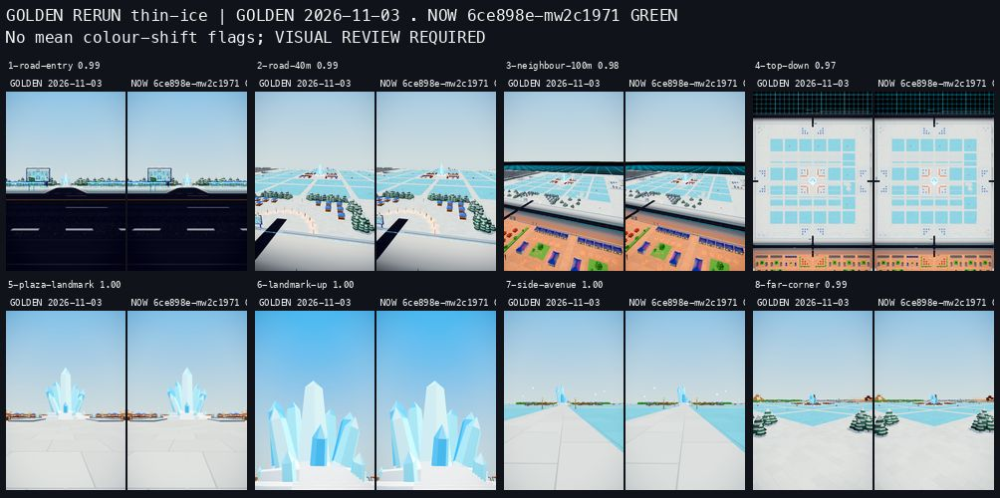
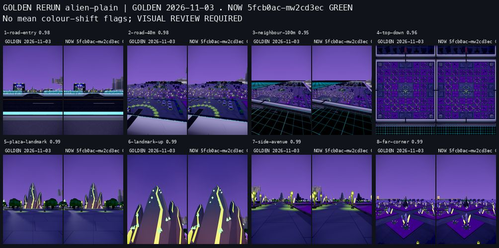
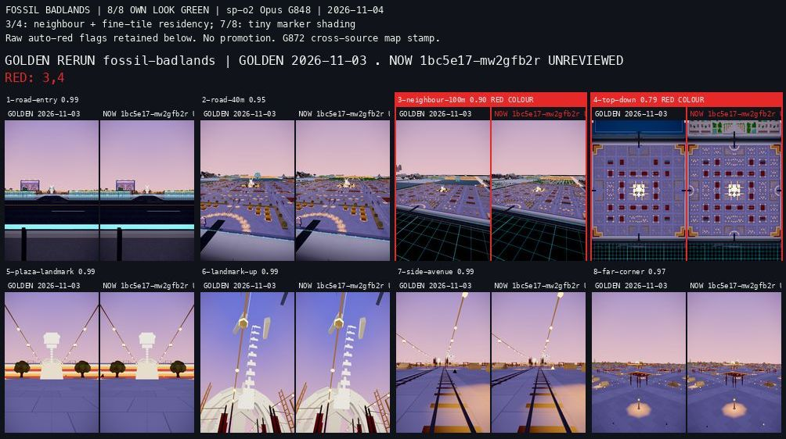

# Final readings for the ten remaining open plots

**Status:** `in flight` (2026-11-03, sp-x1 + sp-x8), **6/10 fully qualified; C/control measured on 10/10**.
**Plan:** [OPEN-PLOTS](../plans/OPEN-PLOTS.md).

Sp-x1 owns matched Chromium plus Night Market control, the maintained walk,
and the eight-view golden bridge. Sp-x8 completed separate Chromium memory
and official Simulator windows for six plots; sp-x1 owns the four remaining
Clockwork, Desert, Race and Showcase memory/official cohorts. Sp-x6 owns audio/native bar 10, body/pack/wire proof, activation and joint
row integration for Saltwind and Fossil. Sp-x1 takes the final audio,
activation, native bar 10 and C reports for Clockwork, Desert, Floating
Island Race and Showcase after the agreed transfer. Sp-x2 owns those audio requirements for Sky Harbor, Starfall,
Thin Ice and Pastel Alien Plain. The original 4/6 audio split is narrowed by that transfer. Jungle and
Fairground's complete cohorts stay with sp-x6; the twelve plots are covered.
No visual source changes belong to these readings.

Every measurement binds one final admitted audio-containing SHA and actual
build. The lanes share its normal all-product preview through separate owner
leases. A visual-boundary walk or hero count is historical evidence; it does
not qualify a later audio candidate. Saltwind's final admitted candidate is
`f8a1406288`; Sky Harbor's is `a8593f8ac6`, and Starfall's is
`aa33a361f5`. Fossil Badlands (`0e0f1ba1c3`), Thin Ice
(`6ce898ee5f`) and Pastel Alien Plain (`5fcb0ac75a`) are also admitted.
Clockwork, Floating Island Race, Desert and Showcase are admitted on
`b752d49037`, build `b752d49-mw26ziu7`, with native bar 10 complete. Admission alone earns no reading qualification.

| Plot | Actual instance / cell | Final candidate | Chromium/control, walk, goldens | Memory / Simulator |
|---|---|---|---|---|
| Fossil Badlands | `open-plot-1-0` / (-1,-2) | `0e0f1ba1c3`; admitted `0e0f1ba-mw1c0i2g`, fresh Sim `0e0f1ba-mw1fkttz`; walk/goldens carrier `1bc5e17-mw2gfb2r` | Complete: C/control, walk 0 stuck/out, goldens 8/8; G872 provenance bridge | Memory + fresh-process standalone/grid official Sim complete |
| Saltwind Lighthouse | `open-plot-2-4` / (0,2) | `f8a1406288` / `f8a1406-mw167rcy` | Complete: C/control, walk 0 stuck/out, goldens 8/8 | Memory + standalone Sim + authorized fresh grid complete |
| Sky Harbor | `open-plot-4-4` / (2,2) | `a8593f8ac6` / `a8593f8-mw176ax3` | Complete: C/control, walk 0 stuck/out, goldens 8/8 | Memory + standalone/grid official Sim complete |
| Starfall Observatory | `open-plot-3-4` / (1,2) | `aa33a361f5` / `aa33a36-mw17vdnh` | Complete: C/control, walk 0 stuck/out, goldens 8/8 | Memory + standalone/grid official Sim complete |
| Thin Ice | `open-plot-1-4` / (-1,2) | `6ce898ee5f`; admitted `6ce898e-mw1buojk`, fresh Sim `6ce898e-mw1fktul` | Complete: C/control, walk 0 stuck/out, goldens 8/8 | Memory + fresh-process standalone/grid official Sim complete; original refusal retained |
| Clockwork Canyon | `open-plot-4-3` / (2,1) | `b752d49037`; C `b752d49-mw26ziu7`, walk/goldens `b752d49-mw2bzahj` | Complete: C/control, walk 0 stuck/out, goldens 8/8 | Open |
| Floating Island Race | `open-plot-2-0` / (0,-2) | `b752d49037`; C `b752d49-mw26ziu7`, walk/goldens `b752d49-mw2bzahj` | Complete: C/control, walk 0 stuck/out, goldens 8/8; accepted Far Reach neighbour state | Open |
| Desert Ruin | `open-plot-3-0` / (1,-2) | `b752d49037`; C `b752d49-mw26ziu7`, walk/goldens `b752d49-mw2bzahj` | Complete: C/control, both walk legs 0 stuck/out, goldens 8/8; approved Nine neighbour change | Open |
| Pastel Alien Plain | `open-plot-4-0` / (2,-2) | `5fcb0ac75a`; admitted `5fcb0ac-mw1c7hz2`, fresh Sim `5fcb0ac-mw1gxenk` | Complete: C/control, walk 0 stuck/out, goldens 8/8 | Memory + fresh-process standalone/grid official Sim complete |
| Showcase Template | `open-plot-sw` / (-1,-1) | `b752d49037`; C `b752d49-mw26ziu7`, walk/goldens `b752d49-mw2bzahj` | Complete: C/control, walk 0 stuck/out, goldens 8/8 | Open |

All ten plots have eight committed golden cameras and maintained route
inputs. Saltwind's `db418c06d7` adds `road-avenue-plaza`: 14 waypoints with
the original 180 s bound, awaiting qualification on the final audio candidate.
Desert's two legs remain intact.
Pastel's final board is `6aaef37e93`; Showcase's is `6d8d10289d`.
Their original maintained route inputs were restored by `3dde21ddfb`; each
has 14 waypoints and a 180 s bound. O2's Showcase walk on `300a65548b`
reports one complete leg with zero stuck/out; this stays geometry-only
evidence until its final audio-containing cohort is measured.
Starfall's `d4d4b17674` walk (164.478 s) and Clockwork's `f1d64e700c` walk
(164.421 s) each completed 14 waypoints with zero stuck/out; these remain
geometry-only evidence in the plan until the final candidate is checked.

The maintained Chromium pair uses phone 2×, live clock, acknowledged 4× CPU,
120 drawn frames per window, and the same real road/plaza poses for each plot
and Night Market. Its raw CPU-target misses remain visible; it earns no
Simulator timing credit. The walk keeps the source's complete route, controller,
waypoint and timeout guards. The golden bridge uses the maintained eight-view
capture and Homebrew Python board maker; all eight rows are read, with original
G994 visual gaps retained and no golden promotion by the readings lane.

Final sections below will record actual source/build, numbers, failures,
remaining owner work and lease release. Unmeasured values remain open.

## Saltwind Lighthouse — Chromium/control (sp-x1)

Exact source **f8a1406288c2407b26085afa9d54aa599d30941d**, normal shared
preview **f8a1406-mw167rcy** (:4401). Audio activation is `f8a1406288`,
publication `678d952bb0`, shared-recording contract `f47d8c9ad7`. Sp-x6's
native bar 10 passes all five spots plus the canonical Coral bed; the
immutable bridge preserves 199/200 candidate bodies, changing only the
164 B map source stamp with the map image exact. All original 158 binary
bodies and 32/34 pre-audio sections remain exact; only audio and client plan
change. The audio owner retains that body/pack/wire evidence.

One maintained `frame-floor.mjs` command measures Saltwind and Night Market
on the same pin: Chromium Metal M5 Max, muted iPhone 16 Pro CSS 402×874,
canvas 804×1748 / phone 2×, live clock, boot CPU 1× then acknowledged
ready/new-draw CPU 4×. Each of six windows has **120/120 paired drawn
frames and render-CPU samples**, zero skipped samples and page errors.
Command time **51.913 s**, complete/pass under the existing floor reader;
Chromium earns no official Simulator or physical-device timing credit.

| Plot / pose | Max draws | Median reported triangles | Mean / worst render CPU µs per draw |
|---|---:|---:|---:|
| Saltwind / spawn | 44 | 31,401 | 39.148 / 70.455 |
| Saltwind / road | 53 | 33,076 | 41.572 / 66.038 |
| Saltwind / plaza | 53 | 42,291 | 26.934 / 47.170 |
| Night Market / spawn | 48 | 225,198 | 33.108 / 54.167 |
| Night Market / road | 56 | 140,577 | 30.818 / 51.786 |
| Night Market / plaza | 57 | 283,280 | 29.123 / 47.368 |

All six windows report **30.03 fps / p95 33.4 ms**, maximum interval
33.4–33.5 ms, and zero sampled intervals over 50 or 100 ms. The original
strict 33.3 ms flags are **false** and remain separate from the floor verdict.
All draw windows fit the unchanged 150-draw limit; the unchanged **30 µs/draw
CPU target misses on both plots**, including Saltwind plaza despite its mean
below 30 µs. The worst whole-frame ratio is the gate, not a mean or percentile
ratio. These descriptive matched readings remain under the existing
G908 / OB8-RENDER-CPU follow-up, with no isolated CPU saving or cause claim.

Standing poses are the original real road `(0,1.7,-241,pi,0)` and plaza
`(0,1.7,-62,pi,0)`, shared with the control. Raw records and pose hashes are
in `tmp/sp-x1-open-plots/saltwind-final/chromium/`; the source-bound standing
file is `tmp/sp-x1-open-plots/saltwind-lighthouse-standing.json`.
The Chromium/control browser closed before sp-x8's finite memory/official
Simulator window. The later walk/golden completion is recorded below.

## Saltwind Lighthouse — Memory/Simulator (sp-x8)

Exact admitted source **f8a1406288c2407b26085afa9d54aa599d30941d**,
normal immutable build **f8a1406-mw167rcy** (:4401), shares the audio/body
bridge above. The literal served index SHA-256 is
`7017ad4f16c8666b35181666ca82e8aba24d25a6b2548ccafad74fee16fbea07`.
The independently matching normalized index-object hash is
`65526fcbc06ca11d4d9c9da6a63efdbda5b7279c5e81c1b67f1468aa99966287`:
Python sorted compact ASCII JSON, without a newline. Extra scratch checks
initially confused these hash units; the served raw bytes matched throughout.
The correct defining projection matched before Simulator admission. No source,
threshold or admission guard changed.

The separate maintained Chromium phone-memory reader uses phone 2×, its
original 20 s settle and three samples, without forced GC or page errors.
Its renderer/GPU-process/JS-heap figures are **MiB**, despite the legacy
`MB` field names; they are not native Simulator RAM or a per-shard sum.

| Sample | Renderer MiB | GPU process MiB | JS heap MiB | FPS | Draws |
|---|---:|---:|---:|---:|---:|
| 1 | 189 | 509 | 46 | 60.2 | 53 |
| 2 | 157 | 497 | 45 | 60.2 | 53 |
| 3 | 159 | 495 | 46 | 60.2 | 53 |

All three retain 18 textures, 81 geometries and 25 programs. The browser
closed before official quiet admission; these FPS readings earn no native
timing credit.

One official `frame-floor.mjs --surface=sim --quiet` command owns the
`wildshard-iphone` window, normal shared model lock and native sampler.
X1's browser and X2's completed model batch released before admission;
no model was interrupted. The actual build reports Apple GPU, phone 2×,
CSS 402×714 and canvas 804×1428. Three standalone windows are complete,
with 120/120 frames each, zero skipped frames, no page errors or context loss.

| Pose | Median FPS | p95 / p99 / max ms | Max draws | Reported triangles |
|---|---:|---:|---:|---:|
| Spawn | 30.303 | 34 / 35 / 35 | 50 | 35,493 |
| Road entry | 30.303 | 34 / 34 / 34 | 57 | 33,148 |
| Plaza | 30.303 | 34 / 34 / 35 | 60 | 43,707 |

All pass the existing 30 FPS floor and 150-draw controls. The stricter
33.3 ms p95 and strict-pass flags remain **false**. These are Mac-backed
Simulator results, not physical-phone clearance.

Standalone native memory has **221 playing / 75 loading samples** and
**47 GPU witnesses**. The conservative playing upper envelope is
**262.018 MB** (241.848 MB native + 20.170 MB GPU ledger); loading is
**1,059.825 MB** (1,039.655 + 20.170 MB). These separate maxima need not
occur simultaneously. They fit the unchanged 1,200 / 1,800 MB per-shard
limits. GPU-process footprint is excluded. The GPU ledger retains
1.044 MB unattributed and one Inspector-closed error; phase coverage remains
complete. The memory sampler explicitly grants no timing credit.

Every standalone after-window pool observation reports 45 returned,
retained and available logical blocks, **3,080,192 B**, with zero hits,
misses or blocked blocks. This is reusable logical capacity, not another
resident-memory charge or a claim about unused physical pages.

**Grid scope refused.** The same finite command then hit the original
**240 s grid-loading deadline**, with repeated Inspector timeout/reconnect
messages. Their target-swap label does not prove an actual target change.
The grid GPU log has **zero samples and 29 Inspector errors**, including
an evaluation timeout; grading refuses `Missing native/GPU samples`.
Native process sampling alone cannot provide the missing GPU/readiness
witness. The full 364.444 s command exits 3, **complete=false/pass=false**.
No unchanged retry, deadline extension, invented zero or crash attribution
is made. All four junction directions, settled residents, pending/crossing
state and grid pool/memory remain unmeasured. G556 gives the pooled grid
page no 1.2 GB cap; it does not turn absent readings into passes.

The junction inputs come from the admitted pin's real grid source:
Saltwind cell **(0,2)**, southeast intersection **(281.25,1.7,843.75)**,
with Pine Hollow, Template, Saltwind and Starfall as its four neighbours.
That source audit is preparation, not a measured residency claim.

Raw evidence stays under `tmp/sp-x8-plot-readings/saltwind-final/`:
`memory.json`, `admission.json`, `junction-source.json`, `sim-poses.json`,
`summary.json`, `simulator.log`, native phase/GPU logs and official result
`simulator/f8a140628-65472-1793740002467.json`. X6 has the exact paths for
bounded read-only cause review. Quiet is removed, the Simulator is shut
down and the model lock is free; X1/X2/X6 received literal release before
parsing. No browser, model or Simulator lease remains with this reading.
The own preview use is released after recording; X1 and X6 retain theirs.
At that original boundary the full cohort remained open. The authorized
fresh grid reading below completes the missing scope while preserving
the failed attempt. Sky Harbor is now admitted; eight await audio handoffs.

## Saltwind Lighthouse — walk and golden bridge (sp-x1)

The same final audio-containing **f8a1406288 / f8a1406-mw167rcy** completes
the maintained `scripts/open-plots/walk.mjs` leg `road-avenue-plaza`:
**14/14 waypoints, 0 stuck, 0 out of bounds, 164.0762 s**, endpoint
**(0.001, 0.018, -61.975)**, reported maximum Y **0.2 m**. The original
180 s bound, native controller, continuous fixed-step movement and endpoint
guards remain intact. No hovering or per-waypoint teleport. Route source
`scripts/physics-route.json` is read from that exact pin, SHA-256
`f0f88e6a0ab42ce7f52380a79792dd3e64818f32b31337f15a5dd45a9b351fa9`.

The maintained eight-view grid capture completes with **8/8 green**, all
rows read individually. Every view has settled crossing, pending empty,
zero in-flight/queued ring work and no page errors. The original cameras
match the pinned source hash
`276031ad62ec9ff7a32e812344b6b06a2e13349f21e56773809c84bdf347c5e7`.
The original raw receipt remains unchanged; the reviewed labelled board is
[audio-candidate golden rerun](../../art/golden-runs/open-plot-saltwind-lighthouse/2026-11-03-f8a1406288-final-audio-board.jpg).
SSIM spans 0.945–0.996 as descriptive evidence, not the look verdict.

Sp-o3 classifies view 3 green for Saltwind: lighthouse, harbour tiles, lamps
and canal edge match. Its copied `neighbour-100m` camera looks over Pine's
near-placeholder rock; the reference already has white slivers and NOW draws
a different strip at the left edge. This is the existing varying Pine
near-view artefact outside Saltwind's geometry. The far-left corner is a
newly activated neighbour. That note is passed to the coordinator for Pine's
owner; no golden is promoted and no new look round is introduced. The
published G994 density, rain/beam and neighbour-camera gaps remain explicit.

The source/body bridge from sp-x6, matched Chromium/control above, maintained
walk and golden bridge are complete. **The first admission left the cohort
open for sp-x8's recorded Simulator grid refusal**; its standalone results
and missing grid witnesses retain their exact scope. The separately
authorized fresh grid scope below later completes the cohort. The earlier
memory/Sim paragraph's then-pending walk/golden scopes are now complete.
No unchanged retry or invented measurement closes that refusal.

Raw walk, capture, eight comparison rows and explicit classification stay in
`tmp/sp-x1-open-plots/saltwind-final/`. All own browsers are closed; the own
shared preview use is released normally after this report lands. No visual
source, collider, controller, contract, cap or verification rule changes.

### Saltwind — authorized fresh grid reading

After the coordinator's explicit one-admission authorization, harness fix
**060198eb6cee7d32cb7a1938ecd80497a1322ee6** preserves entry Inspector
errors, diagnostics and native unload errors separately. It changes no
original wait, evaluation call, deadline or game code. The one fresh
**grid-only** admission uses the same immutable **f8a1406-mw167rcy** app,
raw index and four original junction poses. The original 364.444 s refusal
above remains retained; the lower Simulator/Inspector cause stays unproved.
No renderer, gameplay, visual or memory-cap change belongs to this reading.

The official command completed in **64.754 s, complete=true/pass=true**.
All five windows have **120/120 frames, zero skips and no page errors**:
the incidental grid spawn and all four Saltwind junction directions.
Apple GPU, phone 2×, CSS 402×714 and canvas 804×1428 match the first visit.

| Grid view | Median FPS | p95 / p99 / max ms | Max draws | Reported triangles |
|---|---:|---:|---:|---:|
| Spawn | 30.303 | 34 / 38 / 41 | 106 | 1,081,502 |
| Junction −135° | 30.303 | 34 / 39 / 42 | 58 | 78,333 |
| Junction −45° | 30.303 | 34 / 35 / 35 | 71 | 93,215 |
| Junction 45° | 30.303 | 34 / 34 / 34 | 48 | 162,124 |
| Junction 135° | 30.303 | 34 / 34 / 34 | 73 | 75,688 |

The existing 30 FPS floor and draw controls pass; all strict 33.3 ms flags
remain **false**. The recorded evaluation-origin drift maximum is 1 ms.
All four authored junction windows independently show the actual Pine,
Template, Saltwind and Starfall neighbours as **near**, with **pending=[]**
and **crossing=settled**. Road current is null and residents are empty;
near visibility is not claimed as four resident gameplay worlds. The
incidental Driftwood spawn still has six pending neighbours; it is not a
claim of whole-grid settled residency.

Native memory has **362 playing / 122 loading samples and 76 GPU witnesses**.
The conservative pooled-page envelopes are **909.987 MB playing**
(743.232 native + 166.756 GPU ledger) and **1,322.639 MB loading**
(1,155.883 + 166.756). The GPU ledger retains 2.768 MB unattributed and one
Inspector-closed error, with complete phase coverage. These are separate
maxima, excluding GPU-process footprint, and are Mac-backed Simulator
regression evidence. G556 gives this pooled page no 1.2 GB cap; the
standalone per-shard verdict above remains separate.

Each junction's pool census is 40 available logical blocks,
**2,752,512 B**, six virgin hits, zero recycled hits, zero misses and zero
blocked blocks; 46 have been returned cumulatively. Spawn has five virgin
hits and 45 cumulative returns. Logical reusable capacity is not added to
the native resident envelope.

Raw official result and checked compact summary are retained under
`tmp/sp-x8-plot-readings/saltwind-grid-preserved/`, including
`simulator/f8a140628-52682-1793741759735.json`, `summary.json`, original-pose
and source admission bindings, and native/GPU logs. Quiet, the Simulator
and shared model lock released normally before parsing; X1/X2/X6 received
literal release. The own Saltwind preview use is released after recording.

**Saltwind's final readings are complete**: audio/body/wire/native bar 10
from X6, Chromium/control `d3cd116da4`, the complete 14-waypoint walk and
reviewed 8/8 golden bridge `e909026e34`, standalone memory/Simulator
`f868216858` and this authorized missing grid scope. X6 retains plan-row
integration. Original CPU-target misses, strict-floor flags, neighbour
visual evidence and the initial failed admission remain recorded.

## Sky Harbor — Memory/Simulator (sp-x8)

Final admitted audio source **a8593f8ac61ad6906b3fec6c8e07fcf4ae0402c8**,
normal shared immutable build **a8593f8-mw176ax3** (:4402). The served raw
index SHA-256 is
`cf8a5bf26e1f620d3b78945080d6ef6441982add216eeca75222226b2b79cb36`;
all **204 listed bodies** match the owner's final disk bytes and full hashes:
165 files, 35 sections and four packs with 199 verified entries.
X2's native bar 10 is bridged from `3dbfcb0fc1`, rather than rerun on the
final SHA: all 165 files and 34/35 sections are exact to that candidate;
only the defining-source map stamp changes. Original 158 pre-audio files,
8,822,239 B, remain exact; final wire cost is 4,384,382 B. The audio owner
retains admission, publication and native-audio qualification.

One separate maintained Chromium phone-memory command uses the original
20 s settle and three samples without forced GC. All are phone 2×,
52 draws, 18 textures, 82 geometries and 26 programs, with no page errors.
The legacy `MB` fields below are **MiB**. GPU-process footprint and Chromium
renderer/heap figures remain separate from native Simulator RAM and are
not summed into a per-shard verdict.

| Sample | Renderer MiB | GPU process MiB | JS heap MiB | FPS |
|---|---:|---:|---:|---:|
| 1 | 197 | 519 | 51 | 60.1 |
| 2 | 166 | 515 | 51 | 60.0 |
| 3 | 168 | 507 | 50 | 60.0 |

The Chromium browser is closed. This command earns no official Simulator
timing, native memory or grid-residency credit. The independent official
results below supply those readings. Admission waited for X1's required
CI proof, then its finite Chromium/control cohort and X2's literal model
release. No model or peer proof was interrupted.

Source-derived junction preparation uses Sky Harbor cell **(2,2)**,
southwest intersection **(843.75,1.7,843.75)** and the actual neighbours
Template, Clockwork, Starfall and Sky Harbor. This is not measured
residency. Raw admission, memory and source-pose inputs are retained at
`tmp/sp-x8-plot-readings/sky-final/`. The full cohort remains open.

### Sky Harbor — official Simulator

One official quiet `frame-floor.mjs` command measures the same admitted
**a8593f8-mw176ax3** app, standalone plus the four original grid-junction
poses. X1's Chromium/control browser and X2's finite model batch released
before admission; the normal shared model lock spans this finite window.
The command completes in **88.377 s, complete=true/pass=true**. Both shard
rows have no page errors, and all **eight windows retain 120/120 frames**
with zero skips. Apple GPU, phone 2×, CSS 402×714, canvas 804×1428.

| Surface / view | Median FPS | p95 / p99 / max ms | Max draws | Reported triangles |
|---|---:|---:|---:|---:|
| Standalone spawn | 30.303 | 34 / 34 / 34 | 52 | 113,846 |
| Standalone road | 30.303 | 34 / 34 / 34 | 53 | 94,178 |
| Standalone plaza | 30.303 | 34 / 34 / 34 | 54 | 122,414 |
| Grid spawn | 30.303 | 34 / 38 / 40 | 107 | 1,081,422 |
| Junction −135° | 30.303 | 34 / 34 / 34 | 56 | 104,714 |
| Junction −45° | 30.303 | 34 / 35 / 44 | 72 | 95,581 |
| Junction 45° | 30.303 | 34 / 35 / 36 | 83 | 135,876 |
| Junction 135° | 30.303 | 34 / 34 / 37 | 76 | 99,119 |

The original 30 FPS floor and 150-draw controls pass. Every strict
33.3 ms flag remains **false**. Evaluation-origin drift maximum is 1 ms
standalone and zero in the grid. These are Mac-backed Mobile Safari
readings, not physical-phone clearance; memory sampling itself earns no
timing credit.

Standalone native memory has **218 playing / 42 loading samples** and
**46 GPU witnesses**. Conservative phase envelopes are **254.214 MB
playing** (230.264 native + 23.950 GPU ledger) and **760.828 MB loading**
(736.878 + 23.950). They fit the unchanged 1,200 / 1,800 MB per-shard
limits. The GPU ledger retains 3.660 MB unattributed.

Grid memory has **363 playing / 70 loading samples** and **76 GPU
witnesses**. Its pooled-page envelopes are **897.578 MB playing**
(764.629 native + 132.950 GPU ledger) and **840.485 MB loading**
(707.535 + 132.950), with 2.059 MB GPU unattributed. G556 gives this
whole pooled page no 1.2 GB cap. Both phase readings retain one
Inspector-closed error with complete native/GPU coverage. Separate native
and GPU maxima need not coincide; GPU-process footprint is excluded.

Every authored junction independently shows Template, Clockwork, Starfall
and Sky Harbor as **near**, with **pending=[]**, **crossing=settled**,
current null and residents empty. This is honest road near visibility,
not four resident gameplay worlds. The incidental Driftwood spawn retains
six pending neighbours; no whole-grid settled claim is inferred.

Standalone pool observations retain 45 available logical blocks,
**3,080,192 B**, with zero hits/misses/blocked. Junction observations retain
40 available blocks, **2,752,512 B**, six virgin hits, zero recycled hits,
zero misses/blocked and 46 cumulative returns. Grid spawn has five virgin
hits and 45 returns. Logical reusable capacity is not another resident-RAM
charge and is never added to native memory.

The official result is
`tmp/sp-x8-plot-readings/sky-final/simulator/a8593f8ac-69434-1793742010633.json`;
checked `summary.json`, native/GPU logs, admission and exact pose/source
bindings share that root. Quiet, the Simulator and model lock released
normally before parsing; X1/X2/X6 received literal release. The browser is
closed and the own preview use is released after recording. Memory and
official Simulator scope are complete; X1's maintained walk/eight golden
views and the audio owner's row integration remain separate.

## Sky Harbor — Chromium/control (sp-x1)

Exact admitted audio source **a8593f8ac61ad6906b3fec6c8e07fcf4ae0402c8**,
shared immutable build **a8593f8-mw176ax3** (:4402). X2's body/native bridge
and X8's independent served-body admission above bind this same candidate:
165 files, 35 sections, four packs / 199 entries; all 204 served bodies exact.
The native bar 10 remains the audio owner's separate earned proof.

One maintained `frame-floor.mjs` command pairs Sky Harbor and Night Market
on the same pin. Chromium Metal M5 Max, muted iPhone 16 Pro CSS 402×874,
canvas 804×1748 / phone 2×, live clock, boot CPU 1× then acknowledged 4×
CPU after readiness and a new completed draw. All six windows retain
**120/120 paired draw and render-CPU samples**, zero skipped samples,
page errors or context loss. The finite command completes in **52.046 s**;
the existing floor reader reports complete/pass, without official Simulator
or physical-device timing credit.

| Plot / pose | Max draws | Median reported triangles | Mean / worst render CPU µs per draw |
|---|---:|---:|---:|
| Sky Harbor / spawn | 45 | 96,337 | 35.963 / 64.444 |
| Sky Harbor / road | 51 | 92,094 | 33.301 / 62.745 |
| Sky Harbor / plaza | 53 | 118,684 | 33.978 / 54.717 |
| Night Market / spawn | 48 | 225,198 | 34.497 / 62.500 |
| Night Market / road | 56 | 140,577 | 28.765 / 55.357 |
| Night Market / plaza | 57 | 283,280 | 24.737 / 43.860 |

All six windows report **30.03 fps / p95 33.4 ms**, maximum interval
33.4–33.5 ms, and zero sampled intervals above 50 or 100 ms. Strict 33.3 ms
flags stay **false**. All windows fit 150 draws; all miss the unchanged
**30 µs/draw** CPU target. The maximum whole-frame ratio is the CPU gate,
not the mean or a percentile ratio. These matched observations stay under
the existing G908 / OB8-RENDER-CPU follow-up, with no isolated saving claim.

The boot console reports all six SFX cues held outside the initial loading
bar and the synth fallback retained. X2 confirms this is the first-control
readiness boundary: the existing late-audio path subsequently fetches and
decodes the held bank. This performance cohort does not observe that later
bank and makes no generated-SFX playback claim; the separate native bar 10
proves the six actual buffers after its own readiness boundary.

Standing inputs retain the same real road `(0,1.7,-241,pi,0)` and plaza
`(0,1.7,-62,pi,0)` as the control. Raw records are in
`tmp/sp-x1-open-plots/sky-final/chromium/`; standing input SHA-256 is
`54eccad82e6205bf8b2faec60179d1a3dc0980e8c2927795f63ad3b0079f8119`.
The browser closed before X8's finite official Simulator window. The later
walk and golden completion is recorded below. No visual source changes.

## Sky Harbor — walk and golden bridge (sp-x1)

The same final audio-containing **a8593f8ac6 / a8593f8-mw176ax3** completes
the maintained `road-avenue-plaza-scaffold` walk: **14/14 waypoints,
0 stuck, 0 out, 164.0586 s**, endpoint **(0.001,0.020,-61.972)**,
maximum Y **0.194 m**. The original 180 s allowance, continuous controller,
all waypoint/endpoint checks and live clock remain unchanged. The last
trace waypoint is 13. Its exact pin's `scripts/physics-route.json` hash is
`f0f88e6a0ab42ce7f52380a79792dd3e64818f32b31337f15a5dd45a9b351fa9`.

All **eight golden rows are read green for Sky**, with sp-o2's explicit
owner classification of the neighbour changes. Every captured view is
settled, pending empty, in-flight/queued zero, phone 2×, without page errors
or context loss. The eight original cameras match SHA-256
`58965047a4deb12171ec003a471e3d2584e7c7f951434b0187ec31aa1d76bffb`.
The [reviewed final-audio board](../../art/golden-runs/open-plot-sky-harbor/2026-11-03-a8593f8ac6-final-audio-board.jpg)
retains the automatic colour flags and adds the owner's classification;
the original raw capture and unreviewed board remain unchanged.

Views 3 and 4 flag colour because the south neighbour, **Clockwork Canyon
at (2,1), instance `open-plot-4-3`**, was a blue stand-in when Sky's reference
was captured on `32d153f7b1`. It is now built: red/tangerine ground fills
the foreground and the south strip of the top-down view. Starfall west of
Sky was also activated later. View 8 differs only in the distant built
neighbour skyline. The owner confirms Sky's basins, wharves, cottages,
airship and lanes hold in all three views. No fix or golden promotion is
part of this reading. SSIM 0.851–0.992 is descriptive, not the look verdict.
The published G994 small road-view airship, square basins, sparse cottages
and decks, and no cumulus remain explicit.

Together with the matched Chromium/control above and X8's committed
`eb20276955` memory/official Simulator results, **Sky's final reading
cohort is complete**. Strict timing and render-CPU target misses retain
their original scope; this is not physical-phone clearance. The audio
owner retains bar 10/body/wire qualification and plan-row integration.
Raw walk, eight capture rows, source bindings and classification stay in
`tmp/sp-x1-open-plots/sky-final/`. All own browsers are closed and the own
shared preview lease is released after reporting. No visual source changes.

## Starfall Observatory — Memory/Simulator (sp-x8)

Final admitted audio source **aa33a361f526d9a82d280912014de6e451cff381**,
normal shared immutable build **aa33a36-mw17vdnh** (:4400). The served raw
index SHA-256 is
`f1196b0de99f4bdb9123ef8c3392922b9461b5ae0d17b29d88a2f355b7688b35`.
All **206 listed bodies** match the owner's final disk bytes and complete
hashes: 166 files, 35 sections and five packs with 201 verified entries.

X2's 17 s native bar 10 is bridged from `060198eb6c`, rather than rerun on
the final SHA. All 166 files and 34/35 sections are exact to that native
candidate; only the source map stamp changes. The original 158 pre-audio
files, **9,173,791 B**, remain exact. Final wire cost is **5,911,520 B**;
B, the canonical Bayou bed and six spots remain the audio owner's proof.
No visual or runtime source change belongs to this reading.

One separate maintained Chromium memory command uses phone 2×, its original
20 s settle and three samples without forced GC. Each reports 57 draws,
18 textures, 94 geometries and 26 programs; there are no page errors.
The legacy `MB` fields are **MiB**. Chromium process figures are separate
from native Simulator memory, and are not summed as a per-shard verdict.

| Sample | Renderer MiB | GPU process MiB | JS heap MiB | FPS |
|---|---:|---:|---:|---:|
| 1 | 199 | 525 | 53 | 60.2 |
| 2 | 167 | 524 | 50 | 60.1 |
| 3 | 167 | 524 | 51 | 60.1 |

The Chromium browser closed at the command's natural end. Its FPS earns
no official timing credit. The independent official reading below follows
X1's literal control-browser end and the model owners' literal releases;
no model or peer proof was interrupted.

The pinned source places Starfall in cell **(1,2)**. Its southwest
intersection is **(281.25,1.7,843.75)**, with actual Pine, Template,
Saltwind and Starfall neighbours. These are prepared source poses, not
measured residency. The exact body admission, memory samples and source
poses are retained at `tmp/sp-x8-plot-readings/starfall-final/`.
The full row stays open for the independent remaining scopes.

### Starfall — official Simulator

One maintained official quiet command measures the same admitted
**aa33a36-mw17vdnh** app: three standalone poses, grid spawn and four
source-bound junction directions. An extra preflight first stopped before
any resource acquisition because of a loose desktop-DPR reader hunk.
The owner then landed checked `1ea6c14007`; committed reader bytes and
unchanged app/index bindings were verified before the **first native run**.
The original pose, frame, deadline and admission controls stay intact.

The complete command runs **99.019 s, complete=true/pass=true**, ending
at **2026-11-03T22:01:32.854Z**. All **eight windows have 120/120 frames**,
zero skips and no page errors. Apple GPU, phone 2×, CSS 402×714,
canvas 804×1428. Model-lock admission follows X6's literal 190 s Fossil
batch end; X2 and X1 also report their finite work ended.

| Surface / view | Median FPS | p95 / p99 / max ms | Max draws | Reported triangles |
|---|---:|---:|---:|---:|
| Standalone spawn | 30.303 | 34 / 34 / 34 | 53 | 106,903 |
| Standalone road | 30.303 | 34 / 34 / 35 | 60 | 90,462 |
| Standalone plaza | 30.303 | 34 / 34 / 35 | 62 | 121,899 |
| Grid spawn | 30.303 | 34 / 36 / 46 | 107 | 1,081,902 |
| Junction −135° | 30.303 | 34 / 34 / 37 | 58 | 78,333 |
| Junction −45° | 30.303 | 34 / 34 / 36 | 71 | 93,215 |
| Junction 45° | 30.303 | 34 / 36 / 38 | 48 | 162,124 |
| Junction 135° | 30.303 | 34 / 34 / 36 | 73 | 75,688 |

The original 30 FPS floor and 150-draw controls pass. Every strict
33.3 ms flag stays **false**. Evaluation-origin drift maximum is zero
standalone and 1 ms in the grid. These are Mac-backed Mobile Safari
readings, not physical-phone clearance; native memory sampling itself
earns no timing credit.

Standalone native memory has **222 playing / 80 loading samples** and
**47 GPU witnesses**. Conservative phase envelopes are **272.540 MB
playing** (249.138 native + 23.402 GPU ledger) and **874.985 MB loading**
(851.583 + 23.402). They fit the unchanged 1,200 / 1,800 MB per-shard
limits. The GPU ledger retains 3.446 MB unattributed.

Grid memory has **361 playing / 113 loading samples** and **76 GPU
witnesses**. Its pooled-page envelopes are **904.077 MB playing**
(756.863 native + 147.214 GPU ledger) and **1,047.916 MB loading**
(900.702 + 147.214), with 2.211 MB GPU unattributed. G556 gives this
whole pooled page no 1.2 GB cap. Both phase readings retain one
Inspector-closed error with complete native/GPU coverage. Separate native
and GPU maxima need not coincide; GPU-process footprint is excluded.

All four junction windows independently show actual Pine, Template,
Saltwind and Starfall neighbours as **near**, with **pending=[]** and
**crossing=settled**. Road current is null and residents are empty;
near visibility does not claim four resident gameplay worlds. The
incidental Driftwood spawn still has six pending neighbours, so no
whole-grid settled-residency claim is inferred.

Standalone pool observations retain 45 available logical blocks,
**3,080,192 B**, with zero hits/misses/blocked. Junction observations retain
40 available blocks, **2,752,512 B**, six virgin hits, zero recycled hits,
zero misses/blocked and 46 cumulative returns. Grid spawn has five virgin
hits and 45 returns. Logical reusable capacity is not another physical-RAM
charge and is not added to the native envelope.

The official result is
`tmp/sp-x8-plot-readings/starfall-final/simulator/aa33a361f-58758-1793743193844.json`;
checked `summary.json`, native/GPU logs, admission and exact source poses
share that root. Quiet, the Simulator and model lock released normally
before parsing. X1/X2/X6/O2 received literal release; O2's following census
is a separate owner window. X1's later interrupted walk has no earned
credit here. All own browsers are closed and the own preview use is
released after recording.

Memory/official scope is complete. The independent maintained walk and
eight goldens remain open with X1, and the audio owner retains row
integration. New reading commits stay local under Jake's push hold;
no audio, plot or documentation push request is made.

## Starfall Observatory — Chromium/control (sp-x1)

Final audio-containing **aa33a361f526d9a82d280912014de6e451cff381**,
shared immutable **aa33a36-mw17vdnh** (:4400). X2's native bar 10 passes
17 s before landing. Its final bridge retains all 166 files and 34/35
sections, with only the map source stamp differing. The pre-audio 158 files,
9,173,791 B, and 32/34 old sections stay exact; wire is 5,911,520 B.
The audio owner retains those full body/pack/wire and playback proofs.

One maintained Chromium/Metal command uses the same pin and real standing
poses for Starfall and Night Market: phone 2×, muted iPhone 16 Pro
402×874 / 804×1748 canvas, live clock, boot CPU 1× then acknowledged 4×
CPU only after readiness/new draw. It completes in **52.320 s**, with all
six windows **120/120 paired draw and render-CPU samples**, zero skips,
page errors or context loss. The existing floor reader reports
complete/pass; this earns no official Simulator or physical-phone timing
credit.

| Plot / pose | Max draws | Median reported triangles | Mean / worst render CPU µs per draw |
|---|---:|---:|---:|
| Starfall / spawn | 47 | 93,596 | 47.908 / 80.851 |
| Starfall / road | 54 | 89,506 | 44.784 / 77.778 |
| Starfall / plaza | 54 | 119,012 | 35.725 / 48.148 |
| Night Market / spawn | 48 | 225,198 | 44.479 / 66.667 |
| Night Market / road | 56 | 140,577 | 43.943 / 75.000 |
| Night Market / plaza | 57 | 283,280 | 35.599 / 49.123 |

All six report **30.03 fps / p95 33.4 ms**, maximum 33.4–33.5 ms and zero
sampled intervals over 50 or 100 ms. All strict 33.3 ms flags remain
**false**. All windows fit 150 draws and miss the original **30 µs/draw**
CPU target. The worst whole-frame ratio stays the gate; these descriptive
matched results stay under G908 / OB8-RENDER-CPU, without an isolated saving
or cause claim. Initial held-cue fallback messages do not establish the
late audio bank's readiness; generated playback remains the separate native
bar 10 scope, as described for Sky above.

Raw result, paired draw-budget report and standing source hash are under
`tmp/sp-x1-open-plots/starfall-final/`. The real road `(0,1.7,-241,pi,0)`
and plaza `(0,1.7,-62,pi,0)` match the control. The browser is closed. X8's separate official window subsequently completed;
the own maintained walk started only after its literal release and a clear
`.git/quiet` preflight. O2 then announced an already-active official census.
The new walk was stopped immediately through its owned browser-lane TERM
trap, exit 143; no `walk.json` or golden capture was produced, so no walk or
golden credit is claimed. The conservative command-log-to-TERM interval is
**22:02:01.691–22:02:42.726 UTC** on 2026-11-03; Chromium's exact launch was
not separately timestamped. O2 retains that overlap and will re-read any
affected official window. All own browser processes are verified absent.
That interrupted attempt remains unqualified. The later successful walk and
golden closure is recorded below. Raw interruption evidence is
`tmp/sp-x1-open-plots/starfall-final/interrupted-walk.json`.
No visual source changes.

## Starfall Observatory — walk and golden bridge (sp-x1)

The final admitted audio source **aa33a361f5 / aa33a36-mw17vdnh** completes
the maintained `road-avenue-plaza-scaffold` walk: **14/14 waypoints,
0 stuck, 0 out, 164.4107 s**, endpoint **(0.001,0.020,-61.970)**,
maximum Y **2.283 m**, final trace waypoint 13. The original 180 s allowance,
continuous native controller, live clock and complete waypoint/endpoint
checks remain intact. This is walk qualification, not a frame-floor reading.
Route source is the exact pin's `scripts/physics-route.json`, SHA-256
`f0f88e6a0ab42ce7f52380a79792dd3e64818f32b31337f15a5dd45a9b351fa9`.

The first interrupted attempt above retains zero credit. The subsequent
walk followed O2's literal release. Its queued golden wrapper then correctly
refused another official quiet window **before creating a capture directory**.
That raw refusal is retained. After O2's next literal release, the maintained
capture completes **all eight views**, settled/pending empty, zero ring work,
phone 2×, no page errors or context loss. No quiet guard is bypassed. The
eight rows are individually read **8/8 green**. Cameras match exact source
SHA-256 `46feb3b78fa5d81ba9370d51ea901840c9e43fcb8934a55f49faa958bdadfdf3`;
all committed reference bodies also match the admitted pin.

The [reviewed final-audio board](../../art/golden-runs/open-plot-starfall-observatory/2026-11-03-aa33a361f5-final-audio-board.jpg)
retains the original GOLDEN/NOW comparison. Sp-o3 explicitly classifies
view 8's changed pale distant band as **Pine Hollow's far proxy drawn in
another state**, the existing Pine-owned **D220 / G908** family. Its bearing
spans −18° to +4° around Pine cell (0,1); Nine is +38°, outside the ±31°
frame. No Pine visual byte changes between the reference and this candidate;
retiring unread `loadout/finishes.json` does not change its visual bodies.
Starfall's observatory, gardens, canals, roofs and lanes hold in all views.
No fix or golden promotion is made. SSIM 0.972–0.995 is descriptive only.
G994's mid-blue sky without stars/Milky Way, missing plaza billboard and
plaza-ring rather than avenue canals remain explicit.

Together with the matched Chromium/control and X8's `c4adc34b31`
memory/official Simulator results above, **Starfall's third final reading
cohort is qualified**. All eight official windows meet the existing floor;
standalone native envelopes are **272.540 / 874.985 MB** playing/loading,
and pooled page **904.077 / 1,047.916 MB**. Per-shard memory limits and G556
pooled-page scope remain separate. Strict 33.3 ms and render-CPU target
misses stay visible; no physical-phone clearance is claimed. The audio
owner retains native bar 10, body/wire proof and plan-row integration.

The closure is **committed locally under Jake's push hold**, not yet a
published third cohort. No audio/plot/docs push is requested. All own
browsers are closed; the own shared preview use releases after recording.
Raw walk, quiet refusal, successful capture, eight comparison rows, source
bindings and explicit classification stay in
`tmp/sp-x1-open-plots/starfall-final/finish-after-quiet/`. No visual source,
collider, controller, budget, tolerance or verification rule changes.

## Thin Ice — Memory/Simulator refusal (sp-x8)

This preserves the original refused/overlapped admission and its then-queued
retake. The completed single fresh-process retake is recorded below.

Final audio-containing source **6ce898ee5fd69dc3a9a7ac3820a6ad562473bb26**,
admitted build **6ce898e-mw1buojk**, used the **reused shared preview process**
on :4402. All 166 files, 35 sections and four packs (205 listed payloads,
201 pack entries) match the admitted owner bodies and hashes. Literal index
SHA-256 is `32f1e2b6ef5e2aeab2852709777899eb085bb58f795808c001ae003a660fc496`;
normalized index-object hash also matches in its separately defined units.
X2 retains exact-source native bar 10 (18 s), body/pack/wire proof and activation.

The separate maintained Chromium phone-memory reader retains its original
20 s settle, three samples and phone 2×, without forced GC or page errors.
These legacy `MB` fields are **MiB**, separate from native Simulator RAM.
They earn no official timing credit.

| Sample | Renderer MiB | GPU process MiB | JS heap MiB | FPS | Draws |
|---|---:|---:|---:|---:|---:|
| 1 | 192 | 509 | 56 | 60.2 | 44 |
| 2 | 159 | 504 | 44 | 60.1 | 44 |
| 3 | 160 | 506 | 44 | 60.0 | 44 |

All samples retain 18 textures, 77 geometries and 26 programs. The browser
closed before the later official command.

The original official `frame-floor --surface=sim --quiet` command on
`wildshard-iphone` ends after **371.2 s**, exit 3,
**complete=false/pass=false**. Its standalone rows each record 120/120 drawn
frames, zero skips, **30.303 fps / p95 34 ms**; the strict 33.3 ms flags
remain false. Raw spawn/road/plaza draws are **44/49/50**, triangles
**41,019/40,510/43,407**, and maximum intervals **34/34/36 ms**.
These raw floor passes do not qualify the official scope.

**Quiet overlap is retained.** Sp-o3's headless Chromium phone-loading run,
CPU-throttled 10×, overlapped the official quiet marker from **18:56:57 to
approximately 18:57:40 UTC−5** on November 3. Its cold visit completed at
18:57:30; its warm visit then began before the owner stopped the run.
Own and X1 browser ends had been checked, but the machine-wide browser
inventory was missed before admission. That is corrected for future
admissions; no clean-quiet timing credit is inferred for the affected rows.
`quiet-overlap.json` retains the owner's exact report.

The standalone native record contains **223 playing / 108 loading samples**
and **47 GPU witnesses**. Its conservative raw playing/loading envelopes
are **234.665 / 836.356 MB** (native **215.043 / 816.734 MB** plus GPU ledger
**19.622 MB**). The separate maxima need not coincide. GPU-process footprint
is excluded; 0.840 MB is unattributed and one Inspector-closed error remains.
These are descriptive observations from the overlapped command, without
clean-quiet qualification or physical-phone clearance. Pool observations
retain 45 available logical blocks, **3,080,192 B**, zero hits/misses/blocked;
logical capacity is not added to physical memory.

**Grid scope refused** at the original **240 s** entry deadline, with
**12 retained Inspector entry-read failures**. `diagnosticError` says the
active evaluation was lost; `unloadError` separately refuses missing
native/GPU samples. The page diagnostic is unavailable. Neither that text
nor reconnect attempts prove the game was still loading or the target
changed. Grid frames, four junction witnesses, settled/pending state,
native memory and pool readings remain unmeasured; missing values are not
zero. G556 gives the pooled page no 1.2 GB cap and grants no missing witness.

The source-only junction preparation uses Thin cell **(-1,2)**, southeast
intersection **(-281.25,1.7,843.75)** and actual Pine Hollow, Night Market,
Thin Ice and Saltwind neighbours. It is not measured residency.

Root's later D223 finding identifies long-lived preview processes as a
candidate cause. It does not establish this original refusal's cause.
**One authorized retake is queued**, using a freshly started normal pinned
preview on a new port, with the actual source/build/body bridge recorded
before admission. The original reused-process result stays intact; no cap,
Inspector replay, capture clock or verification rule changes.

Raw evidence: `tmp/sp-x8-plot-readings/thin-final/`, including `memory.json`,
`admission.json`, `quiet-overlap.json`, `summary.json`, native/GPU logs and
`simulator/6ce898ee5-79982-1793750209732.json`. Quiet, Simulator and model lock
released normally; all own browsers and the old preview lease are released.
The full Thin cohort remains open.

## Fossil Badlands — Memory/Simulator queue (sp-x8)

This preserves the initial memory-boundary queue. The completed first
fresh-process official admission is recorded below.

Admitted final audio source **0e0f1ba1c35e2ff4ea16ac25260a29cf5f0a6e47**,
build **0e0f1ba-mw1c0i2g**, used the reused shared :4400 preview for memory.
All **166 files + 35 sections + four packs = 205 listed payloads** match;
there are 200 pack entries. X6's `bodies` count is the 201 files/sections,
excluding packs. An extra scratch count assertion initially mixed those
units and refused; every body hash and both index hashes matched throughout,
and no capture began on that refusal. Literal index SHA-256 is
`ef2c67e77dadb672a24ed53f9eb253e7f8e654044de5db05cdb3ed1c259d824d`.
X6 retains the full immutable native bar 10 (18 s), seven decoded loops,
body/pack/wire proof and activation.

The separate maintained memory reader uses the original 20 s settle,
three samples, phone 2×, no forced GC and no page errors. All samples retain
18 textures, 85 geometries and 25 programs. These Chromium values are **MiB**,
not native RAM, and earn no Simulator timing credit.

| Sample | Renderer MiB | GPU process MiB | JS heap MiB | FPS | Draws |
|---|---:|---:|---:|---:|---:|
| 1 | 194 | 530 | 51 | 60.2 | 55 |
| 2 | 163 | 526 | 50 | 60.1 | 55 |
| 3 | 164 | 516 | 50 | 60.0 | 55 |

**No official Fossil command has started.** The next admission will use a
freshly started normal pinned preview process on a new port under D223,
after independent source/build/body checks and the agreed resource gap.
Native playing/loading memory, frame floor, four grid junction witnesses
and pools remain unknown. Preparation uses actual cell **(-1,-2)**,
northeast junction **(-281.25,1.7,-843.75)**, with Far Reach, Showcase,
Fossil and Floating Island Race as source neighbours; it is not residency.

Raw evidence is `tmp/sp-x8-plot-readings/fossil-final/`: `admission.json`,
`memory.json`, exact source poses and neighbour audit. The memory browser
closed normally. All old shared-preview owners released :4400 before the
fresh-process request; no official quiet, model or Simulator is reserved.
The full cohort remains open.

## Pastel Alien Plain — Memory/Simulator queue (sp-x8)

This preserves the initial memory-boundary queue. The completed first
fresh-process official admission is recorded below.

Final admitted audio source **5fcb0ac75ac4d47e695dfec2953b280e80445cbc**,
build **5fcb0ac-mw1c7hz2**, remains bound to the reused shared :4404 preview.
All 166 files, 35 sections and four packs (**205 listed payloads**, 200 pack
entries) match the owner bodies and hashes. Literal index SHA-256 is
`90e21e1bea11e26c2eae6b659d76f5d87e6d6093928228a1124cad9d0163443a`;
normalized index-object identity matches separately. X2 retains immutable
native bar 10 (17 s), body/pack/wire proof and activation.

Separate Chromium memory uses the maintained 20 s settle and three samples,
phone 2×, without forced GC or page errors. Every sample retains 18 textures,
87 geometries and 25 programs. Values below are **MiB**, separate from native
Simulator RAM; the recorded FPS earns no official timing credit.

| Sample | Renderer MiB | GPU process MiB | JS heap MiB | FPS | Draws |
|---|---:|---:|---:|---:|---:|
| 1 | 196 | 519 | 49 | 60.2 | 55 |
| 2 | 162 | 515 | 47 | 60.0 | 55 |
| 3 | 164 | 507 | 47 | 60.0 | 55 |

**No official Pastel command has started.** The eventual grid reading will
use a freshly started pinned preview process on a new port under D223.
Native memory, floor, pools and actual grid residency remain unknown.
The source-only northwest junction is **(843.75,1.7,-843.75)** at cell
**(2,-2)**, with Nine Dragon, Desert, Pastel and Ember Forge as the four
source neighbours. No resident or settled state is inferred.

Raw evidence is `tmp/sp-x8-plot-readings/pastel-final/`: `admission.json`,
`memory.json`, exact source poses and neighbour audit. The memory browser
closed normally. X1 and X8 retain normal preview uses for the admitted
source; a lease alone reserves no quiet, model or Simulator window.
No full-cohort closure or audio/plot/documentation push is requested.

## Thin Ice — Chromium/control (sp-x1)

Exact admitted source **6ce898ee5fd69dc3a9a7ac3820a6ad562473bb26**,
normal immutable all-product build **6ce898e-mw1buojk** (:4402). Sp-x2's
final native bar 10 passes 18 s. The final bridge preserves all 166 file
bodies and 34/35 sections against its checked audio candidate; only the map
source stamp differs. The original 158 files and 32 pre-audio sections stay
exact. Wire is 2,961,101 B; the 1,112,919 B audio package uses the canonical
Mosslight bed without a copy, plus six local spots. Those audio proofs belong
to sp-x2; this cohort does not re-earn generated playback or load completeness.

One maintained Chromium/Night Market command completes in **51.671 s** on
the exact source, with **six 120/120 paired drawn-frame/CPU windows**, zero
skipped samples, empty page errors, no context loss and no standing builds.
Muted iPhone 16 Pro CSS 402×874, canvas 804×1748 / phone 2×, Metal M5 Max,
live clock, boot CPU 1× then the original ready/new-draw fence at CPU 4×.

| Plot / pose | Max draws | Median reported triangles | Mean / worst render CPU µs per draw |
|---|---:|---:|---:|
| Thin Ice / spawn | 40 | 39,724 | 50.917 / 77.500 |
| Thin Ice / road | 46 | 40,418 | 45.978 / 63.043 |
| Thin Ice / plaza | 46 | 41,664 | 41.431 / 58.696 |
| Night Market / spawn | 48 | 225,198 | 44.861 / 70.833 |
| Night Market / road | 56 | 140,577 | 38.690 / 64.286 |
| Night Market / plaza | 57 | 283,280 | 34.371 / 54.386 |

All six windows report **30.03 fps / p95 33.4 ms**, maximum intervals
33.4–33.5 ms and no intervals over 50 or 100 ms. The maintained reader marks
the cadence floor complete/pass, while the original strict **33.3 ms flags
remain false**. All draw windows fit 150; the unchanged **30 µs/draw CPU
target misses all six windows**, on both Thin Ice and its matched control.
These report-only samples earn no official Simulator or physical-device
timing credit and remain in the existing G908 / OB8-RENDER-CPU follow-up.

The original road `(0,1.7,-241,pi,0)` and plaza `(0,1.7,-62,pi,0)` are
matched with Night Market. Standing-file SHA-256 is
`baeda5c06bda03453c05dded8d8476527486b1ee7c5181d89cbb48be3667d0aa`.
Raw records are `tmp/sp-x1-open-plots/thin-final/cpu/`, reading
`6ce898ee5-70073-1793750074329`. The runner closed its browser and the
literal completion was sent to sp-x8 before its official admission.
The walk and eight-view golden bridge remain open; no visual source changes.

## Fossil Badlands — Chromium/control (sp-x1)

Exact admitted source **0e0f1ba1c35e2ff4ea16ac25260a29cf5f0a6e47**,
normal immutable all-product build **0e0f1ba-mw1c0i2g** (:4400). Sp-x6's
immutable native bar 10 passes 18 s, with score A, the shared Night Market
bed and six spots; named crane/dry-wind gaps remain. The final bridge binds
201 bodies and four packs / 200 ordered entries / 7,615,459 B. All 158
pre-audio files and 32 sections stay exact; 200/201 candidate bodies match,
with only the 164 B map source stamp changing and the map image exact.
The audio owner's old map-stamp limitation remains explicit in
`tmp/wave-a-audio/fossil-readings/map-stamp-proof.json`: strict MapSchema
and the sole baseline image prove that scope, without a literal old stamp
byte claim. Phone wire is the exact approved **3,838,831 B** ceiling.

One maintained matched Chromium/Night Market command completes in
**51.457 s**, with six **120/120 paired drawn-frame/CPU windows**, zero
skipped samples, empty page errors, no context loss and no standing builds.
It uses the same muted iPhone 16 Pro CSS 402×874 / canvas 804×1748 phone 2×,
Metal M5 Max, live clock and boot 1× / acknowledged measurement CPU 4×
protocol as Thin Ice above.

| Plot / pose | Max draws | Median reported triangles | Mean / worst render CPU µs per draw |
|---|---:|---:|---:|
| Fossil / spawn | 46 | 112,568 | 32.518 / 56.522 |
| Fossil / road | 54 | 91,943 | 29.923 / 53.704 |
| Fossil / plaza | 56 | 136,488 | 32.024 / 53.571 |
| Night Market / spawn | 48 | 225,198 | 30.833 / 60.417 |
| Night Market / road | 56 | 140,577 | 29.687 / 69.643 |
| Night Market / plaza | 57 | 283,280 | 26.082 / 43.860 |

All six windows report **30.03 fps / p95 33.4 ms**, with maximum intervals
33.4–33.5 ms; the cadence reader is complete/pass, while strict 33.3 ms
flags remain false. All draw limits pass, but the unchanged **30 µs/draw CPU
target misses all six windows**, including means below 30: the worst
whole-frame ratio remains the gate. These descriptive samples earn no
official Simulator or physical-device timing credit; G908 / OB8-RENDER-CPU
remains open without an isolated saving or cause claim.

Original road/plaza poses match the control. Standing-file SHA-256 is
`99b6282d4e16fcfc6b00d5b56a65cec80bb3a14e1a24e26a27ae5d3b1b08605e`.
Raw records are `tmp/sp-x1-open-plots/fossil-final/cpu/`, reading
`0e0f1ba1c-7967-1793750678715`. The runner closed its browser and sent the
literal end to sp-x8. Under root's D223 ruling both old Fossil :4400 and
Thin :4402 previews were subsequently released normally; their C records
remain preserved. Fresh preview processes are required for the queued
Fossil official run and the one authorized Thin retake. No such official
reading, walk or golden credit is inferred here; no visual source changes.

## Pastel Alien Plain — Chromium/control (sp-x1)

Exact admitted source **5fcb0ac75ac4d47e695dfec2953b280e80445cbc**,
normal immutable all-product build **5fcb0ac-mw1c7hz2** (:4404). Sp-x2's
immutable final native bar 10 passes 17 s. All 166 final file bodies and
34/35 sections match its checked audio candidate, except the defining
map source stamp; image, audio and client plan remain exact. The audio
package is 1,542,658 B, including the canonical Frostline bed without a
copy; phone wire is 4,088,773 B. Full body/pack/hash and playback proofs
remain with sp-x2; this performance cohort does not re-earn them.

One maintained matched Chromium/Night Market command completes in
**51.626 s**, with six **120/120 paired drawn-frame/CPU windows**, zero
skipped samples, empty page errors, no context loss and no standing builds.
The original muted iPhone 16 Pro CSS 402×874 / canvas 804×1748 phone 2×,
Metal M5 Max, live clock and boot 1× / acknowledged measurement CPU 4×
protocol matches the two cohorts above.

| Plot / pose | Max draws | Median reported triangles | Mean / worst render CPU µs per draw |
|---|---:|---:|---:|
| Pastel / spawn | 47 | 52,595 | 44.752 / 63.830 |
| Pastel / road | 53 | 64,511 | 40.267 / 67.925 |
| Pastel / plaza | 55 | 62,286 | 38.364 / 60.000 |
| Night Market / spawn | 48 | 225,198 | 41.823 / 62.500 |
| Night Market / road | 56 | 140,577 | 34.688 / 57.143 |
| Night Market / plaza | 57 | 283,280 | 31.813 / 47.368 |

All six windows report **30.03 fps / p95 33.4 ms**, maximum intervals
33.4–33.5 ms; cadence is complete/pass, strict **33.3 ms remains false**.
All 150-draw windows pass. The unchanged **30 µs/draw CPU target misses
all six windows** on both Pastel and Night Market. These diagnostic samples
earn no official Simulator or physical-device timing credit; the existing
G908 / OB8-RENDER-CPU follow-up remains open.

Original road/plaza poses match the control. Standing-file SHA-256 is
`6ee6320be0ab091deb356a3384a0eb522962c2dda7798e54a56ed72c6ab378ed`.
Raw records are `tmp/sp-x1-open-plots/pastel-final/cpu/`, reading
`5fcb0ac75-23862-1793752689327`. The runner closed its browser and sent
the literal end before sp-x6's finite DL9 turn. The maintained walk and
eight-view golden bridge remain open; no visual source changes.

## Thin Ice — authorized fresh-process official retake (sp-x8)

The **one authorized D223 retake** completes memory/official scope on the
same final audio source **6ce898ee5fd69dc3a9a7ac3820a6ad562473bb26**.
A normal `serve-build --rev` starts a new preview on **:4435**, PID **2406**,
actual build **6ce898e-mw1fktul**. The old shared preview had no remaining
owners and was stopped normally. The new process has no previous browser
or Simulator game visit before this command. This is a **fresh process**,
not another lease on the original reused server.

The literal product index and all **205 admitted payloads** are byte-exact
to the original candidate, including all **201 pack entries**. Full source
SHA comes from the normal immutable-preview registry. All **190 new runtime
endpoints**, including HTML/version/SW and compiled JS/CSS, match their fresh
disk bodies. The old compiled runtime inventory was not retained, so no
old-versus-new compiled-byte parity is claimed. Build suffixes and these
limits remain explicit in `fresh-process.json` and `runtime-bodies.json`.

X1's two-score model turn and X6's golden browser released first. Global
preflight caught a separate active browser and stale profiling command;
the owners released both before admission. It then verified **0/4 game
browsers, zero outside the lane**, an unchanged committed reader, the exact
preview/index and empty result/native directories. The original model lock
and Simulator lane are acquired normally. Quiet is actually observed at
PID **23281**. No overlapping workload is reported during this retake.

One original `frame-floor --surface=sim --quiet` command measures standalone
spawn/road/plaza and grid home plus four source-derived junction directions.
It completes in **90.269 s**, exit 0, **complete=true/pass=true**. All eight
windows retain **120/120 drawn frames**, zero skips and page errors,
**30.303 fps / p95 34 ms**. Every original **strict 33.3 ms flag remains
false**. Apple GPU uses portrait CSS 402×714, canvas 804×1428, phone 2×
and the shipped auto/30 fps policy; no texture or clock override.

| Scope / pose | Max draws | Reported triangles | p99 / max ms |
|---|---:|---:|---:|
| Standalone spawn | 44 | 41,019 | 34 / 34 |
| Standalone road | 49 | 40,510 | 34 / 34 |
| Standalone plaza | 50 | 43,407 | 34 / 34 |
| Grid home spawn | 107 | 1,082,095 | 38 / 38 |
| Junction −135° | 57 | 67,982 | 40 / 40 |
| Junction −45° | 48 | 179,401 | 34 / 38 |
| Junction +45° | 77 | 138,073 | 34 / 34 |
| Junction +135° | 68 | 69,009 | 34 / 34 |

The native sampler has complete phase and GPU coverage. These are decimal
**MB**, separate from the earlier Chromium **MiB** table. Each conservative
envelope adds the phase's native interval maximum to the global GPU ledger
maximum; those maxima need not coincide. GPU-process footprint is excluded.
The memory sampler itself grants no timing credit.

| Scope | Native playing/loading MB | GPU ledger MB | Envelope playing/loading MB | Phase samples playing/loading | GPU samples |
|---|---:|---:|---:|---:|---:|
| Standalone | 246.795 / 288.907 | 19.622 | 266.417 / 308.529 | 218 / 27 | 46 |
| Pooled grid page | 718.606 / 618.914 | 139.607 | 858.213 / 758.521 | 363 / 71 | 77 |

Standalone stays within the unchanged **1,200 MB playing / 1,800 MB loading**
limits. The pooled grid page has **no 1.2 GB cap under G556**. GPU ledger
unattributed memory is **0.840 MB standalone / 2.184 MB grid**; each scope
retains one Inspector-closed entry. Coverage remains
complete, with no missing-witness refusal.

At all four junction views, actual Pine Hollow, Night Market, Thin Ice and
Saltwind neighbours are **near and drawn**, **pending=[]**, crossing
**settled**. The road has current=null and residents=[], so near visibility
does not claim four gameplay residents. Grid home still has six pending
neighbours; this is no whole-grid residency claim.

Standalone pool observations retain **45 available logical blocks /
3,080,192 B**, with zero hits/misses/blocked. Grid home has 40 available
blocks / 2,752,512 B, five virgin hits and 45 cumulative returns. Each
junction retains **41 available blocks / 2,818,048 B**, five virgin hits,
46 cumulative returns, zero recycled hits, misses or blocked blocks.
Logical reusable capacity is not another physical-memory charge.

The original **371.2 s refused/overlapped attempt** above remains unchanged.
This fresh-process retake qualifies under the requested conditions; it does
not isolate the original refusal's cause or establish a memory saving.
Raw result is
`tmp/sp-x8-plot-readings/thin-fresh/simulator/6ce898ee5-22570-1793755754998.json`;
`summary.json`, native logs, original source poses, preflight, process and
runtime/body bridges share that root. The result records harness revision
`d525bf2f86d2dfc9cbc77d52621d8cc30d057342`.

Quiet, Simulator and model resources release before parsing; global browser
inventory is zero. Fossil then seeks a new independent admission. The own
:4435 preview use is later released normally and retained by X1's actual
joined lease. **Memory/official scope is complete; X1's maintained walk and
eight goldens remain open.** No full-cohort promotion or visual/source,
collider, deadline, threshold or comparator change belongs to this reading.

## Fossil Badlands — fresh-process official reading (sp-x8)

The first official Fossil admission uses final audio source
**0e0f1ba1c35e2ff4ea16ac25260a29cf5f0a6e47**, normal new preview **:4436**,
PID **2454**, actual build **0e0f1ba-mw1fkttz**. The old shared process had
been stopped after every owner released it. The new process has no prior
game visit. This is a **fresh normal pinned process**, not shared-process
reuse. The original index and **205 payloads / 200 pack entries** are exact;
all **190 new runtime endpoints** match disk. Full-source provenance and
the unretained old-runtime-inventory limit are recorded as for Thin.

After Thin's literal resource release, a new preflight checks the exact
source/build/index, empty native/result directories, committed reader,
absent quiet and zero global browsers. It acquires the normal model and
Simulator lanes independently; quiet PID **40805** is observed. No model,
browser or timed proof is admitted during the finite window.

The maintained command completes in **88.354 s**, exit 0,
**complete=true/pass=true**. All eight windows retain **120/120 frames**,
zero skips and page errors, **30.303 fps / p95 34 ms**. All stricter
**33.3 ms flags remain false**. The same portrait Apple GPU / phone 2×
configuration and original caps apply.

| Scope / pose | Max draws | Reported triangles | p99 / max ms |
|---|---:|---:|---:|
| Standalone spawn | 53 | 127,656 | 34 / 34 |
| Standalone road | 56 | 94,167 | 34 / 34 |
| Standalone plaza | 60 | 137,716 | 34 / 43 |
| Grid home spawn | 106 | 1,077,526 | 39 / 46 |
| Junction −135° | 37 | 176,843 | 34 / 41 |
| Junction −45° | 69 | 111,122 | 34 / 35 |
| Junction +45° | 73 | 123,338 | 34 / 34 |
| Junction +135° | 76 | 139,777 | 34 / 34 |

Native coverage and conservative envelopes use the same decimal-MB rule:

| Scope | Native playing/loading MB | GPU ledger MB | Envelope playing/loading MB | Phase samples playing/loading | GPU samples |
|---|---:|---:|---:|---:|---:|
| Standalone | 255.511 / 329.523 | 23.956 | 279.468 / 353.479 | 218 / 27 | 46 |
| Pooled grid page | 787.714 / 637.379 | 138.360 | 926.074 / 775.739 | 365 / 76 | 76 |

Standalone fits the unchanged 1,200/1,800 MB per-shard limits; G556 leaves
the pooled page uncapped at 1.2 GB. The ledger retains **3.297 MB standalone /
2.184 MB grid** unattributed and one Inspector-closed entry in each scope.
Native/GPU phase coverage remains complete; no missing values are filled
with zero and GPU-process footprint is excluded.

Every northeast-junction direction independently shows actual Far Reach,
Showcase, Fossil and Floating Island Race neighbours **near and drawn**,
**pending=[]**, crossing **settled**. Current=null and residents=[] on the
road, so this is near visibility rather than four gameplay residents.
Grid home still has six pending neighbours.

Pool observations match Thin's measured counts: standalone **45 blocks /
3,080,192 B** with zero hits/misses/blocked; grid home **40 blocks /
2,752,512 B**, five virgin hits and 45 returns; each junction **41 blocks /
2,818,048 B**, five virgin hits, 46 cumulative returns and zero recycled
hits, misses or blocked blocks. These are logical reuse diagnostics and are
not added to native memory.

Raw result is
`tmp/sp-x8-plot-readings/fossil-fresh/simulator/0e0f1ba1c-40384-1793755924671.json`;
checked `summary.json`, native/GPU logs, process/runtime bridge, exact source
poses and admission remain together. Result harness revision is
`d525bf2f86d2dfc9cbc77d52621d8cc30d057342`. Quiet is removed, Simulator shut
down, model lock free and global browser inventory zero before parsing.
Peers receive literal release; X2's required CI proof gets the next finite
CPU gap. The own preview use releases normally, retained by X1's actual
joined :4436 lease.

**Memory/official scope is complete; X1's maintained walk and eight goldens
remain open.** The full qualified/published count stays **3/10**, with
memory/official scope then qualified on five plots. At that boundary,
Pastel's official scope and four unadmitted audio candidates remained open. No new official window
is reserved, no visual changes are made and no audio/plot/docs push is
requested under Jake's hold.

## Pastel Alien Plain — fresh-process official reading (sp-x8)

The first official Pastel command binds final audio source
**5fcb0ac75ac4d47e695dfec2953b280e80445cbc**, fresh normal pinned preview
**:4437**, PID **22451**, actual build **5fcb0ac-mw1gxenk**. All old :4404
owners released normally after X6's last capture and body proof. A new
`serve-build --rev` starts after X2's codec CPU release. This is a **fresh
process on a new port**, with no prior browser or Simulator game visit.

The original literal product index, **205 payloads / 200 pack entries** and
all their hashes remain exact. There are no additional schema/runtime file
rows in this Pastel index. The full source pin comes from the normal preview
registry; all **190 new HTML/version/SW/compiled JS/CSS endpoints** match disk.
No retained old compiled-runtime inventory exists, so no old compiled-byte
parity is inferred. This bridges the earlier C/memory candidate to the fresh
server while preserving both actual build identities.

Race's model turn, X6's final golden browser, X2's VM/codec work and X9's two
builders release before admission. Global preflight catches other finite
browsers and waits for their owners' literal ends. It then verifies **0/4
game browsers, zero outside the lane**, unchanged committed reader, exact
source/build/index, absent quiet and empty native/result directories. The
normal model and Simulator lanes are acquired independently. Quiet PID
**62186** is actually observed; peers defer new competing work until release.
One scratch metadata preflight initially treated valid `runtime:null` as an
object; it stopped before any Simulator command, then handles that absence
explicitly. No game measurement was replayed on that refusal.

The original `frame-floor --surface=sim --quiet` command completes in
**89.422 s**, exit 0, **complete=true/pass=true**. Every one of eight windows
retains **120/120 drawn frames**, zero skips and page errors,
**30.303 fps / p95 34 ms**. All **strict 33.3 ms flags remain false**.
Apple GPU uses portrait CSS 402×714, canvas 804×1428, phone 2× and the shipped
auto/30 fps policy. The clock, texture mode, sampling and original caps are
unchanged; this remains Mac-backed Simulator evidence, not physical-phone
clearance.

| Scope / pose | Max draws | Reported triangles | p99 / max ms |
|---|---:|---:|---:|
| Standalone spawn | 55 | 61,398 | 34 / 34 |
| Standalone road | 58 | 66,141 | 34 / 34 |
| Standalone plaza | 58 | 65,889 | 34 / 34 |
| Grid home spawn | 107 | 1,081,916 | 44 / 47 |
| Junction −135° | 60 | 137,558 | 38 / 44 |
| Junction −45° | 60 | 99,062 | 37 / 38 |
| Junction +45° | 76 | 146,866 | 34 / 34 |
| Junction +135° | 50 | 128,495 | 34 / 34 |

Native memory uses decimal **MB**, separate from Chromium **MiB**. The
conservative envelope adds each native phase maximum to the global GPU
ledger maximum; the maxima need not coincide. GPU-process footprint and
logical script-pool capacity are not added again. The native sampler grants
no timing credit; cadence comes from the original drawn-frame observer.

| Scope | Native playing/loading MB | GPU ledger MB | Envelope playing/loading MB | Phase samples playing/loading | GPU samples |
|---|---:|---:|---:|---:|---:|
| Standalone | 243.338 / 321.495 | 21.591 | 264.929 / 343.085 | 219 / 27 | 47 |
| Pooled grid page | 698.322 / 608.592 | 164.435 | 862.757 / 773.027 | 364 / 71 | 77 |

Standalone fits the unchanged **1,200 MB playing / 1,800 MB loading**
limits. G556 gives the pooled page **no 1.2 GB cap**. Complete phase and GPU
coverage retains **1.654 MB standalone / 2.803 MB grid** unattributed memory
and one Inspector-closed entry in each scope. No absent witness is filled
with zero and no refusal is hidden.

At all four northwest-junction directions, actual **Nine Dragon, Desert,
Pastel and Ember Forge** neighbours are independently **near and drawn**,
**pending=[]**, crossing **settled**. Road current is null and residents
empty, so this does not claim four resident gameplay worlds. Grid home has
six pending neighbours; no whole-grid settled-residency claim is made.

Every standalone pool observation retains **45 available logical blocks /
3,080,192 B**, zero hits/misses/blocked. Grid home retains **40 blocks /
2,752,512 B**, five virgin hits and 45 cumulative returns. Every junction
retains **41 blocks / 2,818,048 B**, five virgin hits, 46 cumulative returns,
zero recycled hits, misses or blocked blocks. These are reusable logical
capacity, not another physical-RAM charge.

Raw result is
`tmp/sp-x8-plot-readings/pastel-fresh/simulator/5fcb0ac75-61775-1793758277472.json`;
checked `summary.json`, process/runtime/body bridge, source poses, preflight
and native/GPU logs share that root. The result records harness revision
`e75d1a9962647fe8bb274c0569d001597fbdd04c`. A separate DL9 source/body
handoff lives in `dl9-body-bridge.json`; its initial scratch tally omission
of Pine's schema row is retained in the original audit log and grants no
DL9 timing credit.

The command releases quiet, Simulator and the model lock before parsing;
global browser inventory is zero. Peers receive literal resource release.
The own :4437 preview use releases normally, retained by actual X1 and DL9
joined leases. No additional official window is reserved.

**Memory/official scope is complete on six of ten plots.** Full cohorts stay
**3/10 qualified/published**, with Thin, Fossil and Pastel's maintained walks
and eight goldens still open under X1. Four final audio handoffs remain open.
No source, visuals, collider, budget, threshold, comparator or capture-clock
change belongs to this reading. This is a local documentation commit under
Jake's push hold; no audio/plot/docs push is requested.

## Four final audio candidates — common admission (sp-x1)

The four November 4 candidates below share exact source `b752d49037` and
normal all-product build `b752d49-mw26ziu7`. All four native bar-10 runs pass
with their own score, bed and six spatial spots, including heading/pan and
pause/resume checks. Every one of 633 original file bodies (44,500,053 B)
and 128 unchanged sections remains exact. Only audio and map source stamp
change among old sections; each adds its audio client plan. Map images and
retained pack-member order remain exact. This is audio-only: no visuals or
colliders change. Four separately measured C reports bring C/control to
**10/10**. Full cohorts remain **3/10**, and memory/official remains **6/10**;
all outstanding walks, golden bridges and four new memory/official scopes
stay open. Earlier local-under-hold paragraphs record their actual landing
boundaries; that hold has since lifted and the earlier reading commits are
published. No new memory or visual qualification is inferred.

## Clockwork Canyon — Chromium/control (sp-x1, November 4)

Exact admitted source **b752d49037c8ed98611376418069becb7c2599c0**, normal all-product build
**b752d49-mw26ziu7** (:4401). Audio publication, gameplay binding and exact
content ceilings are `73f65674ef`, `b00b361bd5` and `b752d49037`; the
shared four-plot body/native proof is recorded in the audio review.

One maintained matched command takes **51.720 s**: muted iPhone
16 Pro, Chromium ANGLE Metal M5 Max, CSS 402×874, canvas 804×1748 / phone
2×, live clock, boot CPU 1× then acknowledged ready/new-draw CPU 4×. Each
of the six windows has **120/120 paired drawn frames and render-CPU
samples**, zero skips, page errors, context losses or standing builds.

| Plot / pose | Max draws | Median reported triangles | Mean / worst render CPU µs per draw |
|---|---:|---:|---:|
| Clockwork Canyon / spawn | 51 | 95,492 | 44.967 / 64.706 |
| Clockwork Canyon / road | 60 | 105,964 | 36.903 / 58.333 |
| Clockwork Canyon / plaza | 55 | 111,038 | 34.636 / 52.727 |
| Night Market / spawn | 48 | 225,198 | 37.396 / 62.500 |
| Night Market / road | 56 | 140,577 | 43.765 / 69.643 |
| Night Market / plaza | 57 | 283,280 | 38.289 / 56.140 |

All six windows report **30.03 fps / p95 33.4 ms**; maximum intervals are
33.4–33.5 ms, with no sampled interval over 50 or 100 ms.
The original strict 33.3 ms flags remain **false**. Cadence and the unchanged
150-draw limit pass; the unchanged **30 µs/draw CPU target misses on every
plot and control window**. The worst whole-frame ratio gates this target,
not the mean. These are descriptive matched readings under the existing
OB8-RENDER-CPU follow-up, with no isolated saving or cause claim and no
official Simulator or physical-device timing credit.

Standing file `tmp/sp-x1-open-plots/clockwork-canyon-standing.json` has SHA-256
`cb06d2b776ba7856d59060c756c082e339e702fb7d7c790932502ae464f2d70c`. Road and plaza retain the maintained
real poses `(0,1.7,-241,pi,0)` and `(0,1.7,-62,pi,0)`. Raw primary report:
`tmp/sp-x1-open-plots/clockwork-final/cpu/b752d4903-45984-1793801772706.json`; its adjacent `-draw-budget.json` retains all paired ratios.
Browser closes normally. Walk, eight goldens and separate memory/official
Simulator scopes remain open; this C report does not close a full cohort.

## Desert Ruin — Chromium/control (sp-x1, November 4)

Exact admitted source **b752d49037c8ed98611376418069becb7c2599c0**, normal all-product build
**b752d49-mw26ziu7** (:4401). Audio publication, gameplay binding and exact
content ceilings are `73f65674ef`, `b00b361bd5` and `b752d49037`; the
shared four-plot body/native proof is recorded in the audio review.

One maintained matched command takes **51.443 s**: muted iPhone
16 Pro, Chromium ANGLE Metal M5 Max, CSS 402×874, canvas 804×1748 / phone
2×, live clock, boot CPU 1× then acknowledged ready/new-draw CPU 4×. Each
of the six windows has **120/120 paired drawn frames and render-CPU
samples**, zero skips, page errors, context losses or standing builds.

| Plot / pose | Max draws | Median reported triangles | Mean / worst render CPU µs per draw |
|---|---:|---:|---:|
| Desert Ruin / spawn | 41 | 91,287 | 59.492 / 80.488 |
| Desert Ruin / road | 51 | 111,887 | 40.474 / 66.667 |
| Desert Ruin / plaza | 51 | 138,383 | 34.788 / 50.980 |
| Night Market / spawn | 48 | 225,198 | 40.278 / 62.500 |
| Night Market / road | 56 | 140,577 | 37.128 / 62.500 |
| Night Market / plaza | 57 | 283,280 | 34.020 / 50.877 |

All six windows report **30.03 fps / p95 33.4 ms**; maximum intervals are
33.4–33.5 ms, with no sampled interval over 50 or 100 ms.
The original strict 33.3 ms flags remain **false**. Cadence and the unchanged
150-draw limit pass; the unchanged **30 µs/draw CPU target misses on every
plot and control window**. The worst whole-frame ratio gates this target,
not the mean. These are descriptive matched readings under the existing
OB8-RENDER-CPU follow-up, with no isolated saving or cause claim and no
official Simulator or physical-device timing credit.

Standing file `tmp/sp-x1-open-plots/desert-ruin-standing.json` has SHA-256
`d43346ef3aac90cb0c9327b146e6fd560e2945a6c4ce7dd427dde36e09d694d4`. Road and plaza retain the maintained
real poses `(0,1.7,-241,pi,0)` and `(0,1.7,-62,pi,0)`. Raw primary report:
`tmp/sp-x1-open-plots/desert-final/cpu/b752d4903-74654-1793801870277.json`; its adjacent `-draw-budget.json` retains all paired ratios.
Browser closes normally. Walk, eight goldens and separate memory/official
Simulator scopes remain open; this C report does not close a full cohort.

## Floating Island Race — Chromium/control (sp-x1, November 4)

Exact admitted source **b752d49037c8ed98611376418069becb7c2599c0**, normal all-product build
**b752d49-mw26ziu7** (:4401). Audio publication, gameplay binding and exact
content ceilings are `73f65674ef`, `b00b361bd5` and `b752d49037`; the
shared four-plot body/native proof is recorded in the audio review.

One maintained matched command takes **51.583 s**: muted iPhone
16 Pro, Chromium ANGLE Metal M5 Max, CSS 402×874, canvas 804×1748 / phone
2×, live clock, boot CPU 1× then acknowledged ready/new-draw CPU 4×. Each
of the six windows has **120/120 paired drawn frames and render-CPU
samples**, zero skips, page errors, context losses or standing builds.

| Plot / pose | Max draws | Median reported triangles | Mean / worst render CPU µs per draw |
|---|---:|---:|---:|
| Floating Island Race / spawn | 41 | 97,850 | 50.285 / 73.171 |
| Floating Island Race / road | 47 | 82,922 | 49.202 / 74.468 |
| Floating Island Race / plaza | 48 | 112,010 | 44.757 / 64.583 |
| Night Market / spawn | 48 | 225,198 | 50.087 / 66.667 |
| Night Market / road | 56 | 140,577 | 45.342 / 71.429 |
| Night Market / plaza | 57 | 283,280 | 40.892 / 57.895 |

All six windows report **30.03 fps / p95 33.4 ms**; maximum intervals are
33.4–33.5 ms, with no sampled interval over 50 or 100 ms.
The original strict 33.3 ms flags remain **false**. Cadence and the unchanged
150-draw limit pass; the unchanged **30 µs/draw CPU target misses on every
plot and control window**. The worst whole-frame ratio gates this target,
not the mean. These are descriptive matched readings under the existing
OB8-RENDER-CPU follow-up, with no isolated saving or cause claim and no
official Simulator or physical-device timing credit.

Standing file `tmp/sp-x1-open-plots/sky-race-standing.json` has SHA-256
`1209b27a52236d7a6f087e88c214c2a792ea6a1b0921903d8565eb6819dbad4d`. Road and plaza retain the maintained
real poses `(0,1.7,-241,pi,0)` and `(0,1.7,-62,pi,0)`. Raw primary report:
`tmp/sp-x1-open-plots/race-final/cpu/b752d4903-87258-1793801961267.json`; its adjacent `-draw-budget.json` retains all paired ratios.
Browser closes normally. Walk, eight goldens and separate memory/official
Simulator scopes remain open; this C report does not close a full cohort.

## Showcase Template — Chromium/control (sp-x1, November 4)

Exact admitted source **b752d49037c8ed98611376418069becb7c2599c0**, normal all-product build
**b752d49-mw26ziu7** (:4401). Audio publication, gameplay binding and exact
content ceilings are `73f65674ef`, `b00b361bd5` and `b752d49037`; the
shared four-plot body/native proof is recorded in the audio review.

One maintained matched command takes **51.525 s**: muted iPhone
16 Pro, Chromium ANGLE Metal M5 Max, CSS 402×874, canvas 804×1748 / phone
2×, live clock, boot CPU 1× then acknowledged ready/new-draw CPU 4×. Each
of the six windows has **120/120 paired drawn frames and render-CPU
samples**, zero skips, page errors, context losses or standing builds.

| Plot / pose | Max draws | Median reported triangles | Mean / worst render CPU µs per draw |
|---|---:|---:|---:|
| Showcase Template / spawn | 43 | 152,062 | 49.748 / 69.767 |
| Showcase Template / road | 53 | 136,180 | 47.830 / 83.019 |
| Showcase Template / plaza | 50 | 191,836 | 39.417 / 60.000 |
| Night Market / spawn | 48 | 225,198 | 47.413 / 64.583 |
| Night Market / road | 56 | 140,577 | 45.074 / 73.214 |
| Night Market / plaza | 57 | 283,280 | 40.658 / 56.140 |

All six windows report **30.03 fps / p95 33.4 ms**; maximum intervals are
33.4–33.5 ms, with no sampled interval over 50 or 100 ms.
The original strict 33.3 ms flags remain **false**. Cadence and the unchanged
150-draw limit pass; the unchanged **30 µs/draw CPU target misses on every
plot and control window**. The worst whole-frame ratio gates this target,
not the mean. These are descriptive matched readings under the existing
OB8-RENDER-CPU follow-up, with no isolated saving or cause claim and no
official Simulator or physical-device timing credit.

Standing file `tmp/sp-x1-open-plots/showcase-template-standing.json` has SHA-256
`21f583e7202e36b907cd59f3cbad64dc2cb90565b50b445653a4b0242e0140c8`. Road and plaza retain the maintained
real poses `(0,1.7,-241,pi,0)` and `(0,1.7,-62,pi,0)`. Raw primary report:
`tmp/sp-x1-open-plots/showcase-final/cpu/b752d4903-80937-1793802250706.json`; its adjacent `-draw-budget.json` retains all paired ratios.
Browser closes normally. Walk, eight goldens and separate memory/official
Simulator scopes remain open; this C report does not close a full cohort.

## Clockwork Canyon — maintained walk and golden bridge (sp-x1, November 4)

Exact final audio source **b752d49037c8ed98611376418069becb7c2599c0**,
normal immutable all-product preview **b752d49-mw2bzahj** (:4404). This is
a fresh process for the untimed walk and golden bridge, separate from the
earlier Chromium/control build. Its raw Clockwork index and all **206
payload bodies / 201 pack entries** match the admitted audio candidate
exactly. Across the four audio plots the bridge checks 825 bodies and
803 pack entries; 192 newly compiled runtime endpoints match served
bytes to disk. The earlier compiled runtime inventory was not retained,
so this is not a claim of old-versus-new compiled JavaScript byte parity.

The maintained `road-avenue-plaza-scaffold` leg reaches all **14 waypoints**
in **164.445 s**, with **0 stuck / 0 out**. Final plot-local feet are
`(0.001, 0.020, -61.977)`. The original source-pinned controller, route,
waypoint checks and 180 s bound remain intact. Raw result:
`tmp/sp-x1-open-plots/audio4-untimed/clockwork-canyon/walk.json`.

All **eight** maintained GOLDEN | NOW rows were read individually and are
**green**: road entry, road 40 m, neighbour 100 m, top down, plaza landmark,
landmark up, side avenue and far corner. The capture is complete, with
errors empty, phone DPR 2, the original camera/residency guards and no
golden promotion. The existing G994 visual omissions stay accepted;
this result does not reopen the plot's design. SSIM ranges 0.979–0.996
and is descriptive only.

[Labelled eight-view board](../../art/golden-runs/open-plots/clockwork-canyon/2026-11-04-b752d49037-board.jpg).
Raw capture and per-view rows:
`tmp/sp-x1-open-plots/audio4-untimed/clockwork-canyon-goldens/`.
Both Clockwork browsers closed normally before review. Memory/official
Simulator remains open, so full-cohort coverage stays **3/10**.

## Thin Ice — final walk and golden bridge (sp-x2, November 4)

The fresh normal D223 preview binds exact final-audio source
**6ce898ee5fd69dc3a9a7ac3820a6ad562473bb26**, build
**6ce898e-mw2c1971**. Its raw product index, all **205 served
bodies** and **201 ordered pack entries** match the earlier qualified
Thin Ice admission exactly. No old-versus-new runtime byte parity or new
performance, memory or audio-playback result is inferred.

The unchanged maintained `road-avenue-plaza-scaffold` walk completes all
**14 waypoints in 164.0431 s**, with **zero stuck and bounds failures**.
Endpoint is `(0.001, 0.021, -61.931)` and maximum Y is 0.2 m.
This is an untimed route check, not a performance cohort.

The maintained grid capture completes all **eight views**, phone 2×,
iPhone 16 Pro portrait, with empty page errors and no context loss.
Every individual GOLDEN · NOW row was read: **8/8 green**; the crystal,
ice tiles, pine banks, cottages, igloos, roads and lamps retain their
structure and look. No golden was promoted and no visual source changed.

The original Thin Ice official refusal/overlap and authorized fresh-process
pass above remain separate and intact. Together with the existing C/control,
memory and qualified official readings, this completes Thin Ice's cohort.
Raw evidence stays under `tmp/sp-x2-open-plots/thin/`: `admission.json`,
`walk-after-dl16-priority.json` and `goldens/capture.json`; the earlier
browser-lane queue cancellation is retained separately. Both maintained
commands closed their browsers; the preview owner lease remains until
publication and peer handoff. This raises qualification to **4/10**, with
Thin Ice locally complete and publication still pending.

## Pastel Alien Plain — final walk and golden bridge (sp-x2, November 4)

The fresh normal D223 preview binds exact final-audio source
**5fcb0ac75ac4d47e695dfec2953b280e80445cbc**, build
**5fcb0ac-mw2cd3ec**. Its raw product index, all **205 served
bodies** and **200 ordered pack entries** match the earlier qualified
Pastel admission exactly. No old-versus-new runtime byte parity, memory,
performance or audio-playback result is inferred.

The unchanged maintained `road-avenue-plaza-scaffold` walk completes all
**14 waypoints in 164.011 s**, with **zero stuck and bounds failures**.
Endpoint is `(0.001, 0.020, -61.972)` and maximum Y is 0.2 m.
This is an untimed route check, separate from the qualified C/control and
official Simulator results above.

The maintained grid capture completes all **eight views**, phone 2×,
iPhone 16 Pro portrait, empty page errors and no context loss. Every
individual GOLDEN · NOW row was read: **8/8 green for Pastel's own look**.
The monolith, glowing plants, buildings, lamps, avenues and plot layout
remain consistent. No golden was promoted and no visual source changed.

O3 independently read views 1, 2 and 4. The upper-right skyline change in
1/2 is **neighbour presentation/residency state**, outside Pastel: NOW
has a denser, more complete grey tower cluster than the sparse separated
columns in GOLDEN. View 4's neighbour strip and the plot grid match.
The actual layout places Pastel at `(2,-2)` and Nine northwest at `(1,-1)`;
view 1 looks north, so Nine is to screen right. Its NOW receipt says
`near: true`, `far: false`, L0/L1 zero. Do not describe NOW as a far proxy
or infer the old golden's exact residency from its image. O3 confirms
this does not change Pastel's green verdict; no Pastel fix or promotion
is needed. Existing known artistic gaps remain open as originally recorded.

Raw evidence stays under `tmp/sp-x2-open-plots/pastel/`: `admission.json`,
`walk.json` and `goldens/capture.json`. Both maintained commands closed
their browsers. Together with the earlier C/control, memory and official
Simulator scopes, this completes Pastel's final cohort and brings full
qualification to **5/10**. Thin Ice's closure `4282235f9c` is already
published; this Pastel closure is local at this boundary. Fossil's fresh
historical preview refused product freshness before app build, so its
walk/goldens remain open without a retry or product bypass.

## Desert Ruin — maintained walk and golden bridge (sp-x1, November 4)

Exact final audio source **b752d49037c8ed98611376418069becb7c2599c0**, normal
immutable all-product preview **b752d49-mw2bzahj** (:4404). The raw product index
and **207 payload bodies / 202 pack entries** match the original admitted audio
candidate exactly. The combined fresh bridge covers 825 bodies, 803 pack entries
and 192 new runtime endpoints checked HTTP against disk. The earlier compiled
runtime inventory was not retained; no old-versus-new compiled JavaScript
byte-parity claim is made.

The maintained routes keep the original controller, waypoints and bounds:

- `road-avenue-plaza-scaffold`: **164.044 s**, complete, **0 stuck / 0 out**; final feet `(0.002, 0.025, -61.977)`.
- `plaza-gateway-oasis`: **69.6815 s**, complete, **0 stuck / 0 out**; final feet `(124.996, 0.021, 124.467)`.

All eight rows were read. Desert's own geometry, sign, roads, arch, plaza and
pools match. Sp-o1 classified views 1–6 **green with an approved neighbour
change**: Nine's QD1 silhouette now has its dark base, which Jake passed in QD6
under G1005. Views 7–8 are green. This records that source boundary without
promoting the stale baseline views.

The capture is complete, all eight original camera/residency guards hold at phone
DPR 2, and errors are empty. Raw walk and per-view rows:
`tmp/sp-x1-open-plots/audio4-untimed/desert-ruin/walk.json` and
`tmp/sp-x1-open-plots/audio4-untimed/desert-ruin-goldens/`.

[Labelled eight-view board](../../art/golden-runs/open-plots/desert-ruin/2026-11-04-b752d49037-board.jpg).

All own browsers closed and the normal :4404 preview lease was released. Memory
and official Simulator remain open, so this section does not increase the
full-cohort count.

 ## Floating Island Race — maintained walk and golden bridge (sp-x1, November 4)

Exact final audio source **b752d49037c8ed98611376418069becb7c2599c0**, normal
immutable all-product preview **b752d49-mw2bzahj** (:4404). The raw product index
and **205 payload bodies / 200 pack entries** match the original admitted audio
candidate exactly. The combined fresh bridge covers 825 bodies, 803 pack entries
and 192 new runtime endpoints checked HTTP against disk. The earlier compiled
runtime inventory was not retained; no old-versus-new compiled JavaScript
byte-parity claim is made.

The maintained routes keep the original controller, waypoints and bounds:

- `road-avenue-plaza-tower`: **164.046 s**, complete, **0 stuck / 0 out**; final feet `(0.001, 0.021, -61.972)`.

**Eight golden rows read green.** Sp-o2's G848 Opus classification of
sp-x6's retained bisect boards accepts views 1–4 as **Far Reach's far tier**
(far proxy, `far=true / near=false` at both `793ceb5` and `b752d49`). The low
ridge replaces an older floating-structure silhouette in the neighbour skyline;
Race's own track, gates, decks, parks, billboard and street furniture match.
Views 5–8 match directly. This is an accepted neighbour state, with no fix or
golden promotion. Both states predate `793ceb58`; no culprit commit is claimed.
The labelled board retains its original pending-classification labels; this
paragraph records the later owner verdict. Source boards:
`tmp/sp-x6-race-bisect/`.

The capture is complete, all eight original camera/residency guards hold at phone
DPR 2, and errors are empty. Raw walk and per-view rows:
`tmp/sp-x1-open-plots/audio4-untimed/sky-race/walk.json` and
`tmp/sp-x1-open-plots/audio4-untimed/sky-race-goldens/`.

[Labelled eight-view board](../../art/golden-runs/open-plots/sky-race/2026-11-04-b752d49037-board.jpg).

All own browsers closed and the normal :4404 preview lease was released. Memory
and official Simulator remain open, so this section does not increase the
full-cohort count.

 ## Showcase Template — maintained walk and golden bridge (sp-x1, November 4)

Exact final audio source **b752d49037c8ed98611376418069becb7c2599c0**, normal
immutable all-product preview **b752d49-mw2bzahj** (:4404). The raw product index
and **207 payload bodies / 200 pack entries** match the original admitted audio
candidate exactly. The combined fresh bridge covers 825 bodies, 803 pack entries
and 192 new runtime endpoints checked HTTP against disk. The earlier compiled
runtime inventory was not retained; no old-versus-new compiled JavaScript
byte-parity claim is made.

The maintained routes keep the original controller, waypoints and bounds:

- `road-avenue-plaza-scaffold`: **164.411 s**, complete, **0 stuck / 0 out**; final feet `(0.001, 0.021, -61.975)`.

All eight rows were read individually and are **green**, with the original G994
omissions retained. Road entry, road 40 m, neighbour 100 m, top down, plaza
landmark, landmark up, side avenue and far corner retain their structure. No
golden baseline changes.

The capture is complete, all eight original camera/residency guards hold at phone
DPR 2, and errors are empty. Raw walk and per-view rows:
`tmp/sp-x1-open-plots/audio4-untimed/showcase-template/walk.json` and
`tmp/sp-x1-open-plots/audio4-untimed/showcase-template-goldens/`.

[Labelled eight-view board](../../art/golden-runs/open-plots/showcase-template/2026-11-04-b752d49037-board.jpg).

The last capture overlapped the newly announced O4 timed window. Conservative
command bounds, from log creation to final write after browser closure, are
**17:05:56.623–17:07:01.816 UTC**. Those bounds were sent to O4 for its sample
accounting. These are untimed settled images; they earn no clean-quiet or timing
credit.

All own browsers closed and the normal :4404 preview lease was released. Memory
and official Simulator remain open, so this section does not increase the
full-cohort count.

## Fossil Badlands — final walk and golden bridge (sp-x2, November 4)

The reading uses current normal all-product carrier
**1bc5e1758a41f7324af1d9d2796844b50a35835c**, build
**1bc5e17-mw2gfb2r**, under the coordinator's specific **G872** approval.
The final audio pin remains **0e0f1ba1c35e2ff4ea16ac25260a29cf5f0a6e47**;
this is a cross-source payload/native bridge, not a new performance,
memory or audio-playback reading and not old compiled-JavaScript parity.

All **205 current served bodies** pass size/hash and HTTP/disk checks.
Against the retained audio admission, **166/166 files, 34/35 sections and
3/4 packs** are byte-identical. The exception is the **164 B `look/map`
source stamp** and its containing pack. The same **200 total ordered pack
entries** retain their sizes, order and offsets; only entry `(0,11)` in
pack 0 (35 entries) has the changed map hash. The raw index differences
are retained: build source/validator, that section hash, that pack member
hash and the containing pack hash/path.

The **20,598 B map image** remains SHA256
`6a9fd00954c686159ba3f9d42d905e947bd237407579a298d81461039f1347d8`.
The original final map body/stamp was not retained: the original strict
MapSchema and sole baseline image establish the image proof, not literal
old-map-byte equality. G872 explicitly accepts this `tilesHash` provenance
stamp as the same isolated volatile field allowed by DL18. The strict
bridge reports the difference unchanged; the staleness guard is untouched.
All **ten defining native source roots**, including exact original UTF8
output/binding object spans, are byte-identical to the audio pin.

The unchanged maintained `road-avenue-plaza-skeleton` route completes all
**14 waypoints in 164.0247 s**, with **zero stuck and bounds failures**.
Endpoint is `(0.001, 0.020, -61.974)`, maximum Y 0.194 m. The route source
is identical across the audio and carrier pins. This is an untimed route
check with the original controller, waypoint and timeout guards.

The eight-view phone 2× capture is complete with empty errors. Every
individual GOLDEN · NOW row was read; **sp-o2's G848 Opus verdict is 8/8
green for Fossil's own look**. Views 3/4 retain their automatic colour flags:
the north neighbour cell is now populated, and Fossil's lantern/bench arcs
and dot clusters show fuller fine-tile residency of the unchanged authored
bodies. Views 7/8 have tiny ground markers that shade pale instead of black;
the owner classifies this as a shading-only presentation note. Views 1, 2,
5 and 6 match. No visual source changed and no golden was promoted.

Raw evidence is under `tmp/sp-x2-open-plots/fossil/`:
`carrier-bridge.json`, `carrier-native-source.json`, `ruling.json`,
`walk-current-carrier.json` and `goldens-current-carrier/capture.json`.
The earlier historical build refusal is retained separately; it preceded
app build and earns no failed-walk or new tooling-regression claim.
Both commands closed their browsers, and the lane released its own
carrier lease normally while preserving the peer's lease. Together with
the existing qualified C/control, memory and fresh-process official
Simulator scopes, this completes Fossil's cohort: **6/10 fully qualified**.
