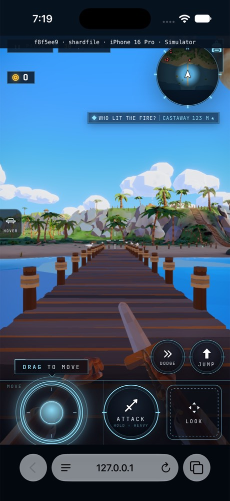

# O6 acceptance after ordinary native recheck

Exact served build: `f8f5ee9a9dd3dd49020c18b6c3bb7715eaa629aa`.

Ordinary native SHARD SELECT: 9.9 s wall / 9.933 s stage sum,
250 ms maximum detail gap, 0.011% actual-wire byte error.
The real service worker controls the measured entry; no GL instrumentation is installed.
The targeted receipt repeats only the earlier failed native path.

CPU-4x iPhone 16 Pro Chromium grid remains 20.7 s, with 536 ms detail gap.
The coordinator explicitly accepts 20.7 s as meeting the approximate 20 s O6 target
once this ordinary native check is green. The other five valid entries, all three
real road returns and the one green source batch remain in ../diagnostic-f8f5ee9/.
This is a combined same-build verdict with a targeted native repeat, not a new full matrix.

The original 1,943 ms native post-chain pause stays in that diagnostic receipt.
The later instrumented non-reproduction and this ordinary pass do not explain
or claim to fix that pause. No rendering change is claimed for O6 acceptance.
O5 shader/node-build optimization remains separate.

The measured wildshard-loading device (9FAD) was not erased; the primed marker
belongs to the separate frame-floor device (AC96). No reset-device warm claim.

The labelled portrait was visually reviewed: the normal dock first frame,
world, weapon and touch controls are present.

