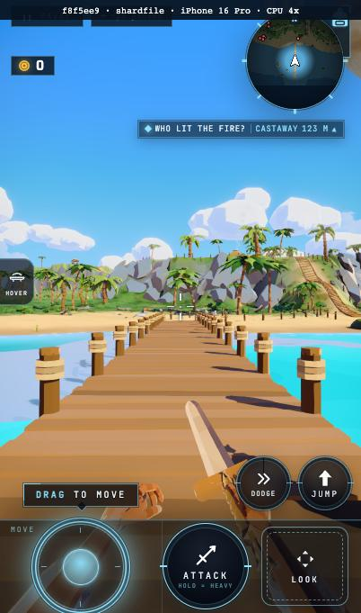
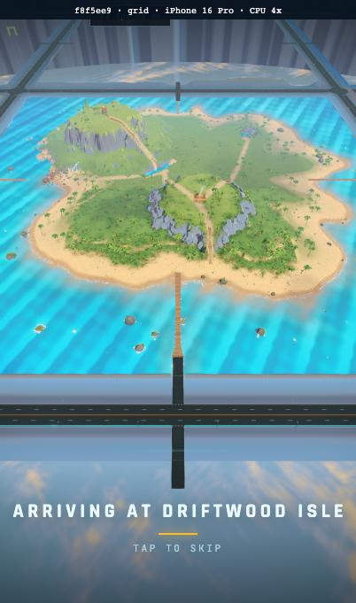
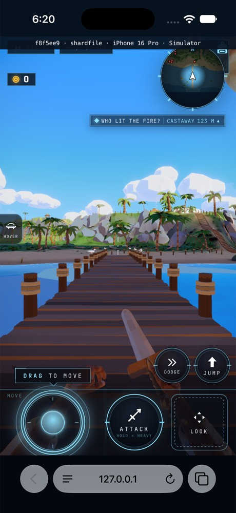
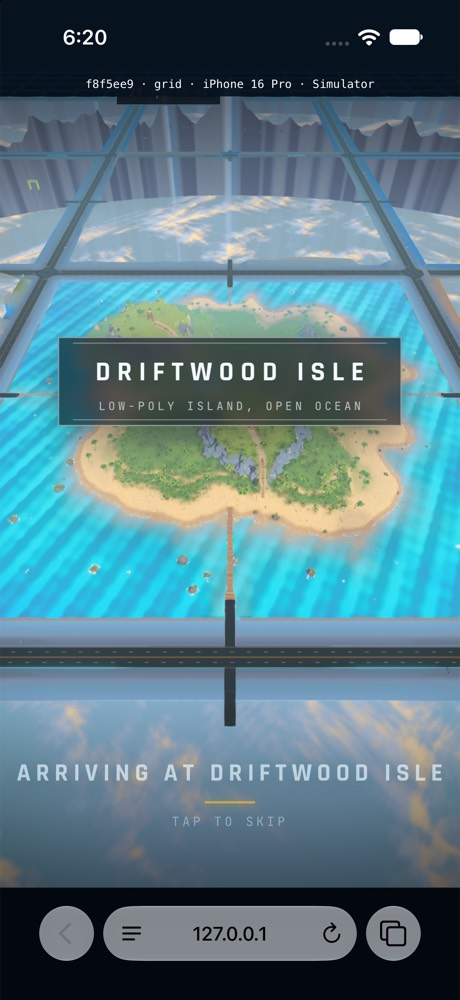

# Road allocation diagnostic: native cadence still open

Exact served SHA: `f8f5ee9a9dd3dd49020c18b6c3bb7715eaa629aa`.

The one exact-SHA Driftwood source batch passes in 147.2 seconds and covers
both road allocation cuts;
its owner verdict and log digest are retained in source-batch.json.

Accuracy/crossing failures: 1. CPU-4x cold-grid target met: false.

| Surface | Path | Wall / stage seconds | Wire / displayed MB | Detail gap ms | Node builds / CPU ms |
|---|---|---|---|---|---|
| phone | shardfile | 22.8 / 22.884 | 137.918 / 137.910 | 347.2 | 67 / 6171.2 |
| phone | grid | 20.7 / 20.755 | 135.809 / 135.801 | 536.0 | 74 / 2724.6 |
| simulator | shardfile | 23 / 22.994 | 140.853 / 140.870 | 1943.0 | 67 / 3177.0 |
| simulator | grid | 8.8 / 8.829 | 143.170 / 141.446 | 282.0 | 74 / 908.0 |
| desktop | shardfile | 7.6 / 7.729 | 144.376 / 144.374 | 593.7 | unavailable |
| desktop | grid | 9.2 / 9.238 | 145.178 / 145.181 | 214.2 | unavailable |

All entries are cold paths. This matrix does not repeat the accepted
Safari warm proof or conceal the retained Chromium warm eviction residual.
Wire totals include observed response bodies and actual response headers.
Phone Chromium is muted iPhone 16 Pro / CPU 4x; native Safari uses the
portrait phone Simulator through sim-lane. Desktop grid asserts enabled AO.
Native timing starts after the successful frame-floor priming marker.
The reset/primed device is frame-floor-iphone-17-pro (AC96); this capture
uses wildshard-loading (9FAD), which was not erased. No reset-device warm
cache claim is made. Actual note and device names are retained together.
Grid entries use the actual 5 x 5 and normal controls for real road returns.
No pose, layout, readiness, parser or cap bypass is used.

Node-build diagnostics are read after the recorded first frame. They do not
extend the stage, byte or update-cadence measurement window. Their existing
bounded material/object log is retained without changing production work.

Cold phone grid: 20.7 s; the approximate 20 s target remains open.
These sequential shared-machine measurements are not an isolated A/B.

- Detailed update gap exceeds 1 s

The original failed native SHARD SELECT receipt remains the gate result:
1,943 ms at post-chain Pass 5, with 119 programs before and after. No shader
cause is established. The later controlled GL diagnostic is separate: it
passes cadence at 333 ms, has a 136 ms first-frame stage, zero first-frame
links or parallel-link polls, and no first-frame GL call over 9 ms. Its
observed post programs match the warm draws. This non-reproduction does not
repair or erase the original failure. A separate ordinary affected-native
capture follows the worker-control precondition fix `a003d8e8f4`.

The first GL diagnostic was uncontrolled by the worker and is excluded from
acceptance. Its overly broad draw recorder also filled the bounded trace;
the controlled diagnostic records screen triangles and has zero drops.

Four labelled portrait frames were visually reviewed. The native SHARD
SELECT picture proves a frame was reached, not that its cadence passed.

