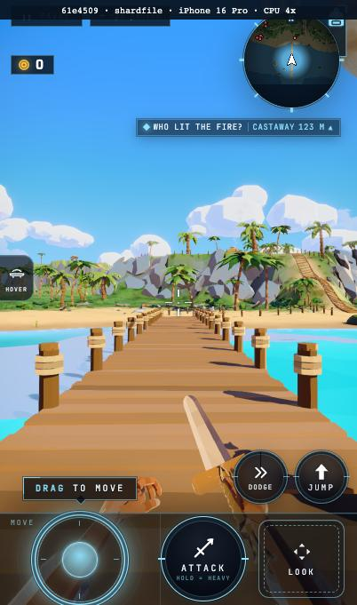
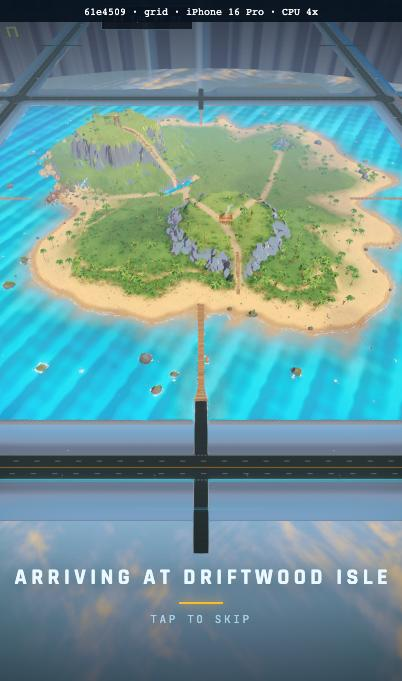
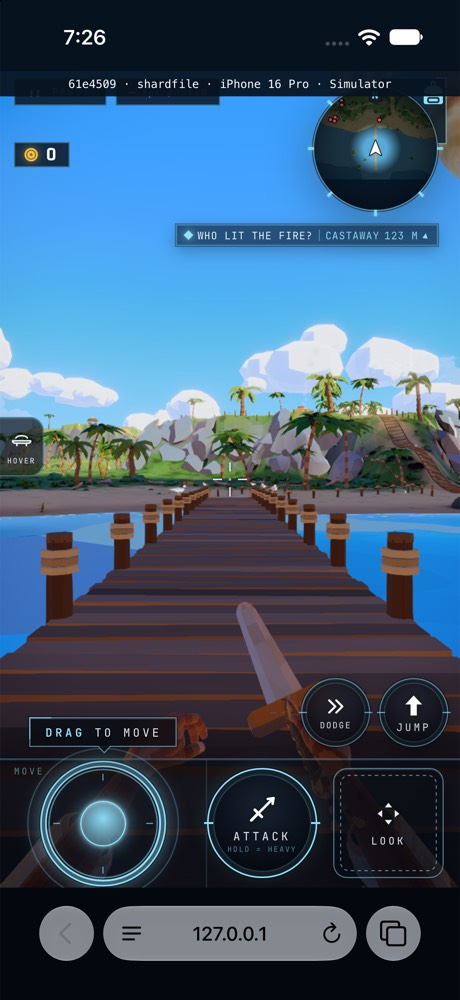
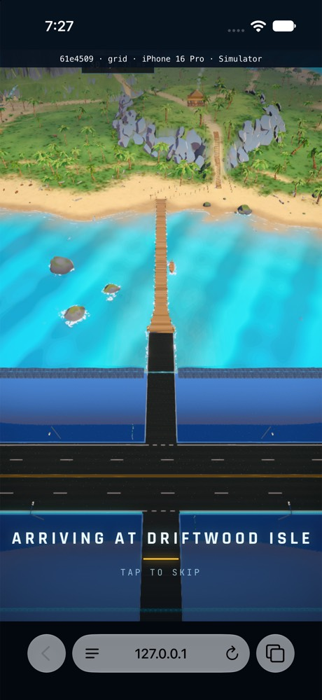

# O5 scoped node traversal: served entry measurements

Exact served SHA: `61e45099ae3afba4bd35261ebb0a9be92bc36128`.

The one exact-SHA Driftwood/Nine/Pine source batch passes in 180.6 seconds.
It includes types, strict lint, related tests and all three real first frames;
its owner verdict and log digest are retained in source-batch.json.

Accuracy/crossing failures: 0. CPU-4x cold-grid wall time: 20.4 s.

| Surface | Path | Wall / stage seconds | Wire / displayed MB | Detail gap ms | Node builds / CPU ms |
|---|---|---|---|---|---|
| phone | shardfile | 19.5 / 19.531 | 137.918 / 137.910 | 365.9 | 67 / 5481.2 |
| phone | grid | 20.4 / 20.429 | 135.810 / 135.802 | 545.6 | 74 / 2725.3 |
| simulator | shardfile | 12.1 / 12.094 | 140.370 / 140.386 | 432.0 | 67 / 2994.0 |
| simulator | grid | 14.7 / 14.733 | 138.270 / 138.287 | 372.0 | 74 / 1145.0 |
| desktop | shardfile | 7.4 / 7.418 | 145.272 / 145.273 | 133.3 | unavailable |
| desktop | grid | 10.5 / 10.523 | 146.081 / 146.096 | 174.1 | unavailable |

All entries are cold paths. This matrix does not repeat the accepted
Safari warm proof or conceal the retained Chromium warm eviction residual.
Wire totals include observed response bodies and actual response headers.
Phone Chromium is muted iPhone 16 Pro / CPU 4x; native Safari uses the
portrait phone Simulator through sim-lane. Desktop grid asserts enabled AO.
Native timing starts after the successful frame-floor priming marker.
The reset/primed device is frame-floor-iphone-17-pro (AC96); this capture
uses wildshard-loading (9FAD), which was not erased. No reset-device warm
cache claim is made. Actual note and device names are retained together.
Grid entries use the actual 5 x 5 and normal controls for real road returns.
No pose, layout, readiness, parser or cap bypass is used.

Node-build diagnostics are read after the recorded first frame. They do not
extend the stage, byte or update-cadence measurement window. Their existing
bounded material/object log is retained without changing production work.

Cold phone grid: 20.4 s. The prior O6 threshold was approximate:
the coordinator accepts the 20.7 s f8 result after its ordinary native repeat.
This new node-build candidate retains its own measured time and accuracy verdict.
These sequential shared-machine measurements are not an isolated A/B.

The source-mapped node CPU comparison is retained in ../shader-profile-61e4509/.
Counts and material/object multisets match (67 SHARD SELECT, 74 grid).
Logged SHARD SELECT node build CPU is 6171.2 -> 5481.2 ms; grid is
2724.6 -> 2725.3 ms. Grid build CPU is effectively unchanged. The measured
whole entry improves to 19.5 / 20.4 s; the shared-machine comparison does
not isolate this cut from other committed changes or timing variation.

The four labelled portrait frames below were visually reviewed: normal
dock and grid arrival first frames are present with their existing UI.

