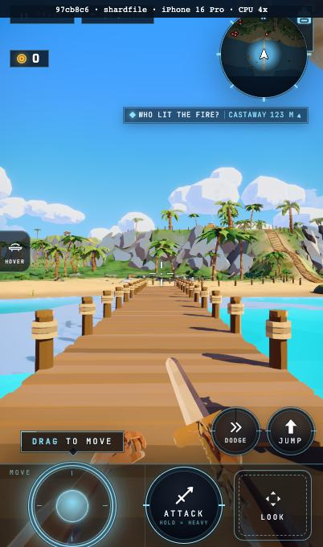
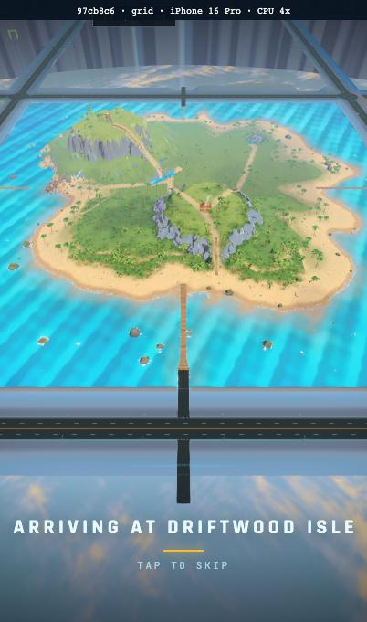
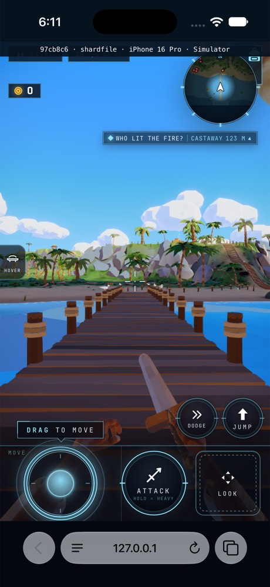
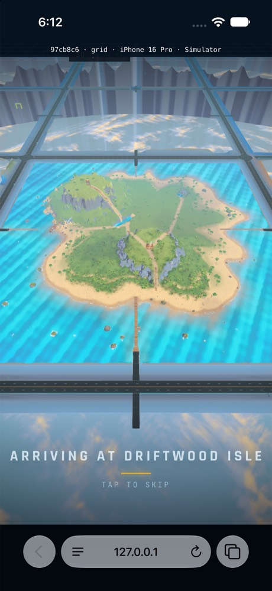

# Cold-entry shader and payload measurements

Exact served SHA: `97cb8c6723b5b6ebcc7b7b58115a2638bf177be9`.

The shared Nine/Pine/Driftwood source batch passed in 432.4 seconds;
its owner verdict and log digest are retained in source-batch.json.

Accuracy/crossing failures: 0. CPU-4x cold-grid target met: false.

| Surface | Path | Wall / stage seconds | Wire / displayed MB | Detail gap ms | Node builds / CPU ms |
|---|---|---|---|---|---|
| phone | shardfile | 22.3 / 22.371 | 141.725 / 141.698 | 395.5 | 75 / 7254.2 |
| phone | grid | 23.6 / 23.576 | 137.098 / 137.093 | 464.9 | 82 / 4060.8 |
| simulator | shardfile | 10.9 / 10.944 | 140.370 / 140.386 | 214.0 | 75 / 2796.0 |
| simulator | grid | 14.9 / 14.902 | 146.418 / 142.845 | 396.0 | 82 / 1441.0 |
| desktop | shardfile | 8.8 / 8.911 | 144.852 / 144.712 | 173.5 | unavailable |
| desktop | grid | 10.3 / 10.358 | 143.826 / 143.789 | 218.1 | unavailable |

All entries are cold paths. This matrix does not repeat the accepted
Safari warm proof or conceal the retained Chromium warm eviction residual.
Wire totals include observed response bodies and actual response headers.
Phone Chromium is muted iPhone 16 Pro / CPU 4x; native Safari uses the
portrait phone Simulator through sim-lane. Desktop grid asserts enabled AO.
Native timing starts after the successful frame-floor priming marker.
The reset/primed device is frame-floor-iphone-17-pro (AC96); this capture
uses wildshard-loading (9FAD), which was not erased. No reset-device warm
cache claim is made. Actual note and device names are retained together.
Grid entries use the actual 5 x 5 and normal controls for real road returns.
No pose, layout, readiness, parser or cap bypass is used.

Node-build diagnostics are read after the recorded first frame. They do not
extend the stage, byte or update-cadence measurement window. Their existing
bounded material/object log is retained without changing production work.

Cold phone grid: 23.6 s; the approximate 20 s target remains open.
These sequential shared-machine measurements are not an isolated A/B.

Four labelled portrait first frames were visually reviewed: phone SHARD
SELECT/grid and native SHARD SELECT/grid. They preserve the same dock and
arrival views; the native captures include the ordinary Safari chrome.

