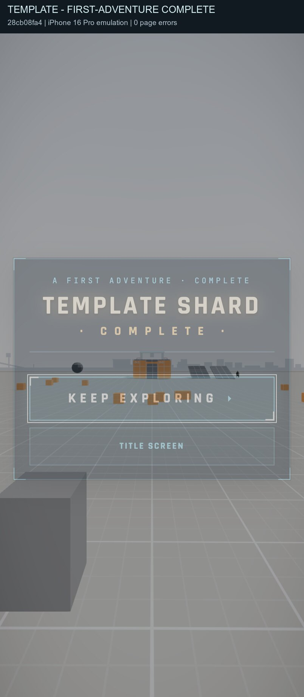

# Declared completion cards

The existing ShardComplete renderer now consumes admitted `ui/completion`
rows through the shared completion installer. Driftwood deletes its private
Complete controller and projection. Template is the second shard user, with
a minimal card after its existing first-adventure quest and no runtime module.

Matched source ruler, all ten byte-validated products, parent `9e83e28d0`
and candidate `28cb08fa4`: **net −229 shard lines** (DW −229; Pine and
Template unchanged). DW C5: **1,199 → 983**; Pine C5 remains **1,806**.
Platform source grows 122 code lines; the existing renderer becomes shared.

Thirty related checks pass, including the 17 headless cases, Pine product
and hands fixtures, Template, reward handoff, safe polling, persisted seen
flags, ordered finds/stats and the live zipline placement anchor. Root and
composite layer types and typed lint pass. The shipped Driftwood card copy
retains its frozen hash and its renderer is unchanged.

Built phone capture: iPhone 16 Pro portrait emulation, muted, candidate
`28cb08fa4`. The fixture marks the existing hut/blob quest inputs through
the actual simulation flag owner; the existing quest raises its completion
flag and the admitted polling policy opens the card. Zero page errors.
Keep exploring closes it and releases player carry; the seen flag persists.

The initial Driftwood boot encountered the pre-existing native wood-sword
profile refusal in level.kit, before completion installs. This is routed to
the C9 owner; no completion boot or visual parity claim is made from that
failed page.
