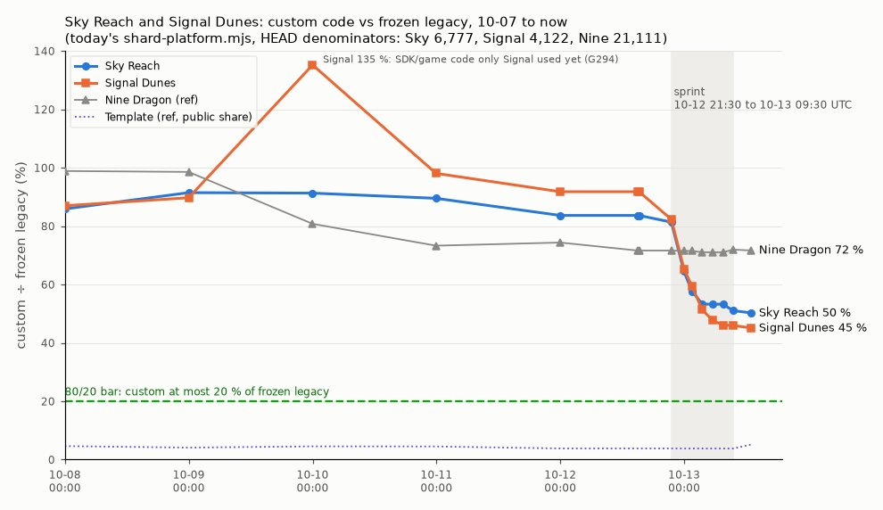

# Sky Reach and Signal Dunes: shardfile vs custom, 10-07 to 10-13

Jake asked: for the last five days, day by day, how much of Sky Reach and Signal Dunes was shardfile and how much
custom, and how is it trending?

**Short answer:** for four days both shards sat at 80–92 % custom, a lot of churn with little reduction. Then the
sprint (10-12 21:30 → 10-13 09:30 UTC) took **Sky from 81 % to 51 %** and **Signal from 82 % to 46 %** of their frozen
legacy size. Now Sky is at **50.3 % (PORT ≈ 70 %)** and Signal at **45.1 % (PORT ≈ 75 %)**. Both are still 25–30
points above the 20 % bar. The curve has been nearly flat since about 05:30 UTC.

## Method: one ruler

- **Ruler.** HEAD's `scripts/shard-platform.mjs` (`351e3f8bc`, unchanged at `0bc6fcb9e`). Its `shardLines(root)` ran
  against a `git archive` of each sampled commit (`src scripts lint`). The script and its helpers were imported from
  a HEAD export linked with `scripts/link-node-modules.mjs`.
  - Custom = authored runtime TS + raw GLSL outside runtime TS (G306) + SDK / game / engine code that only that
    shard reaches (G294, per export).
  - "SDK-driven / public" is the script's `publicLines`.
- **Denominator fixed at HEAD's frozen legacy:** Sky 6,777, Signal 4,122, Nine 21,111.
  - The `-legacy/` folders only exist from SF73 (10-09).
  - The frozen count also moves when a legacy file becomes a declared generator output, because declared outputs
    are excluded on both sides. Sky's was 9,679 until the bake-offline commits around 10-12 23:00 UTC (`fc7c93db5`,
    `fd523da91`, `f36d2a239 fix(metric): count authored baked modules`). The same exclusion is why Sky's public
    lines fall from 5,936 to 2,943 in the same window.
  - The "as measured then" column gives the ratio against the denominator that tree had.
- **One relaxation.** HEAD's `discoverGeneration` refuses some older `generation-jobs.json` rows (`Recorded-input
  comparison is not registered: pine-king-collision`) from 10-10 to 10-13 03:30. Those trees were measured with
  `validateProducer` and that check skipped, in a scratch copy only. The set of declared outputs is read unchanged.
- **Samples.** The last first-parent `main` commit before each UTC time: 23:59 daily, plus the sprint points.
- **PORT (G390)** = 80 × clamp((100 − custom %) ÷ 80) + world (20 yes / 10 partial / 0 no).
  - Products (`public/shardfiles`) are build outputs that aren't committed, and old trees can't build them without
    `pnpm gen`, so **world is inferred from git**.
  - Signal has had terrain tiles since `7ce6398f2` (10-08 23:59:36 UTC).
  - Sky has had props tiles since `fd1b0a9a4 feat(sky): draw static islands from props tiles` (10-13 05:47).
  - Private binaries reach 0 at `c9f6e59be feat(navigation): adopt Signal and Sky rows` (10-13 04:44): the
    remaining `navmesh.bin` becomes an admitted alias. Before that commit the count is the raw tree count
    (`navmesh.bin`, `physics.baked.json`, Signal's `terrain.bin`).
  - The current values match STATE's 12:30Z headline (Signal 76, Sky 70).

### Sky Reach (`far-reach`), frozen legacy 6,777 lines

| UTC sample | commit | custom lines (shard TS + sole platform + extra GLSL) | SDK-driven / public lines | custom ÷ legacy | as measured then | world (tiles · private bins) | PORT (G390) |
|---|---|---|---|---|---|---|---|
| 2026-10-07 23:59 | `b96229a4c` | 5,819 (5,622 + 197 + 0) | 2,955 | **85.9 %** | 60.1 % (÷ 9,679) | no (no tiles, 1 bin) | 14 % |
| 2026-10-08 23:59 | `e10c77df9` | 6,198 (5,905 + 293 + 0) | 2,959 | **91.5 %** | 64.0 % (÷ 9,679) | no (no tiles, 1 bin) | 9 % |
| 2026-10-09 23:59 | `b4f73dea7` | 6,187 (5,630 + 555 + 2) | 4,244 | **91.3 %** | 63.9 % (÷ 9,679) | no (no tiles, 2 bins) | 9 % |
| 2026-10-10 23:59 | `40362736e` | 6,066 (5,477 + 589 + 0) | 5,380 | **89.5 %** | 62.7 % (÷ 9,679) | no (no tiles, 2 bins) | 10 % |
| 2026-10-11 23:59 | `c5a704e60` | 5,669 (5,369 + 300 + 0) | 5,936 | **83.7 %** | 58.6 % (÷ 9,679) | no (no tiles, 2 bins) | 16 % |
| 2026-10-12 18:00 | `03484c121` | 5,669 (5,369 + 300 + 0) | 5,936 | **83.7 %** | 58.6 % (÷ 9,679) | no (no tiles, 2 bins) | 16 % |
| 2026-10-12 21:30 | `85711a7c0` | 5,513 (4,774 + 300 + 439) | 5,936 | **81.3 %** | 57.0 % (÷ 9,679) | no (no tiles, 2 bins) | 19 % |
| 2026-10-12 23:59 | `b60dde094` | 4,368 (3,417 + 330 + 621) | 2,943 | **64.5 %** | 64.5 % (÷ 6,777) | no (no tiles, 2 bins) | 36 % |
| 2026-10-13 01:30 | `97b49415d` | 3,911 (2,965 + 325 + 621) | 3,171 | **57.7 %** | 57.7 % | no (no tiles, 2 bins) | 42 % |
| 2026-10-13 03:30 | `6018bba46` | 3,611 (2,655 + 342 + 614) | 3,149 | **53.3 %** | 53.3 % | no (no tiles, 2 bins) | 47 % |
| 2026-10-13 05:30 | `29303b889` | 3,608 (2,652 + 342 + 614) | 3,195 | **53.2 %** | 53.2 % | partial (no tiles, 0 bins) | 57 % |
| 2026-10-13 07:30 | `862ec4999` | 3,608 (2,658 + 336 + 614) | 3,185 | **53.2 %** | 53.2 % | yes (tiles, 0 bins) | 67 % |
| 2026-10-13 09:30 | `074909c6e` | 3,458 (2,547 + 297 + 614) | 3,329 | **51.0 %** | 51.0 % | yes (tiles, 0 bins) | 69 % |
| now (10-13 12:52) | `0bc6fcb9e` | 3,407 (2,547 + 246 + 614) | 3,329 | **50.3 %** | 50.3 % | yes (tiles, 0 bins) | 70 % |

### Signal Dunes (`sunscar-dunes`), frozen legacy 4,122 lines

| UTC sample | commit | custom lines (shard TS + sole platform + extra GLSL) | SDK-driven / public lines | custom ÷ legacy | world (tiles · private bins) | PORT (G390) |
|---|---|---|---|---|---|---|
| 2026-10-07 23:59 | `b96229a4c` | 3,585 (3,535 + 50 + 0) | 44 | **87.0 %** | no (no tiles, 2 bins) | 13 % |
| 2026-10-08 23:59 | `e10c77df9` | 3,698 (3,602 + 96 + 0) | 40 | **89.7 %** | no (no tiles, 2 bins) | 10 % |
| 2026-10-09 23:59 | `b4f73dea7` | 5,573 (2,514 + 3,059 + 0) | 1,066 | **135.2 %** | partial (tiles, 3 bins) | 10 % |
| 2026-10-10 23:59 | `40362736e` | 4,042 (2,330 + 1,712 + 0) | 1,223 | **98.1 %** | partial (tiles, 3 bins) | 12 % |
| 2026-10-11 23:59 | `c5a704e60` | 3,783 (3,238 + 545 + 0) | 1,565 | **91.8 %** | partial (tiles, 3 bins) | 18 % |
| 2026-10-12 18:00 | `03484c121` | 3,783 (3,238 + 545 + 0) | 1,565 | **91.8 %** | partial (tiles, 3 bins) | 18 % |
| 2026-10-12 21:30 | `85711a7c0` | 3,393 (2,864 + 529 + 0) | 1,794 | **82.3 %** | partial (tiles, 3 bins) | 28 % |
| 2026-10-12 23:59 | `b60dde094` | 2,693 (2,439 + 248 + 6) | 1,932 | **65.3 %** | partial (tiles, 3 bins) | 45 % |
| 2026-10-13 01:30 | `97b49415d` | 2,449 (2,199 + 244 + 6) | 1,954 | **59.4 %** | partial (tiles, 3 bins) | 51 % |
| 2026-10-13 03:30 | `6018bba46` | 2,116 (1,963 + 147 + 6) | 2,007 | **51.3 %** | partial (tiles, 3 bins) | 59 % |
| 2026-10-13 05:30 | `29303b889` | 1,966 (1,813 + 147 + 6) | 2,082 | **47.7 %** | yes (tiles, 0 bins) | 72 % |
| 2026-10-13 07:30 | `862ec4999` | 1,900 (1,772 + 122 + 6) | 2,077 | **46.1 %** | yes (tiles, 0 bins) | 74 % |
| 2026-10-13 09:30 | `074909c6e` | 1,894 (1,772 + 116 + 6) | 2,077 | **45.9 %** | yes (tiles, 0 bins) | 74 % |
| now (10-13 12:52) | `0bc6fcb9e` | 1,860 (1,741 + 113 + 6) | 2,185 | **45.1 %** | yes (tiles, 0 bins) | 75 % |

Signal's frozen denominator has stayed at 4,122 since SF73, so its "as measured then" equals the fixed column.

**Signal's 135 % on 10-09 is a ruler effect, not a regression.** SF73 and the first M3 moves put SDK bake / project
modules and game systems into the platform: `sdk/bake/world.ts`, `sdk/bake/authoredWorld.ts`, `sdk/project.ts`,
`game/systems/looks/fireFx.ts`, the lash item and others. On that day only Signal reached them, so G294 charged
all 3,059 of those lines to Signal. The number fell as each module gained a second user or became rows.

### Reference lines

| UTC sample | Nine Dragon custom ÷ 21,111 | Template custom share (no legacy; PORT 100 %) |
|---|---|---|
| 2026-10-07 23:59 | 20,872 = 98.9 % | 4.6 % |
| 2026-10-08 23:59 | 20,805 = 98.6 % | 4.1 % |
| 2026-10-09 23:59 | 17,052 = 80.8 % | 4.5 % |
| 2026-10-10 23:59 | 15,471 = 73.3 % | 4.5 % |
| 2026-10-11 23:59 | 15,698 = 74.4 % | 3.8 % |
| 2026-10-12 21:30 | 15,119 = 71.6 % | 3.8 % |
| 2026-10-13 03:30 | 14,995 = 71.0 % | 3.8 % |
| now (10-13 12:52) | 15,127 = 71.7 % | 5.1 % |

Nine's sprint was elsewhere: it is flat at about 71 % and now PORTs ≈ 48 % on its world points (STATE: 49).

## The biggest moves

1. **Sprint, first 2.5 h (10-12 21:30 → 23:59 UTC).**
   - Sky went from 81.3 % to 64.5 % (−1,145 lines; its runtime TS fell from 4,774 to 3,417).
   - Signal went from 82.3 % to 65.3 % (−700).
   - Shared hosts: `02e371386 refactor(signal): creature rigs on shared loader`, `14a757da1 refactor(game): shared
     creature-body loader`, `61c0fe31b refactor(sky): Roc brain as the diver's raptor`, `7fd5bd161 refactor(npc): one
     shared pivot NPC host`.
   - Offline bakes: `2ca5393c1`, `1fe1fe6fb`, `fc7c93db5` (Sky's windmill, firs, sward atlas and islet rig).
   - Removed fallbacks: `af27e4a36 refactor(signal): drop dome and flame fallbacks`.
2. **Sprint, 23:59 → 03:30 UTC.**
   - Sky went from 64.5 % to 53.3 % (−757) and Signal from 65.3 % to 51.3 % (−577).
   - Commits: `d5267c284 refactor(sky): bake the fan hand, drop stand-ins`, `dc986514b feat(look): host Sky's look
     on a painted data look`, `0e00aa4e7 refactor(combat): run lash and fan on move rows`, `d9112c821 refactor(signal):
     sand dusk as look.curves rows`, `56af303ec refactor(format): shared map palette rows`.
3. **Signal, 10-09 → 10-10.**
   - 135 % to 98 % (−1,531). Most of it is G294 attribution falling from 3,059 to 1,712.
   - `7f2a1aa4a` (SF27: quest graph, quest-giver, Matriarch presentation and headless host as rows) removed 434 lines.
   - `462896b66`, `95ef7a0a3` and `bdc2503f6` moved the baked ground, the Matriarch brain and the dusk look to SDK
     rows.

**Trend.** Since 05:30 UTC the custom curve is nearly flat (Sky −201, Signal −106 lines). The PORT gains since then
are world points (tiles and 0 private binaries), not less code. To reach the 20 % bar, Sky needs ≤ 1,355 custom
lines (−2,052 from now) and Signal ≤ 824 (−1,036).
