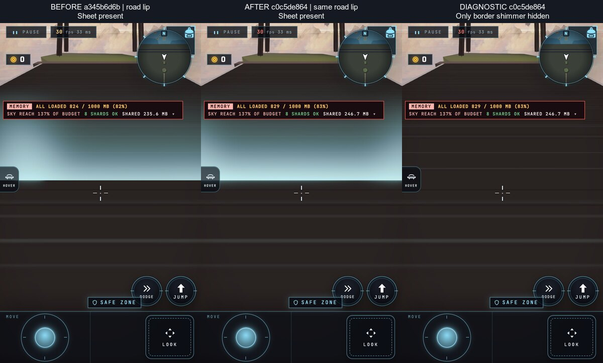

# F4 attribution: the road's border shimmer predates W1

The cyan-white band is present on **both** `a345b6d6b` and `c0c5de864`
when the traveller stops at the same Sky road lip. There is no first-bad
commit in that reported range. The original QA pair does not establish a
regression at a matched position.

The third panel is a diagnostic, not a proposed appearance: only
`grid-border-shimmer-line` was hidden for that capture, then restored.
Hiding `grid-soft-wall`, `grid-seam-curtain`, `far.sky-dressing`, or
`road-sky` separately leaves the band. Hiding the border shimmer removes
it on both builds. The band therefore belongs to the shared grid border
effect, not the new cloud-sea, updraft, or islet draws.

## Reproduction

Each revision was built by `scripts/serve-build.sh --rev`, then visited in
a fresh muted iPhone 16 Pro portrait Chromium context, phone tier, DPR 2,
Developer on, with the same pinned random stream. Only one owned preview
was retained at a time; browsers ran through `scripts/browser-lane.sh`.

The traveller entered the grid from the title. The existing floor-route
staging and held-input movement drove north from the neutral-road
midpoint `(0, -277.5)` toward `(0, -303.5)`. For this visual probe only,
the driver stopped on reaching its waypoint tolerance rather than waiting
for a completed geometric shard crossing. It does not claim floor,
crossing, or timing qualification. No game scheduler was replaced.

| Revision | Feet at stop (world x, y, z), metres | Result |
| --- | --- | --- |
| `a345b6d6b` | `(0.00309, 0.02010, -302.10135)` | Band visible; no page errors |
| `c0c5de864` | `(0.00215, 0.02000, -302.10140)` | Band visible; no page errors |

Both had Sky admitted and gameplay-ready, no pending resident or crossing
issues, and remained visibly in SAFE ZONE. Captures followed 30 seconds
of settling, with yaw `0`, forward pitch `-0.08`, and downward pitch
`-0.6`. The board uses the downward views. A separate capture about six
metres farther inside Sky showed no band, demonstrating why the stop
position matters.

`src/game/grid/borderShimmer.ts` and its installation in
`src/game/grid/session.ts` are unchanged across the two revisions. The
effect is a cyan additive vertical ribbon at the shard boundary, from
0.25 metres below the declared ground to 1.25 metres above it. Looking
down from just outside that ribbon makes it cover a broad screen band.

No rendering source, material, policy, threshold, or baseline was changed.
The first historical appearance of the border effect was not bisected;
only the reported W1 regression range was investigated. Any visual
redesign of this existing border remains a separate look decision.
